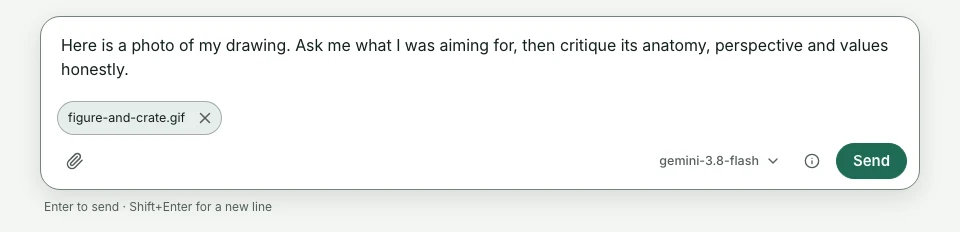
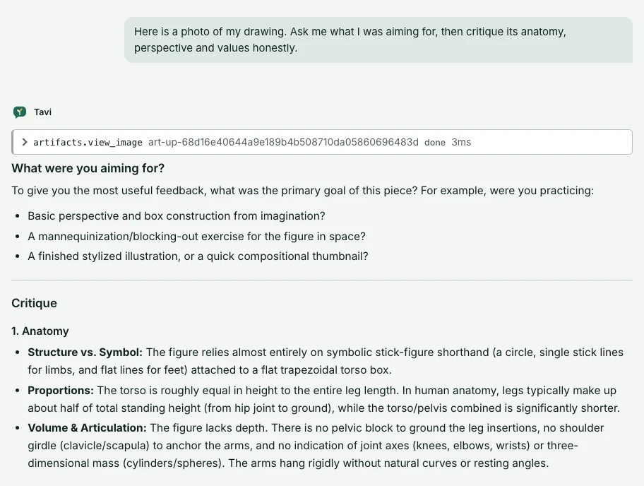
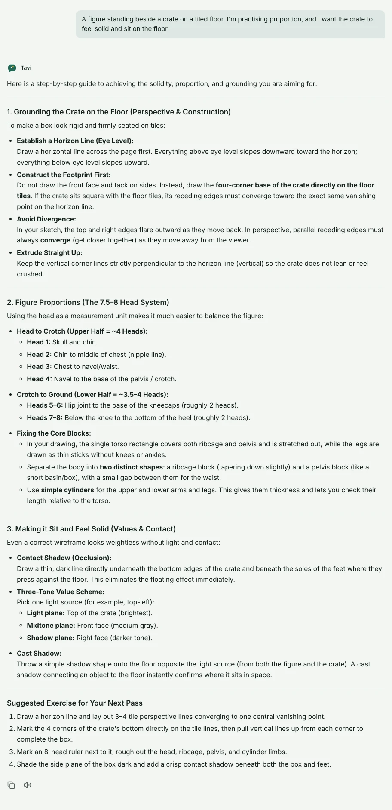

# Get an honest critique of a drawing

Send Tavi a picture of a drawing. It asks what you were going for, then gives you specific notes on anatomy, perspective and values, the way a teacher would.

> **Uses:** Images
> **Asks first:** Nothing — it only reads and suggests
> **Runs:** When you ask
> **Idea card:** "Critique my drawing" (`learning.sketch-critique`)
> **Before you start:** a model that reads images connected ([Ask about a photo](../../photos-and-video/ask-about-a-photo.md)) · the canvas open ([Open the web canvas and walk through Welcome](../../get-started/web-canvas-tour.md)) · a picture of your drawing, saved as a GIF

## 1. Ask for it

Take a picture of the drawing in even light, straight on. The canvas takes a picture as a GIF, so save it as one first ([Send a file or image with your message](../../chat/attach-files-to-chat.md)). Choose **New chat** above the chats to open a chat of its own. Choose the paperclip, pick the picture, and send the prompt: `Here is a photo of my drawing. Ask me what I was aiming for, then critique its anatomy, perspective and values honestly.` Once Tavi knows this is something you do, **Ideas** may offer it as a card in its own words; **Try it** there starts the same chat.

## 2. Say what you were aiming for

Tavi opens the picture with `artifacts.view_image`, named on the line above its answer, and asks what you were going for. It may not wait for your reply: here it goes straight on to a first critique of the anatomy, perspective and values. Answer its question all the same, in a sentence or two, such as `A figure standing beside a crate on a tiled floor. I'm practising proportion, and I want the crate to feel solid and sit on the floor.`

## 3. Read the critique

The next answer goes back over the drawing against what you said you wanted, with what to change for each aim.

<!-- cover -->

Tavi goes by one picture: a low-resolution or badly lit one hides your lines and your darks, and it can't see how the drawing was made. These are one reader's notes, so keep what helps. A teacher who watches you draw will catch things it can't.

## Variations

- `Be gentle: this is my third week of drawing.`
- `Give me one exercise for the biggest problem you found.`

## Related

- [Ask about a photo](../../photos-and-video/ask-about-a-photo.md)
- [Send a file or image with your message](../../chat/attach-files-to-chat.md)
- [Have Tavi tutor you, one question at a time](../learning/tutor.md)
