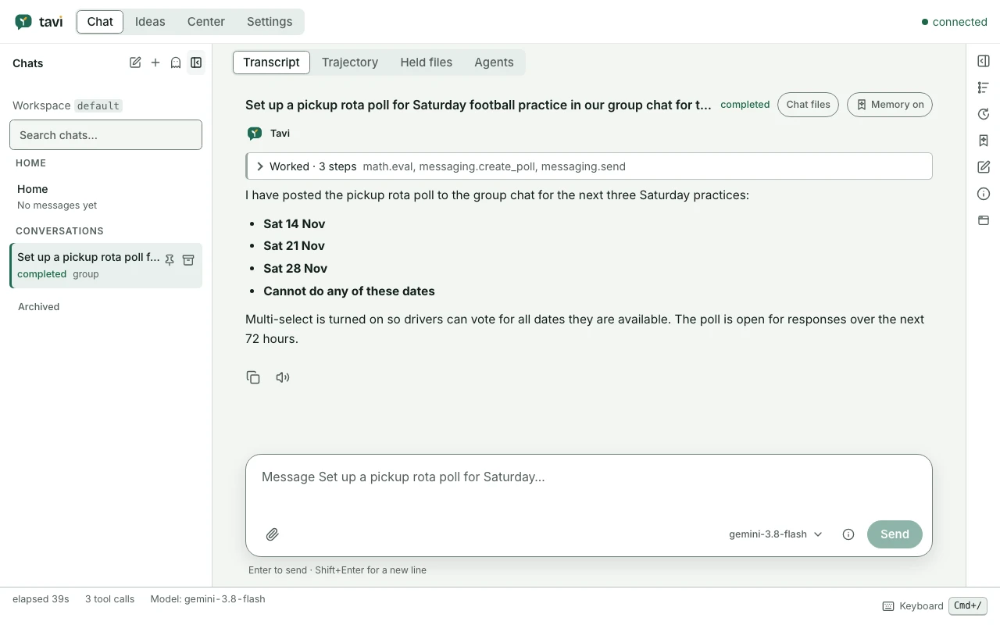
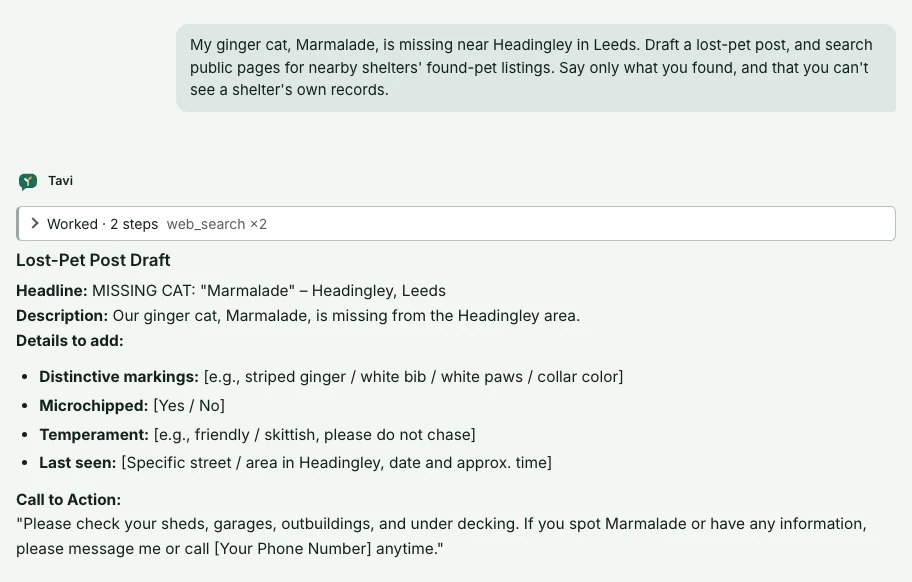
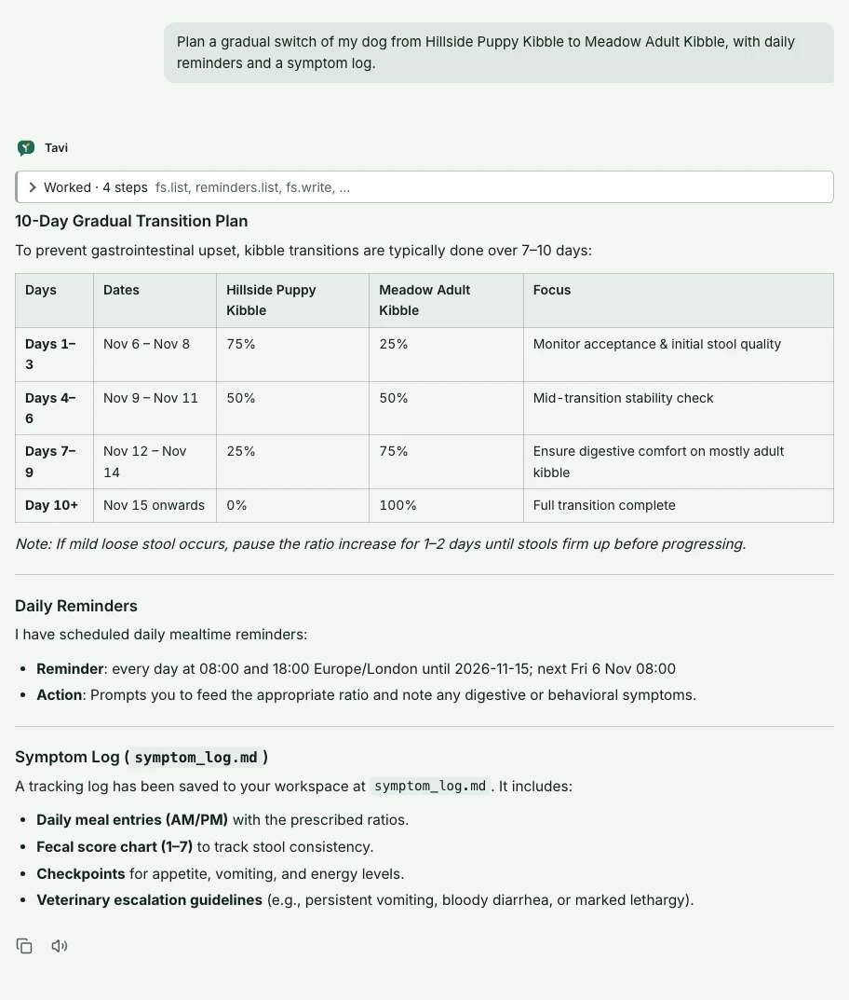
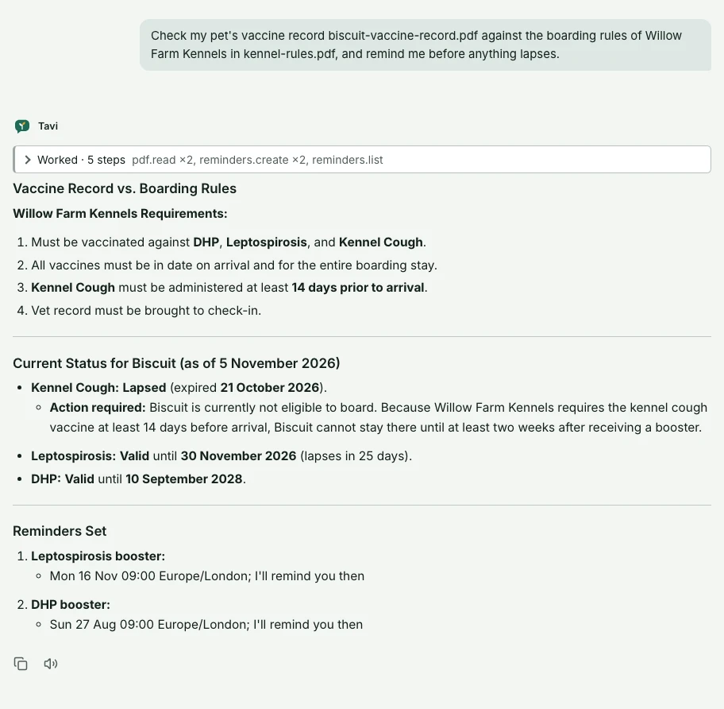
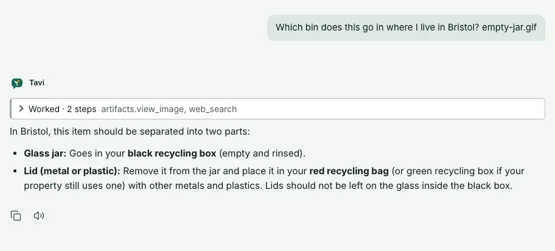
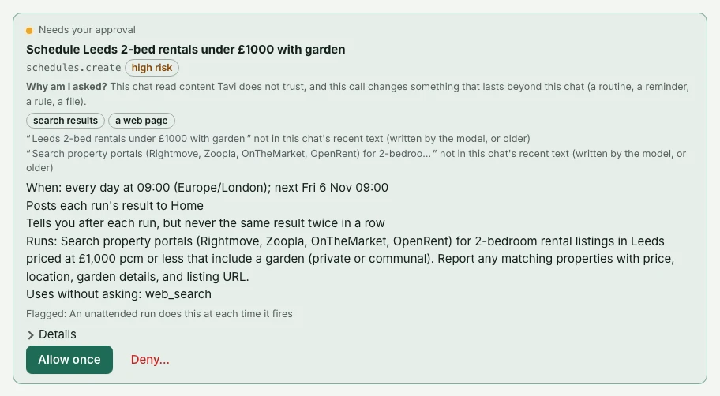
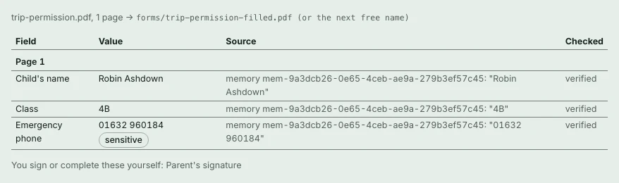

<!-- Generated by scripts/docs/guide-indexes.mjs from the guides: edit the guides, not this file. -->

# Home, family and pets

Rentals, energy, forms, carpools and pets.

| | Guide |
| :--- | :--- |
|  | [Organise a carpool with a poll in your group chat](carpool.md) In your parents' Discord room, ask Tavi for a pickup rota: it drafts a poll for who drives when, asks you before posting it, and reads the votes back when you ask. |
|  | [Search for a lost pet](lost-pet.md) Tell Tavi who's missing and where. |
|  | [Switch your pet to a new food, step by step](pet-diet.md) Tavi plans a gradual changeover day by day, reminds you of each step, and keeps a log of any symptoms. |
|  | [Check your pet's vaccines before boarding](pet-vaccines.md) Give Tavi your vet's record and the kennel's rules. |
|  | [Find out which bin something goes in](recycling.md) Show Tavi an item and say where you live. |
|  | [Watch rental listings](rental-watch.md) Tell Tavi the area, your budget and what you can't do without. |
|  | [Fill in a school form](school-forms.md) Give Tavi a school's fillable PDF. |

[All everyday recipes](../README.md)
