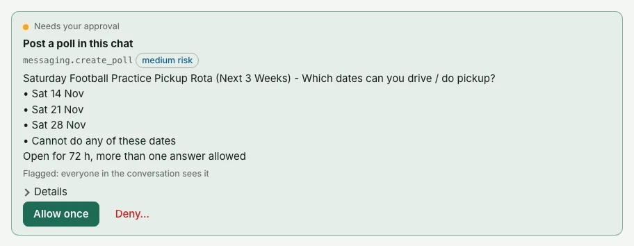
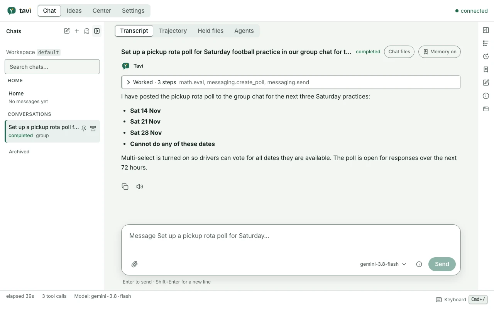

# Organise a carpool with a poll in your group chat

In your parents' Discord room, ask Tavi for a pickup rota: it drafts a poll for who drives when, asks you before posting it, and reads the votes back when you ask.

> **Uses:** Messaging
> **Asks first:** Messaging
> **Runs:** When you ask
> **Idea card:** "Organise a carpool" (`people.carpool`)
> **Before you start:** a model connected ([Connect your first model](../../get-started/first-model.md)) · Tavi on your Discord server, with a room, and you allowed ([Add Tavi to a Discord server](../../channels/discord-rooms.md)) · the other parents in that room

## 1. Ask for it in the room

In the room, address the bot with the prompt and your details in it: `@yourbot Set up a pickup rota poll for Saturday football practice in our group chat for the next three weeks.` A poll is a post in the room, so Tavi drafts it and asks you first: the card, in the canvas and in your DM with the bot, shows the question and every answer. **Ideas** may offer this as a card once Tavi knows you do it; its prompt is the one to send in the room.

## 2. Approve the poll

Choose **Allow once**, in the canvas or with the button in your DM. Tavi posts the poll in the room for everyone to vote in, and says when it closes. When the votes are in, ask in the room, such as `@yourbot Read the rota poll and tell us who's driving each week.`, and Tavi reads them back: the voters you allowed by name, everyone else as a count ([Run a poll in a group and wait for the answers](../../channels/run-a-poll.md)).

<!-- cover -->

Tavi keeps no rota of its own beyond the poll: a swap made in the chat later is yours to post. A Discord poll holds up to ten answers, so for a longer rota ask for one poll a week.

## Variations

- `@yourbot Set up a pickup rota poll for swimming lessons on Tuesdays and Thursdays for the next two weeks.`
- `@yourbot Who hasn't voted in the rota poll yet?`

## Related

- [Run a poll in a group and wait for the answers](../../channels/run-a-poll.md)
- [Add Tavi to a Discord server](../../channels/discord-rooms.md)
