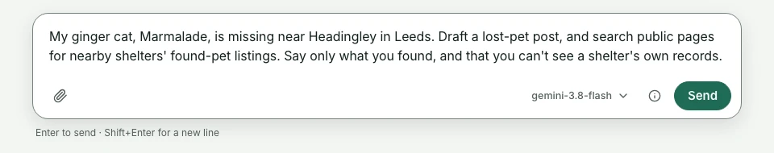
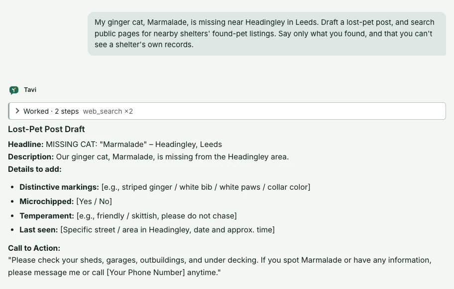

# Search for a lost pet

Tell Tavi who's missing and where. It drafts a post for you to finish, looks through what shelters and lost-pet sites publish, and tells you who to contact. It helps with the legwork; it can't see inside a shelter.

> **Uses:** Web
> **Asks first:** Nothing — it only reads and suggests
> **Runs:** When you ask
> **Idea card:** "Lost pet search" (`health-home.lost-pet`)
> **Before you start:** a model connected ([Connect your first model](../../get-started/first-model.md)) · the canvas open ([Open the web canvas and walk through Welcome](../../get-started/web-canvas-tour.md)) · web search set up ([Set up web search](../../web-and-browser/set-up-web-search.md))

## 1. Ask for it

Choose **New chat** above the chats to open a chat of its own and send the prompt with your pet and the area in it: `My ginger cat, Marmalade, is missing near Headingley in Leeds. Draft a lost-pet post, and search public pages for nearby shelters' found-pet listings. Say only what you found, and that you can't see a shelter's own records.` Once Tavi knows this is something you do, **Ideas** may offer it as a card in its own words; **Try it** there starts the same chat.

## 2. Read the post and the shelters

Tavi searches public pages and gives you the post, with gaps in square brackets for what it doesn't know, such as markings and when your pet was last seen. Below it, Tavi says what it found, with a list of who to contact. The prompt asks it to say too that it can't see a shelter's own records. A further search can stop on a card: check it and choose **Allow once**.

<!-- cover -->

Don't take "no match" as an answer. Tavi only reads what search finds on public pages. It can't see a shelter's intake, and a found pet is often not online yet. Call the shelters, vets and your council yourself, and tell your microchip database. A name, number or link in Tavi's list comes from the model reading search results and can be wrong, so check it on the organisation's own site.

Tavi doesn't post anything. Fill in the gaps, copy the post where you want it, and leave out your home address. It isn't a vet either: if your pet is found hurt, call one.

## Variations

- `Rewrite the post for a neighbourhood poster, in under 60 words.`
- Search again in the same chat each day, because listings change: `Search again for found-pet listings.`
- `My black and white border collie, Moss, is missing near Hebden Bridge. Draft a lost-pet post, and search public pages for nearby shelters' found-pet listings. Say only what you found, and that you can't see a shelter's own records.`

## Related

- [Research a question with cited sources](../../web-and-browser/research-with-sources.md)
- [Set up web search](../../web-and-browser/set-up-web-search.md)
- [Set a reminder (once, on an event, or repeating)](../../automation/set-a-reminder.md)
