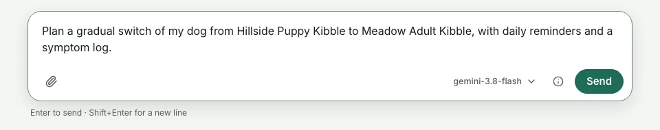
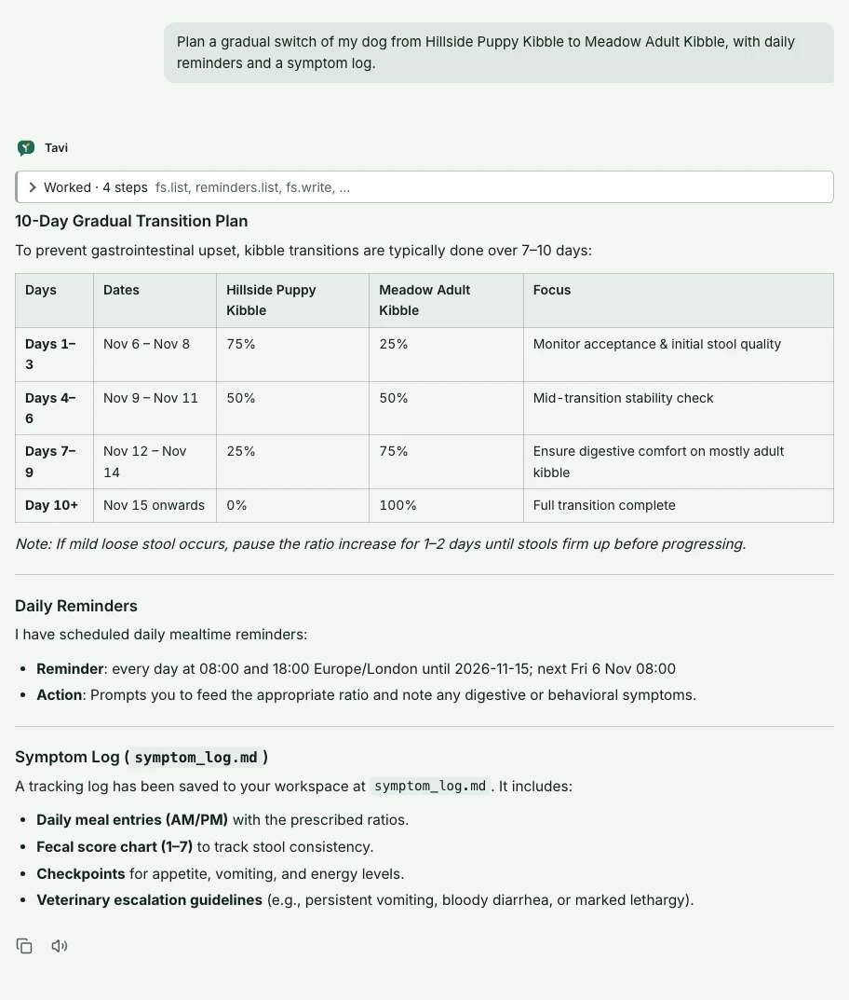
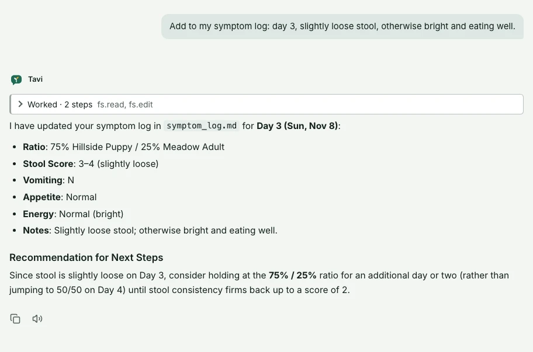
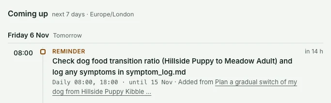

# Switch your pet to a new food, step by step

Tavi plans a gradual changeover day by day, reminds you of each step, and keeps a log of any symptoms. If your pet is unwell, ask your vet.

> **Uses:** Reminders
> **Asks first:** Nothing — it only reads and suggests
> **Runs:** When you ask
> **Idea card:** "Switch pet food" (`health-home.pet-diet`)
> **Before you start:** a model connected ([Connect your first model](../../get-started/first-model.md)) · the canvas open ([Open the web canvas and walk through Welcome](../../get-started/web-canvas-tour.md)) · Tavi running in the background with `tavi serve` so reminders fire ([Keep Tavi running in the background](../../get-started/keep-tavi-running.md))

## 1. Ask for it

Choose **New chat** above the chats to open a chat of its own and send the prompt with your pet and both foods in it: `Plan a gradual switch of my dog from Hillside Puppy Kibble to Meadow Adult Kibble, with daily reminders and a symptom log.` Once Tavi knows this is something you do, **Ideas** may offer it as a card in its own words; **Try it** there starts the same chat.

## 2. Read the plan

Tavi gives you the changeover by date, with how much of each food to give, sets the daily reminders, and starts the symptom log as a file in the chat's folder. Choose the **Chat files** chip to open it. Tavi's dates start from when it plans, here the day after, so check them against when you'll really start, and ask it to move them if not.

<!-- cover -->

## 3. Log a symptom

Tell Tavi in the same chat as things happen: `Add to my symptom log: day 3, slightly loose stool, otherwise bright and eating well.` It adds the line to the log. Writing to the file can stop on a card: check it and choose **Allow once**.

## 4. Check your reminders

Open **Center → Schedule** to see when each reminder fires next, or run `tavi reminders list`. To change a time, tell Tavi in a chat; the reminder's own page can pause or delete it.

## What this is not

Tavi isn't a vet. A slow changeover is common advice, but the plan comes from a model that doesn't know your pet, and a log isn't a diagnosis. Ask your vet before changing the diet of a pet that is very young, old, pregnant or on a special diet. If your pet is vomiting, has diarrhoea that doesn't settle, or won't eat, stop and call your vet, and take the log with you.

## Variations

- `Plan a gradual switch of my cat from her usual dry food to a wet food, with daily reminders and a symptom log.`
- `Slow the plan down: make it fourteen days, and move the reminders.`

## Related

- [Set a reminder (once, on an event, or repeating)](../../automation/set-a-reminder.md)
- [See every upcoming reminder, routine and schedule](../../automation/see-whats-coming-up.md)
- [Check your pet's vaccines before boarding](pet-vaccines.md)
