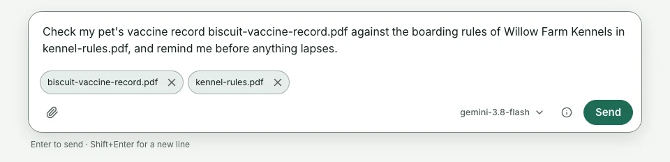
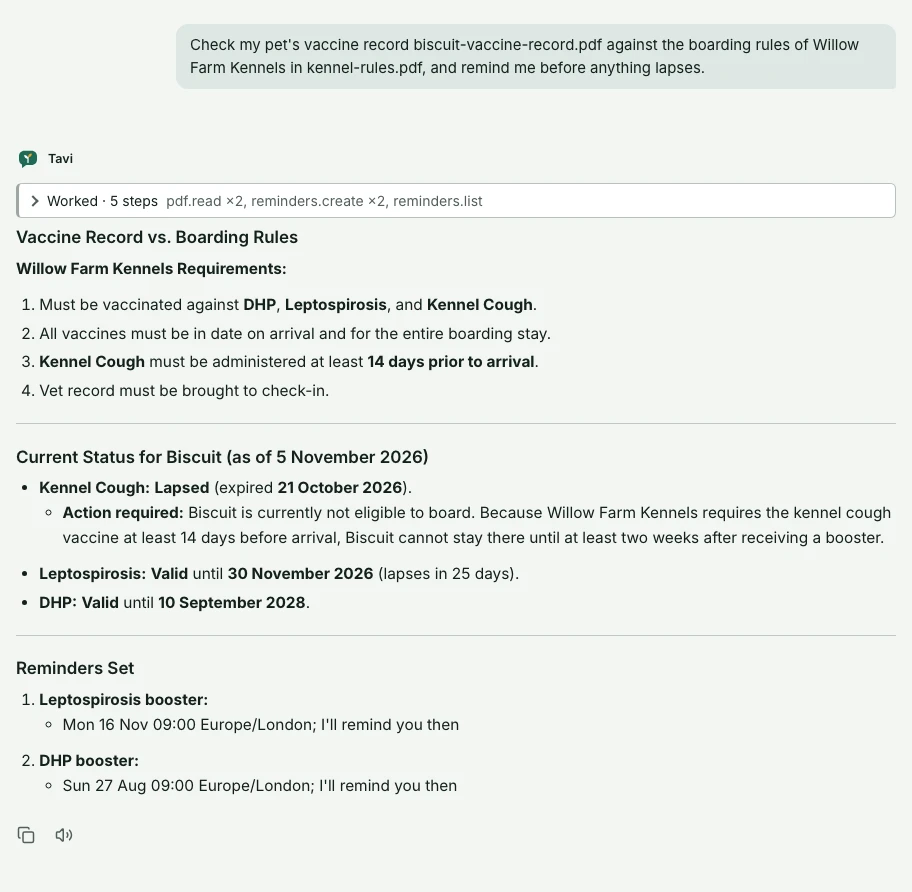
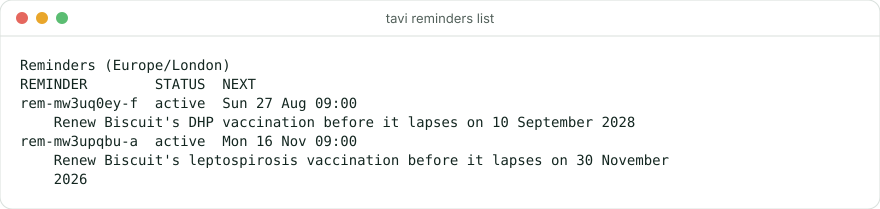

# Check your pet's vaccines before boarding

Give Tavi your vet's record and the kennel's rules. It tells you what's in date and what isn't, and reminds you before the next one lapses. Your vet has the final say.

> **Uses:** Reminders · PDFs
> **Asks first:** Nothing — it only reads and suggests
> **Runs:** When you ask
> **Idea card:** "Check pet vaccines" (`health-home.pet-vaccines`)
> **Before you start:** a model connected ([Connect your first model](../../get-started/first-model.md)) · the canvas open ([Open the web canvas and walk through Welcome](../../get-started/web-canvas-tour.md)) · Tavi running in the background with `tavi serve` so reminders fire ([Keep Tavi running in the background](../../get-started/keep-tavi-running.md)) · the vet's record and the kennel's rules as PDFs ([Summarise a PDF and pull out tables](../../documents/read-a-pdf.md))

## 1. Attach the record and the rules

Choose **New chat** above the chats to open a chat of its own, attach both PDFs with the paperclip, and send the prompt with their names in it: `Check my pet's vaccine record biscuit-vaccine-record.pdf against the boarding rules of Willow Farm Kennels in kennel-rules.pdf, and remind me before anything lapses.` Biscuit, his record and the kennels are all made up. Once Tavi knows this is something you do, **Ideas** may offer it as a card in its own words; **Try it** there starts the same chat.

## 2. Read what's due

Tavi reads both files with `pdf.read`, sets the rules beside the record, and tells you where each vaccination stands. Here the kennel cough has already lapsed, so Biscuit can't board until two weeks after a booster. A reminder set after reading a file can stop on a card: check it and choose **Allow once**, or for several reminders together **Allow selected; deny unchecked**. Unticking a reminder refuses it.

<!-- cover -->

## 3. Check the reminder

Run `tavi reminders list`, or open **Center → Schedule**, to see each reminder and when it fires. Check the date against the record. To move one, tell Tavi in the chat.

<picture>
  <source media="(prefers-color-scheme: dark)" srcset="../../../assets/use-cases/everyday/home-family-and-pets/pet-vaccines/03-check-the-reminder-dark.svg">
  
</picture>

## What this is not

Tavi isn't a vet. It reads the dates and rules you give it, and a scan it can't read well or a rule the kennel changed can make its answer wrong. It doesn't know your pet's health. Ask your vet what's due and when, and ask the kennel before you book.

## Variations

- `Check my pet's vaccine record tilly-record.pdf against the boarding rules of Willow Farm Kennels in kennel-rules.pdf, for a stay from 20 to 27 December, and remind me before anything lapses.`
- Add the booster when it's done: `Biscuit had his kennel cough booster today. What's the first day he can board?`

## Related

- [Summarise a PDF and pull out tables](../../documents/read-a-pdf.md)
- [Set a reminder (once, on an event, or repeating)](../../automation/set-a-reminder.md)
- [See every upcoming reminder, routine and schedule](../../automation/see-whats-coming-up.md)
- [Switch your pet to a new food, step by step](pet-diet.md)
