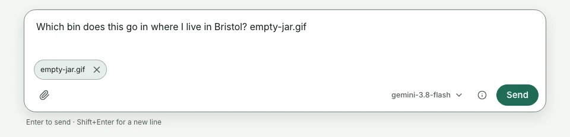
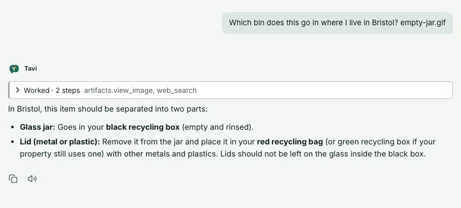

# Find out which bin something goes in

Show Tavi an item and say where you live. It looks at the picture, checks your council's rules on the web, and tells you which bin.

> **Uses:** Images · Web
> **Asks first:** Nothing — it only reads and suggests
> **Runs:** When you ask
> **Idea card:** "Which bin?" (`health-home.recycling`)
> **Before you start:** a model connected ([Connect your first model](../../get-started/first-model.md)) · the canvas open ([Open the web canvas and walk through Welcome](../../get-started/web-canvas-tour.md)) · web search set up ([Set up web search](../../web-and-browser/set-up-web-search.md)) · a model that reads images, and your picture saved as a GIF ([Ask about a photo](../../photos-and-video/ask-about-a-photo.md))

## 1. Ask for it

Choose **New chat** above the chats to open a chat of its own, attach the picture with the paperclip, and send the prompt with your city and the file's name in it: `Which bin does this go in where I live in Bristol? empty-jar.gif` Once Tavi knows this is something you do, **Ideas** may offer it as a card in its own words; **Try it** there starts the same chat.

The canvas takes a picture as a GIF, and refuses a PNG or JPEG. Save the photo as a GIF, or send it from a messaging channel, where photos go as they are.

## 2. Read the result

Tavi opens the picture with `artifacts.view_image`, searches for your council's rules, and tells you where each part goes. Once a chat holds a picture, a search can stop on a card: check it and choose **Allow once**.

<!-- cover -->

Rules differ from council to council and change over time, and search results can be out of date. What your council says, on its site or on the leaflet you were sent, is what counts. Tavi can also misread a picture, so name the material if it matters: a plastic lid and a metal one can go to different places.

## Variations

- No picture? Describe it: `Which bin does this go in where I live in Bristol? A greasy pizza box.`
- Ask a follow-up in the same chat: `Do I need to take the label off?`

## Related

- [Ask about a photo](../../photos-and-video/ask-about-a-photo.md)
- [Send a file or image with your message](../../chat/attach-files-to-chat.md)
- [Research a question with cited sources](../../web-and-browser/research-with-sources.md)
