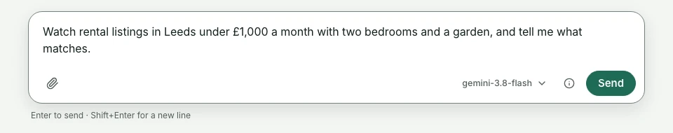
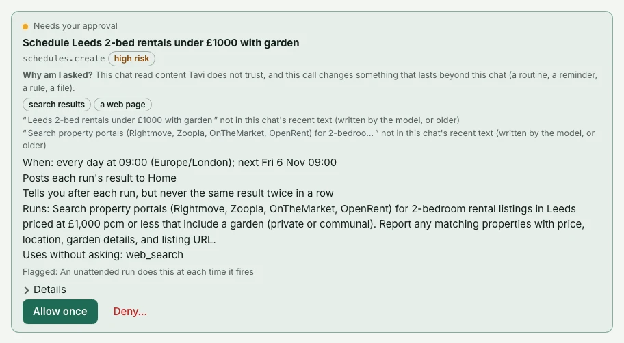
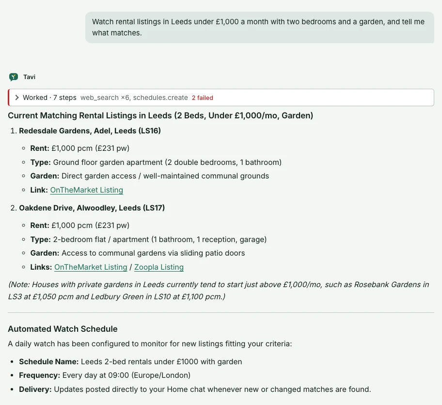

# Watch rental listings

Tell Tavi the area, your budget and what you can't do without. It looks at what's listed today, and a daily schedule searches again and posts the matches it finds, including ones you've already seen.

> **Uses:** Web · Routines
> **Asks first:** Nothing — it only reads and suggests
> **Runs:** Daily
> **Idea card:** "Watch rental listings" (`health-home.rental-watch`)
> **Before you start:** a model connected ([Connect your first model](../../get-started/first-model.md)) · the canvas open ([Open the web canvas and walk through Welcome](../../get-started/web-canvas-tour.md)) · web search set up ([Set up web search](../../web-and-browser/set-up-web-search.md)) · Tavi running in the background with `tavi serve` ([Keep Tavi running in the background](../../get-started/keep-tavi-running.md)), for the daily runs

## 1. Ask for it

Choose **New chat** above the chats to open a chat of its own and send the prompt with your search in it: `Watch rental listings in Leeds under £1,000 a month with two bedrooms and a garden, and tell me what matches.` Once Tavi knows this is something you do, **Ideas** may offer it as a card in its own words; **Try it** there starts the same chat.

## 2. Make it recurring

Because you asked it to watch, Tavi searches the web and proposes a schedule of its own. Creating a schedule always asks, because it keeps running after this chat. Read the card: when it runs, where the result goes, and what it will do each time. Then choose **Allow once**, or **Deny…** if you'd rather set it up yourself (see Variations). Tavi picks the time. It's listed in **Center → Schedule** and in `tavi schedules list`.

<!-- cover -->

## 3. Read the result

Tavi confirms the schedule and tells you what it found today, with a link to where it found it, which may be a portal's search page, so the listing may need finding there. Later runs post to Home as the card says, and a run can post that it found nothing. If you have no Home yet, the first result starts one.

**Worked** can show a step as failed, such as a search that didn't go through: open it to see which. The answer is what the rest found.

Each run starts afresh and doesn't remember the runs before it, so it can't tell a new listing from one it has already sent, whatever the card or the answer says. Each run reports the matches it finds, and the same listing can come back day after day: read each result against what you've already seen.

Tavi reads what web search finds, not the portals' own live lists, so it can miss a listing, reach you late, or show one that has gone. Open the link, find the listing and check the rent, the area and the garden with the agent before you count on it. Tavi doesn't contact agents or apply for you. Each run spends searches, so a portal's own email alert will usually reach you first; this is a second pair of eyes across portals.

## Variations

- `Watch rental listings in Sheffield under £850 a month with a ground floor and pets allowed, and tell me what matches.`
- To choose the time yourself, choose **Deny…** on the card, then point at your message and choose **Repeat this…**. A form opens, filled in from the chat and set to every day. If the chat only searched the web it's **Create routine**: set the time and save. Tavi checks a new routine before it starts, which can take up to fifteen minutes ([Follow a topic with a research routine](../../automation/research-routine.md)). If Tavi also read your schedules on the way, as the **Worked** line shows, it's **Create schedule**, and no tool is filled in: add `web_search` beside **Used in this chat — add**, or the run has no search to use. Only **Create routine** has a link to switch to the other: **Repeat it as a schedule instead**.

## Related

- [Turn a chat that worked into a schedule](../../automation/repeat-this.md)
- [Create, change, pause and cancel schedules from a chat](../../automation/manage-schedules-by-chatting.md)
- [Follow a topic with a research routine](../../automation/research-routine.md)
- [Research a question with cited sources](../../web-and-browser/research-with-sources.md)
