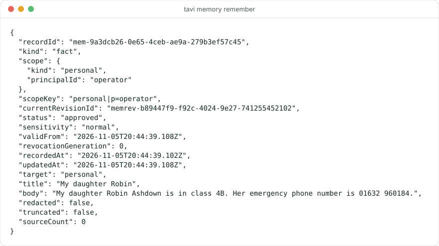
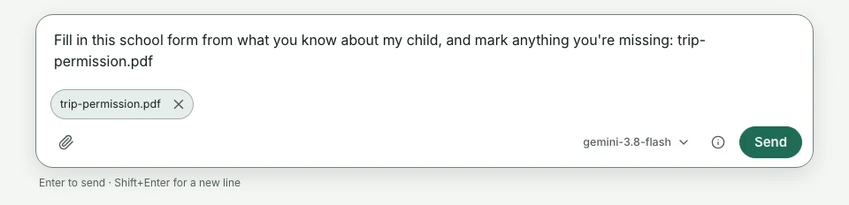
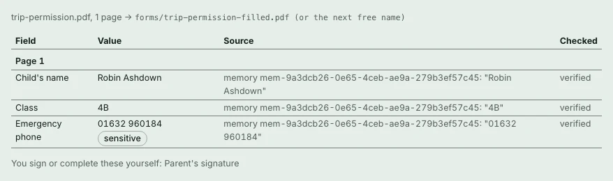
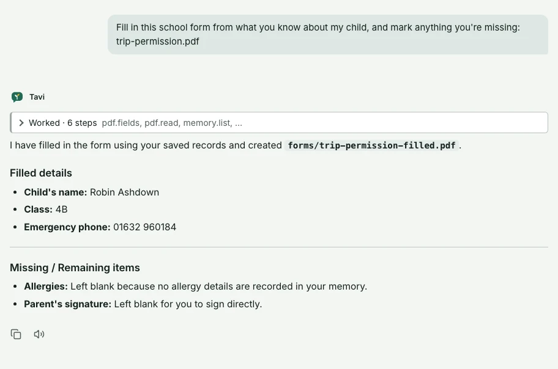

# Fill in a school form

Give Tavi a school's fillable PDF. It fills in what it knows about your child, marks what's missing, and shows you every value before it writes anything. You check it and sign it; Tavi doesn't send it anywhere.

> **Uses:** PDFs
> **Asks first:** PDFs
> **Runs:** When you ask
> **Idea card:** "Fill a school form" (`health-home.school-forms`)
> **Before you start:** a model connected ([Connect your first model](../../get-started/first-model.md)) · the canvas open ([Open the web canvas and walk through Welcome](../../get-started/web-canvas-tour.md)) · a fillable PDF form, one whose boxes you can type into in a PDF viewer ([Fill a PDF form from your own notes](../../documents/fill-a-pdf-form.md))

## 1. Tell Tavi about your child

Tavi can only fill in what it knows. Save the details as a memory: `tavi memory remember --kind fact --title "My daughter Robin" --body "My daughter Robin Ashdown is in class 4B. Her emergency phone number is 01632 960184."` Everything here is made up. Think about what you store: it's kept in your memory until you remove it, and what a chat uses goes to your model's provider ([Teach Tavi a fact, and make it forget one](../../memory-and-skills/remember-and-forget.md)).

<picture>
  <source media="(prefers-color-scheme: dark)" srcset="../../../assets/use-cases/everyday/home-family-and-pets/school-forms/01-tell-tavi-about-your-child-dark.svg">
  
</picture>

## 2. Attach the form

Choose **New chat** above the chats to open a chat of its own, attach the PDF with the paperclip, and send the prompt with the file's name in it: `Fill in this school form from what you know about my child, and mark anything you're missing: trip-permission.pdf` Once Tavi knows this is something you do, **Ideas** may offer it as a card in its own words; **Try it** there starts the same chat.

## 3. Check every value

Tavi reads the form's fields and your memory, then stops before writing anything. The card lists every value by page, with the memory it came from and whether the value was **verified** there. A phone number is marked **sensitive**. **You sign or complete these yourself** names the signature box, which stays blank. Read every row against what you know: a value from an old memory can be out of date.

<!-- cover -->

## 4. Allow it and read what's missing

Choose **Allow once**. Tavi fills a new copy in the chat's `forms/` folder, leaves your original alone, and tells you what it left blank. Choose the **Chat files** chip to download the copy.

Tavi won't guess: a box with no source stays empty, and that includes medical details such as allergies. Add those yourself, or tell Tavi and ask again. Tavi doesn't sign, doesn't send the form, and isn't a doctor or a school: on a medical form, what you and your doctor know is what counts. Open the copy and read it before it goes anywhere.

## Variations

- Give it what's missing in the chat: `Robin has no allergies. Fill that in too.`
- Keep it out of memory: attach a notes file with the form and ask Tavi to fill it in from your notes ([Fill a PDF form from your own notes](../../documents/fill-a-pdf-form.md)).

## Related

- [Fill a PDF form from your own notes](../../documents/fill-a-pdf-form.md)
- [Teach Tavi a fact, and make it forget one](../../memory-and-skills/remember-and-forget.md)
- [Approve, reject or always-allow a tool call](../../chat/approve-tool-calls.md)
