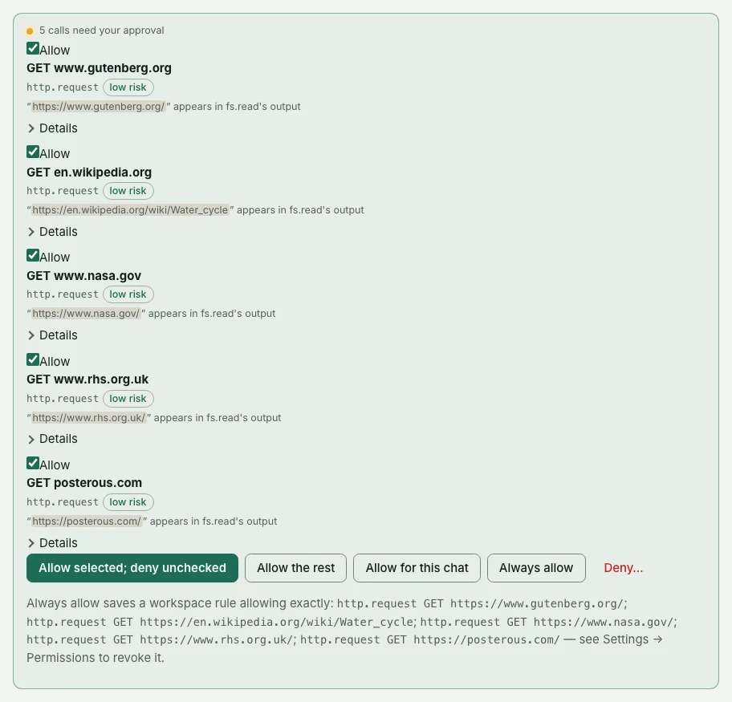
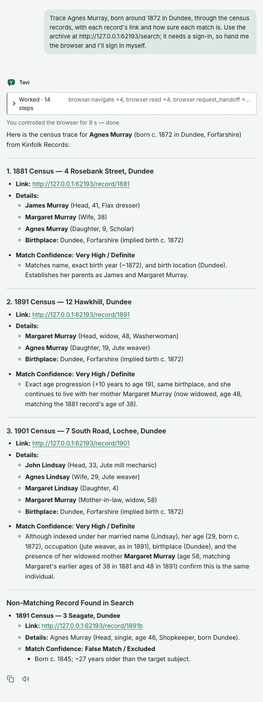
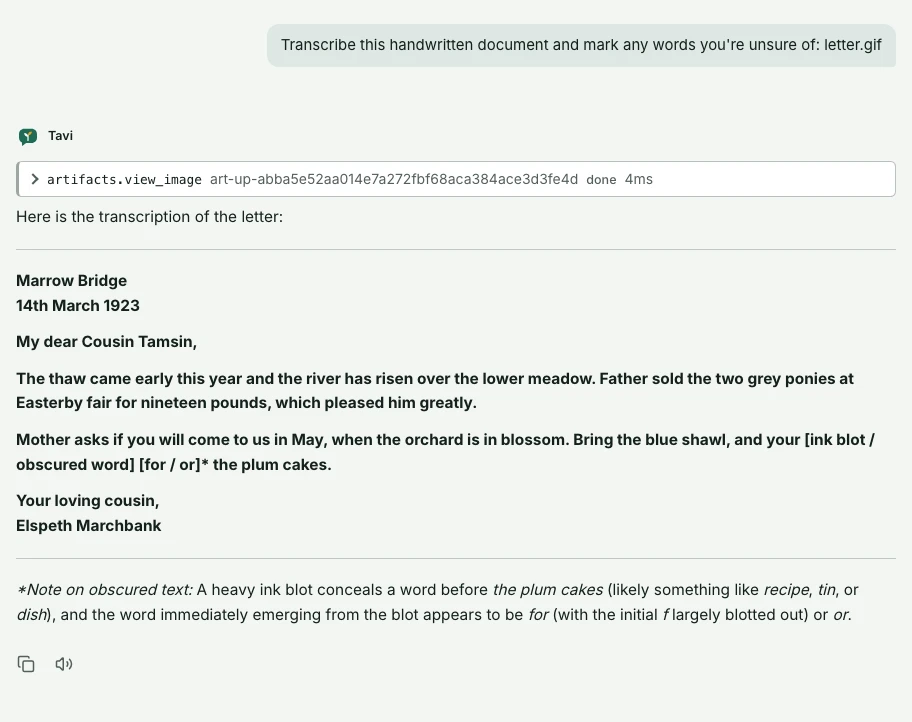
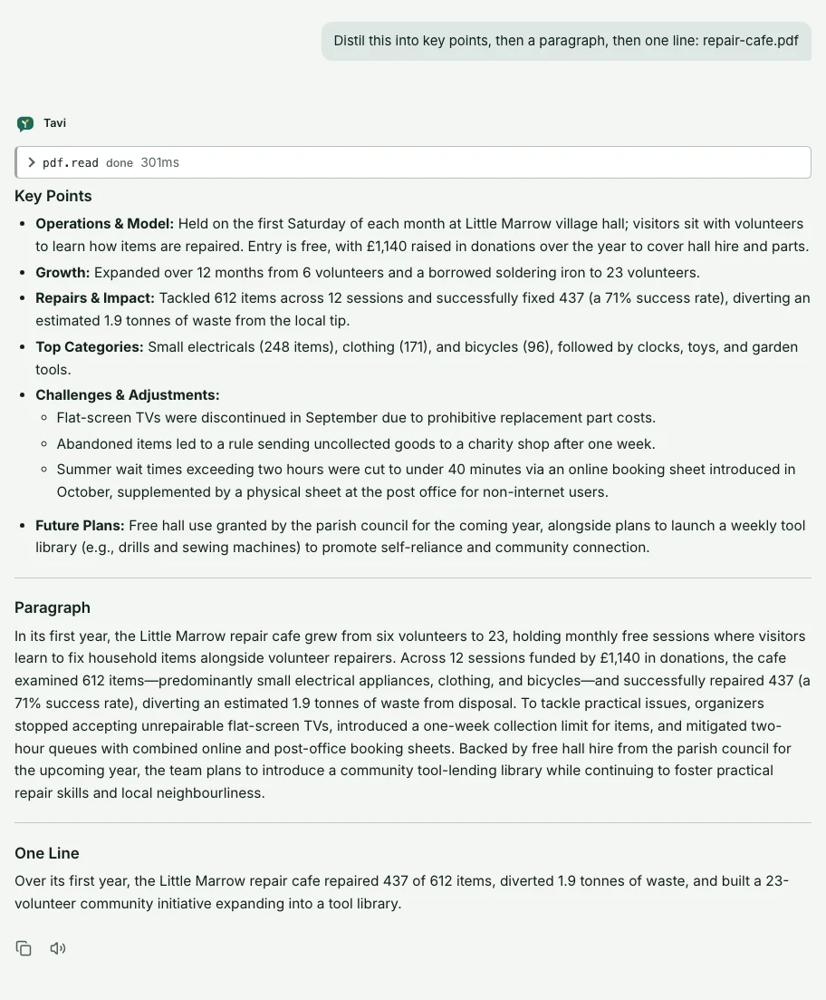
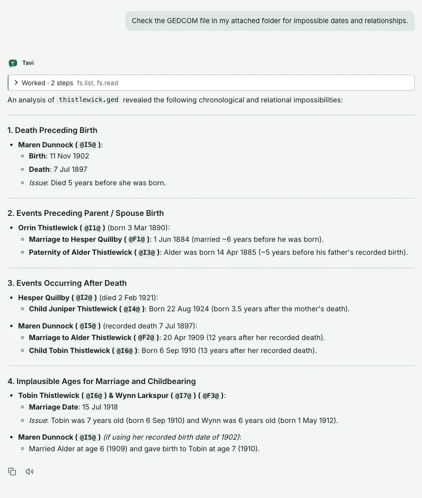
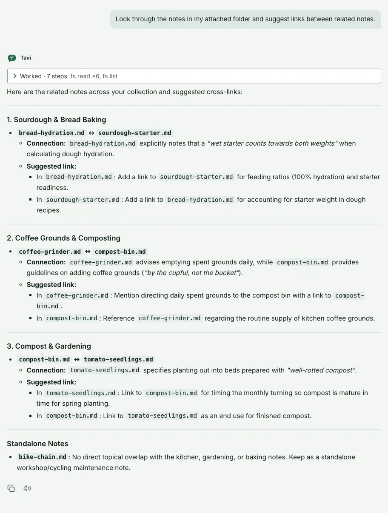

<!-- Generated by scripts/docs/guide-indexes.mjs from the guides: edit the guides, not this file. -->

# Knowledge and archives

Old letters, records, family trees, notes and bookmarks.

| | Guide |
| :--- | :--- |
|  | [Rescue the bookmarks you never got back to](bookmarks.md) Give Tavi your bookmarks export and it opens the links, finds an archived copy of the dead ones, groups the rest, and picks the ones worth reading. |
|  | [Trace an ancestor through the census records](census.md) Give Tavi a name, a rough year of birth and a place. |
|  | [Transcribe an old handwritten letter](cursive.md) Send Tavi a scan of a letter or record and it writes out what it can read, marking the words it isn't sure of. |
|  | [Distil an article down to what matters](distil.md) Give Tavi something long, a PDF or a link, and it boils it down in layers: key points, then a paragraph, then one line. |
|  | [Check your family tree for impossible dates](gedcom.md) Export your tree as a GEDCOM file and Tavi checks it for dates and relationships that can't be right, such as a parent younger than their child. |
|  | [Find the links between your notes](note-links.md) Point Tavi at a folder of notes, such as an Obsidian vault, and it suggests which ones belong together. |

[All everyday recipes](../README.md)
