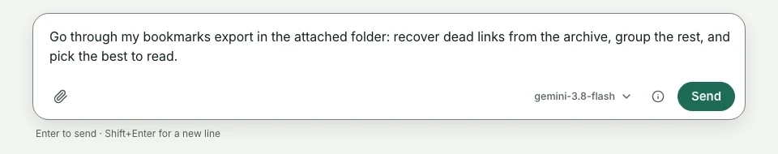
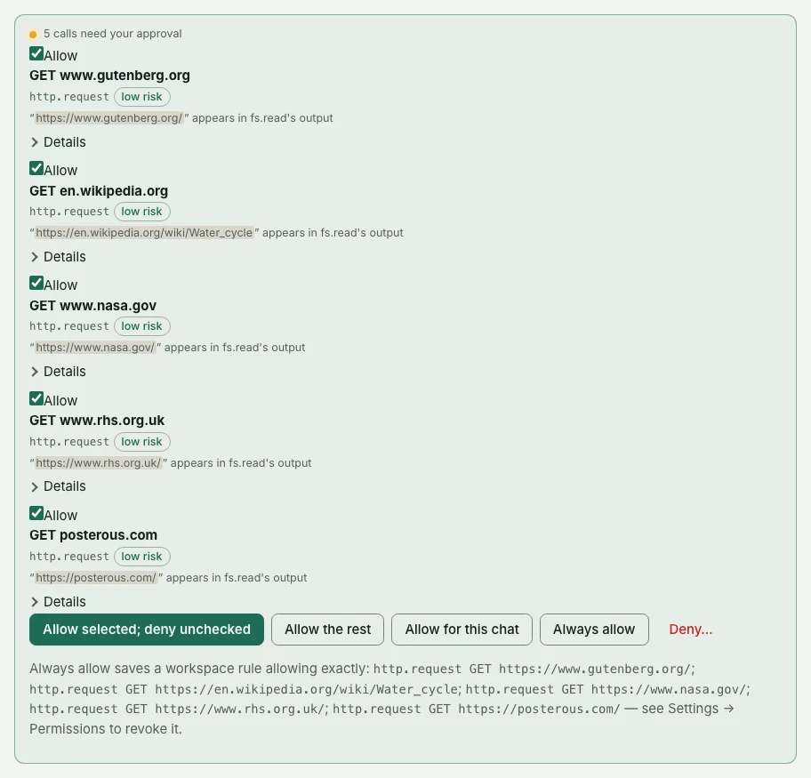
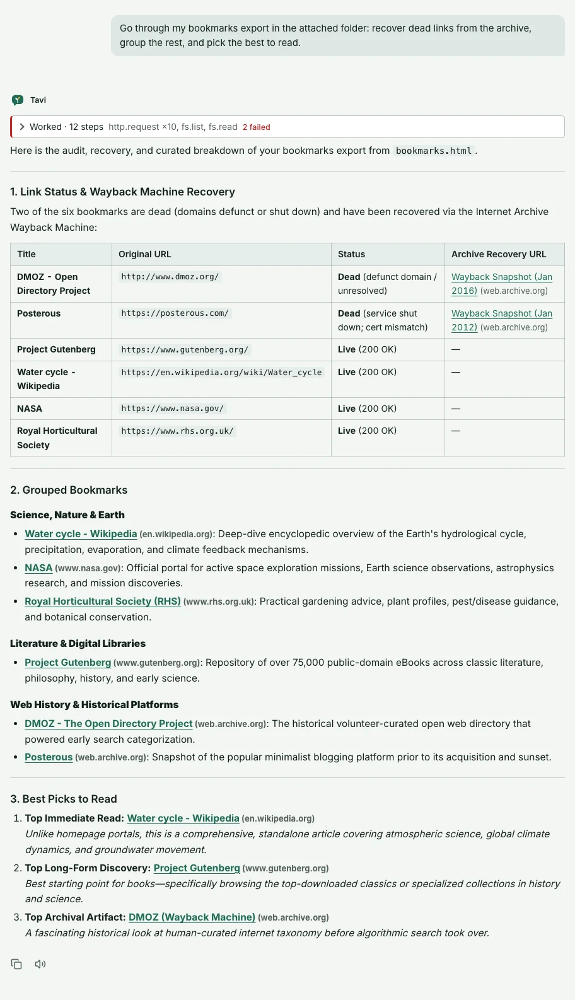

# Rescue the bookmarks you never got back to

Give Tavi your bookmarks export and it opens the links, finds an archived copy of the dead ones, groups the rest, and picks the ones worth reading.

> **Uses:** Web · Files
> **Asks first:** Nothing — it only reads and suggests
> **Runs:** When you ask
> **Idea card:** "Rescue my bookmarks" (`productivity.bookmarks`)
> **Before you start:** a model connected ([Connect your first model](../../get-started/first-model.md)) · the canvas open ([Open the web canvas and walk through Welcome](../../get-started/web-canvas-tour.md)) · web search set up ([Set up web search](../../web-and-browser/set-up-web-search.md)) · a folder Tavi may read, with your bookmarks export in it ([Give Tavi a working folder](../../files-and-code/attach-a-folder.md))

## 1. Ask for it

Export your bookmarks from your browser as an HTML file, and put it in a folder of its own. Tavi can open only the sites you list when you start it, so name the folder, the Internet Archive and each site you want checked: `tavi serve --fs-root /Users/you/bookmarks --http-allow-host web.archive.org --http-allow-host archive.org --http-allow-host www.nasa.gov`, with one more `--http-allow-host` for each site. Choose **New chat** above the chats to open a chat of its own and send the prompt: `Go through my bookmarks export in the attached folder: recover dead links from the archive, group the rest, and pick the best to read.` Once Tavi knows this is something you do, **Ideas** may offer it as a card in its own words; **Try it** there starts the same chat.

## 2. Allow the addresses

Tavi reads the file, then opens the links with `http.request`, and that stops on cards. Several calls together come as one card, such as **5 calls need your approval**, with each address listed: untick any you don't want, and choose **Allow selected; deny unchecked**. A single call has **Allow once**. Further cards follow for the archive. Those can be marked high risk, because Tavi wrote the address itself: check that it holds only the link you saved.

<!-- cover -->

## 3. Read the result

Tavi says which links answered and which didn't, links an archived copy of each dead one, groups what's left, and picks what to read. The **failed** on the line above the answer is the sites that didn't answer, which is how it knows they're dead. The sites here are public, and two of them closed for good years ago.

The answer is only as good as what Tavi opened. Check the line above it: with no `http.request` there, or no sites listed when you started Tavi, it couldn't open a thing, and a link it calls live or dead comes from what it remembers. When it has no way to open a link at all, Tavi is told so and should say it couldn't check them rather than call them live or give an archive date. A link that answers can still have changed since you saved it, and one that fails may only be down today. An archived copy is an old page, not the site as it is now. The picks are its judgement of the pages, so yours may differ. Your export stays as it was.

## Variations

- A long export: `Start with the 20 oldest bookmarks.` Each link is a call to allow, and each site has to be on your list.
- Sort by what you're after: `Group them by what I'd use them for, not by subject.`

## Related

- [Give Tavi a working folder](../../files-and-code/attach-a-folder.md)
- [Research a question with cited sources](../../web-and-browser/research-with-sources.md)
- [Approve, reject or always-allow a tool call](../../chat/approve-tool-calls.md)
- [Distil an article down to what matters](distil.md)
