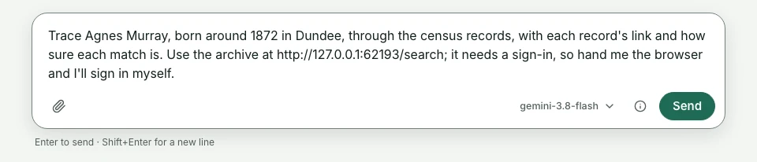
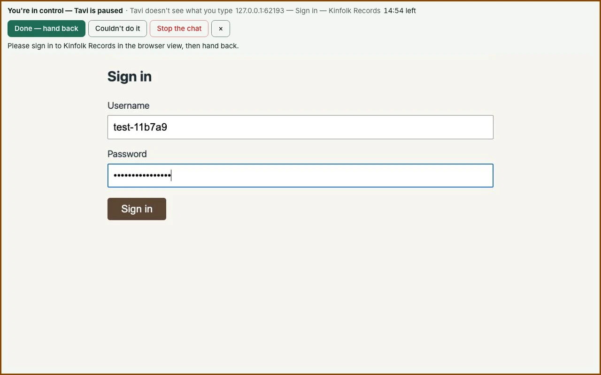
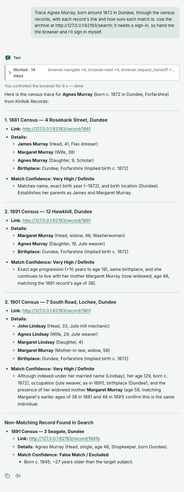

# Trace an ancestor through the census records

Give Tavi a name, a rough year of birth and a place. It searches a census archive in your own signed-in session and follows the person from one census to the next, telling you what each record says and how sure the match is.

> **Uses:** Browser · Web
> **Asks first:** Browser
> **Runs:** When you ask
> **Idea card:** "Trace an ancestor" (`learning.census`)
> **Before you start:** a model connected ([Connect your first model](../../get-started/first-model.md)) · the canvas open on this computer ([Open the web canvas and walk through Welcome](../../get-started/web-canvas-tour.md)) · the agent's browser working ([Let Tavi drive a browser while you watch, signed in or signed out](../../web-and-browser/browse-with-tavi.md)) · your account on a census archive

## 1. Ask for it

Choose **New chat** above the chats to open a chat of its own and send the prompt with the person in it, and the archive to search, such as `Trace Agnes Murray, born around 1872 in Dundee, through the census records, with each record's link and how sure each match is. Use the archive at https://records.example.com/search; it needs a sign-in, so hand me the browser and I'll sign in myself.` Once Tavi knows this is something you do, **Ideas** may offer it as a card in its own words; **Try it** there starts the same chat.

## 2. Sign in yourself

Tavi asks before it opens the archive in its browser: choose **Allow for this chat**. At the archive's sign-in Tavi stops and asks for you: choose **Take control**, sign in in the page, then **Done — hand back**. Tavi doesn't see what you type ([Take over for a login or a final checkout](../../web-and-browser/take-over-the-browser.md)).

## 3. Read the trail

Tavi fills in the archive's search, then opens each likely record. Once it has read a page from the web, each of these steps asks you again, since the page is something Tavi doesn't trust: typing the search, pressing **Search** (the card names the button) and opening each record page. Choose **Allow once** for each. It then lists the person census by census: age, address, occupation and household, each record's link, and how sure it is of each match. For each match it says why: what lines up, such as a married name with the same age and birthplace and her mother in the household, and it names a record it set aside, such as another woman of the same name. Check those links yourself before they go in your tree.

<!-- cover -->

Census ages and spellings drift from one record to the next, and two people of the same name can live in one town. Tavi tells you its reasons; whether a match is right is your call.

## Variations

- `Trace John Lindsay, born around 1868 in Dundee, through the census records, and list his children in each.`
- Check the dates in your whole tree afterwards: [Check your family tree for impossible dates](gedcom.md).

## Related

- [Check your family tree for impossible dates](gedcom.md)
- [Take over for a login or a final checkout](../../web-and-browser/take-over-the-browser.md)
- [Let Tavi drive a browser while you watch, signed in or signed out](../../web-and-browser/browse-with-tavi.md)
