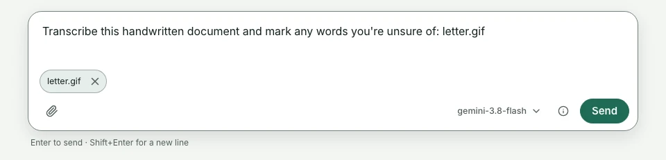
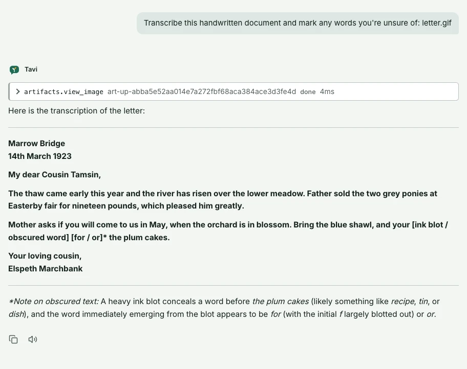
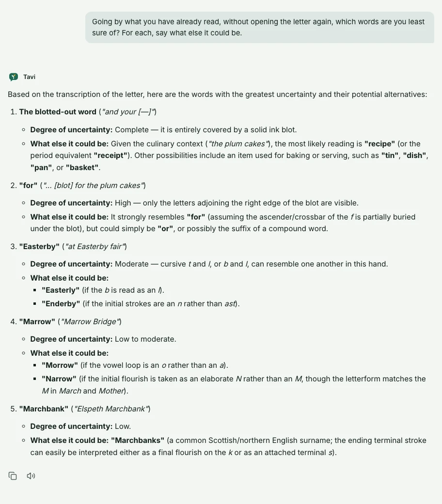

# Transcribe an old handwritten letter

Send Tavi a scan of a letter or record and it writes out what it can read, marking the words it isn't sure of. What comes back is a first reading to check against the page, not a record.

> **Uses:** Images
> **Asks first:** Nothing — it only reads and suggests
> **Runs:** When you ask
> **Idea card:** "Transcribe a document" (`learning.cursive`)
> **Before you start:** a model that reads images connected ([Ask about a photo](../../photos-and-video/ask-about-a-photo.md)) · the canvas open ([Open the web canvas and walk through Welcome](../../get-started/web-canvas-tour.md)) · a scan of the document, saved as a GIF

## 1. Ask for it

Scan or photograph the page straight on, in good light. The canvas takes a picture as a GIF, so save it as one first ([Send a file or image with your message](../../chat/attach-files-to-chat.md)). Choose **New chat** above the chats to open a chat of its own. Choose the paperclip, pick the picture, and send the prompt: `Transcribe this handwritten document and mark any words you're unsure of: letter.gif` Once Tavi knows this is something you do, **Ideas** may offer it as a card in its own words; **Try it** there starts the same chat.

The letter here was drawn for this guide, with its people and places made up and a blot over one word, so its reading could be checked word for word.

## 2. Read the transcription

Tavi opens the picture with `artifacts.view_image`, named on the line above its answer, and writes out the text line by line. Where it can't read a word it says so in square brackets, and says why under the transcription.

<!-- cover -->

A machine reading goes wrong in ways that are easy to miss. It can swap letters that look alike in a hand, such as `u` and `n`, or `e` and `i`. It can turn a name it doesn't know into a word it does, misread a date or a sum, and tidy old spelling into modern spelling. It can also fill a gap with a word that fits the sentence and was never on the page, and all of that reads as smoothly as the words it got right. So a word with no mark isn't a word it checked. Compare every name, date and figure with the scan yourself before you copy it into a tree or quote it.

## 3. Ask what it was least sure of

Ask it to go back over its own reading: `Going by what you have already read, without opening the letter again, which words are you least sure of? For each, say what else it could be.` Any guess it offers for a word it couldn't read is only a guess, so keep it apart from the transcription. Asked to look again, Tavi may want to run a script on the picture: that stops on **Needs your approval**, and **Deny…** stops the script.

## Variations

- Keep the old spelling: `Keep the spelling and punctuation exactly as written, even where it looks wrong.`
- For a typed or printed page, have it read in a PDF with OCR ([Read a scanned document (local OCR)](../../documents/read-a-scan.md)).

## Related

- [Ask about a photo](../../photos-and-video/ask-about-a-photo.md)
- [Send a file or image with your message](../../chat/attach-files-to-chat.md)
- [Check your family tree for impossible dates](gedcom.md)
