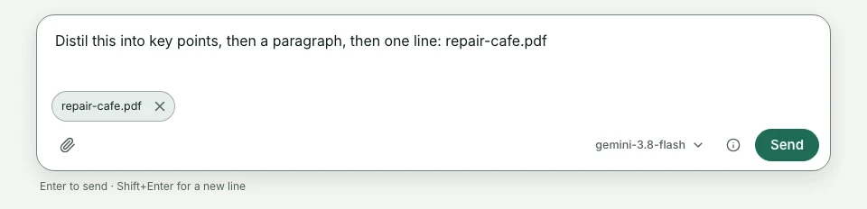
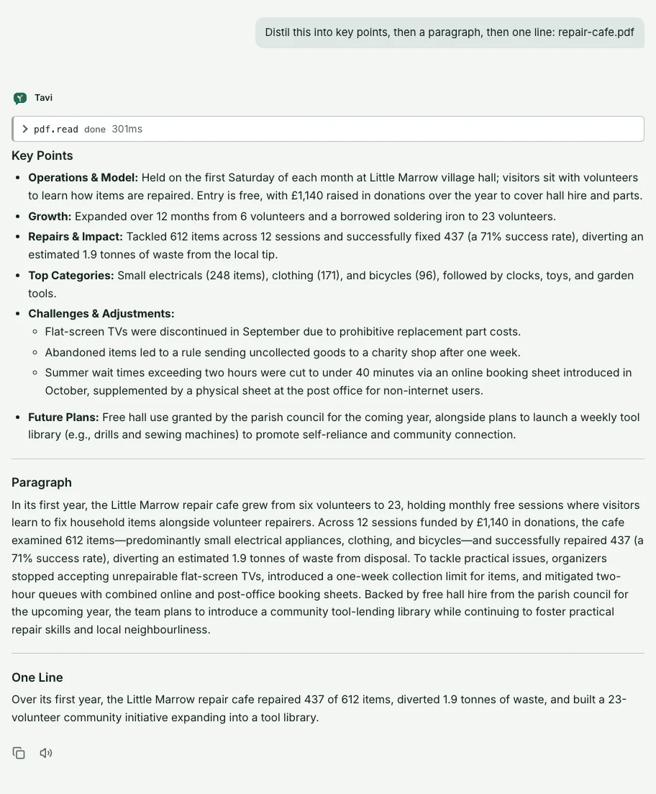
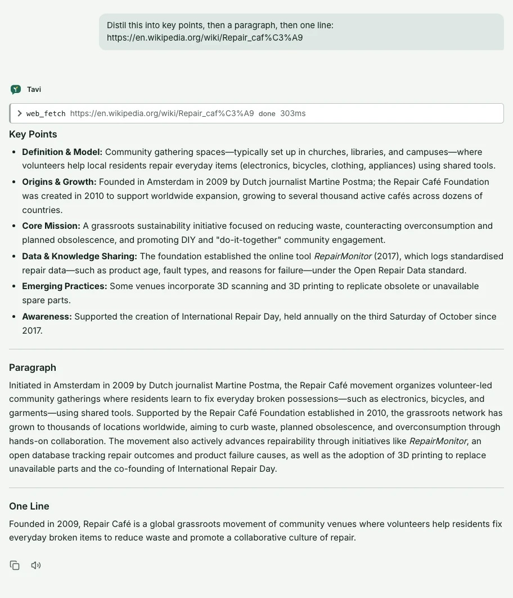

# Distil an article down to what matters

Give Tavi something long, a PDF or a link, and it boils it down in layers: key points, then a paragraph, then one line.

> **Uses:** PDFs · Web
> **Asks first:** Nothing — it only reads and suggests
> **Runs:** When you ask
> **Idea card:** "Distil an article" (`productivity.distil`)
> **Before you start:** a model connected ([Connect your first model](../../get-started/first-model.md)) · the canvas open ([Open the web canvas and walk through Welcome](../../get-started/web-canvas-tour.md)) · a PDF of what you're reading ([Summarise a PDF and pull out tables](../../documents/read-a-pdf.md)) · for a link, the site on Tavi's list, with `tavi serve --http-allow-host <site>` ([Research a question with cited sources](../../web-and-browser/research-with-sources.md))

## 1. Attach the article

Choose **New chat** above the chats to open a chat of its own, attach the PDF with the paperclip, and send the prompt: `Distil this into key points, then a paragraph, then one line: repair-cafe.pdf` Once Tavi knows this is something you do, **Ideas** may offer it as a card in its own words; **Try it** there starts the same chat.

## 2. Read the layers

Tavi reads the PDF with `pdf.read` and writes the three layers in order, each shorter than the last. The article here is made up, a year of a village repair cafe, and every figure in the answer comes from it.

<!-- cover -->

A shorter layer leaves more out, and what goes first is often the small print. The article warns that its 1.9 tonnes says nothing about what people bought instead, and a warning like that is easily lost. Before you quote a figure, check it in the article, along with what the writer says about it.

## 3. Distil a page from the web

Send the same prompt with a link: `Distil this into key points, then a paragraph, then one line: https://en.wikipedia.org/wiki/Repair_caf%C3%A9` Tavi reads a page with `web_fetch` when its site is on the list you started Tavi with, here `tavi serve --http-allow-host en.wikipedia.org`. For a site that isn't on the list, it may ask to open the page in the browser: check the address and choose **Allow once**, or **Deny…** and paste the text in instead.

## Variations

- Set the length: `Keep the key points to five, and the one line under 15 words.`
- Keep the warnings: `Add a last layer for the caveats the writer gives.`
- A scanned article is read with OCR first ([Read a scanned document (local OCR)](../../documents/read-a-scan.md)).

## Related

- [Summarise a PDF and pull out tables](../../documents/read-a-pdf.md)
- [Research a question with cited sources](../../web-and-browser/research-with-sources.md)
- [Turn a chapter into flashcards](../learning/flashcards.md)
