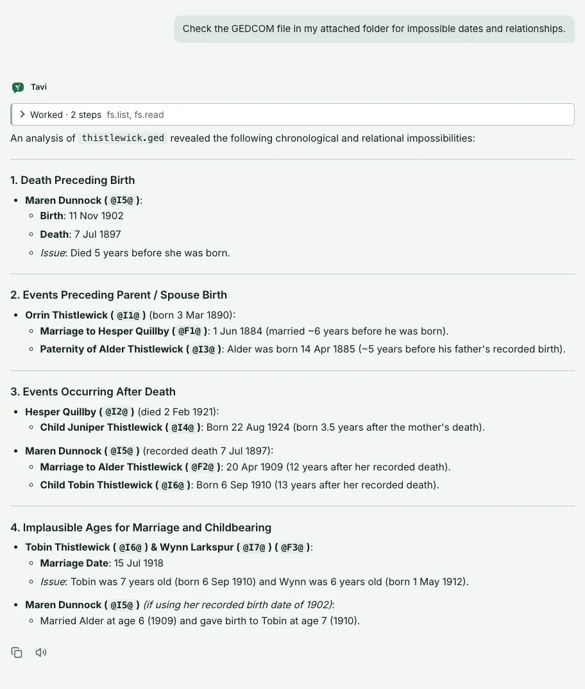

# Check your family tree for impossible dates

Export your tree as a GEDCOM file and Tavi checks it for dates and relationships that can't be right, such as a parent younger than their child.

> **Uses:** Files · Sandbox
> **Asks first:** Nothing — it only reads and suggests
> **Runs:** When you ask
> **Idea card:** "Audit my family tree" (`learning.gedcom`)
> **Before you start:** a model connected ([Connect your first model](../../get-started/first-model.md)) · the canvas open ([Open the web canvas and walk through Welcome](../../get-started/web-canvas-tour.md)) · a folder Tavi may read, with your GEDCOM file in it ([Give Tavi a working folder](../../files-and-code/attach-a-folder.md)) · the sandbox working ([Check the sandbox (and set it up on Linux)](../../run-and-maintain/sandbox-setup.md))

## 1. Ask for it

Put the exported `.ged` file in a folder of its own, and start Tavi with that folder by its full path: `tavi serve --fs-root /Users/you/family`. Each new chat then has it attached read-only, so Tavi can read the file and can't change it. Choose **New chat** above the chats to open a chat of its own and send the prompt: `Check the GEDCOM file in my attached folder for impossible dates and relationships.` Once Tavi knows this is something you do, **Ideas** may offer it as a card in its own words; **Try it** there starts the same chat.

## 2. Read the result

Tavi finds the file with `fs.list`, then reads it with `fs.read` or with a short script in the sandbox. A script it wrote itself stops on **Needs your approval**, flagged **runs inline code**, with the code under **Details**. Choose **Allow once**, or **Allow for this chat** so the next script doesn't ask. **Deny…** stops the script.

Tavi then lists what can't be right, with each person's name and their GEDCOM reference, such as `@I5@`, so you can find them in your family-tree program.

<!-- cover -->

The tree here is made up, with its mistakes put in on purpose. Tavi can tell you two dates can't both be true. It can't tell you which one is wrong, and it doesn't know what your sources say, so go back to the record before you change anything. A tree can also pass and still be wrong, because a date that is possible isn't the same as a date that is right. Your file stays as it was.

## Variations

- Set your own limits: `Also flag anyone who married under 16, or had a child after 50.`
- Keep the fixes for later: `List these as a table: person, GEDCOM reference, what's wrong, and which record to check.`

## Related

- [Give Tavi a working folder](../../files-and-code/attach-a-folder.md)
- [Check the sandbox (and set it up on Linux)](../../run-and-maintain/sandbox-setup.md)
- [Transcribe an old handwritten letter](cursive.md)
