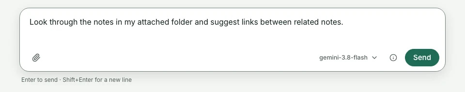
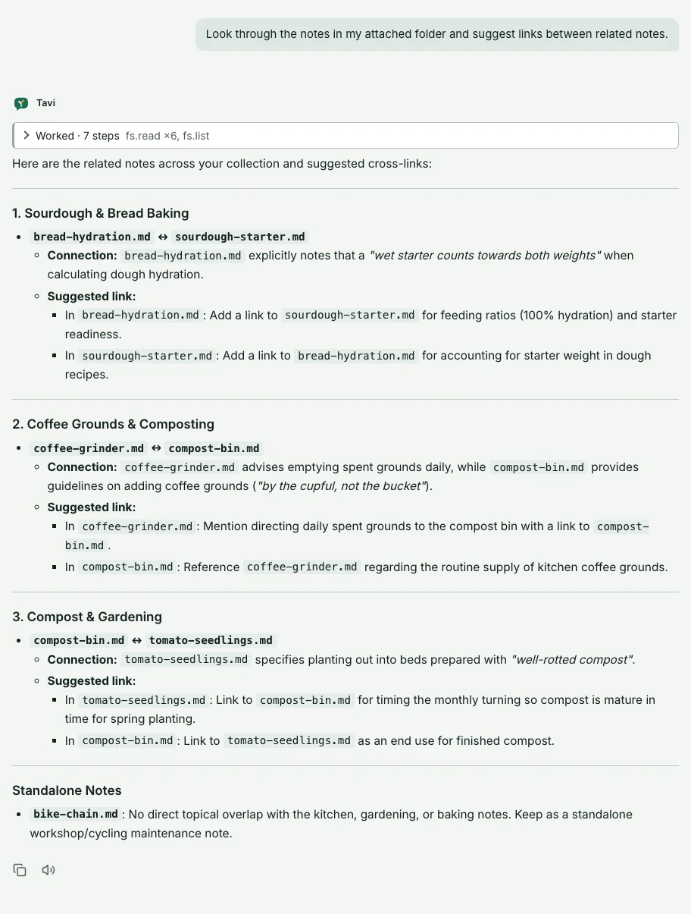

# Find the links between your notes

Point Tavi at a folder of notes, such as an Obsidian vault, and it suggests which ones belong together. You decide which links to add.

> **Uses:** Files · Sandbox
> **Asks first:** Nothing — it only reads and suggests
> **Runs:** When you ask
> **Idea card:** "Link my notes" (`productivity.note-links`)
> **Before you start:** a model connected ([Connect your first model](../../get-started/first-model.md)) · the canvas open ([Open the web canvas and walk through Welcome](../../get-started/web-canvas-tour.md)) · a folder of notes Tavi may read ([Give Tavi a working folder](../../files-and-code/attach-a-folder.md)) · the sandbox working, which a large folder may need ([Check the sandbox (and set it up on Linux)](../../run-and-maintain/sandbox-setup.md))

## 1. Ask for it

Start Tavi with your notes folder by its full path: `tavi serve --fs-root /Users/you/notes`. Each new chat then has it attached read-only, so Tavi can read your notes and can't change them. Choose **New chat** above the chats to open a chat of its own and send the prompt: `Look through the notes in my attached folder and suggest links between related notes.` Once Tavi knows this is something you do, **Ideas** may offer it as a card in its own words; **Try it** there starts the same chat.

## 2. Read the suggestions

Tavi lists the folder with `fs.list` and reads the notes with `fs.read`, as the line above its answer says. Each suggestion names the two notes, says what connects them, and says what to add to each.

<!-- cover -->

Tavi goes by what's written in the notes, so a shared word can look like a real connection: keep the links that help you. Your notes stay as they were, and you add the links you want yourself. It works from the folder as it is now, and doesn't keep the suggestions up to date as your notes change.

## Variations

- Have Tavi add them: start a chat that works in the folder itself, with `tavi run --folder /Users/you/notes "Add these links: ..."` and the links you chose. Every file write asks you first, with the change shown ([Give Tavi a working folder](../../files-and-code/attach-a-folder.md)).
- Narrow it down: `Only look at the notes in the garden folder.`
- Ask what's missing: `Which of these notes have nothing linking to them?`

## Related

- [Give Tavi a working folder](../../files-and-code/attach-a-folder.md)
- [Check the sandbox (and set it up on Linux)](../../run-and-maintain/sandbox-setup.md)
- [Rescue the bookmarks you never got back to](bookmarks.md)
