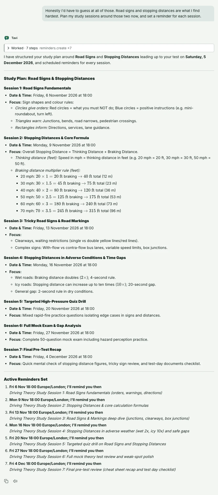
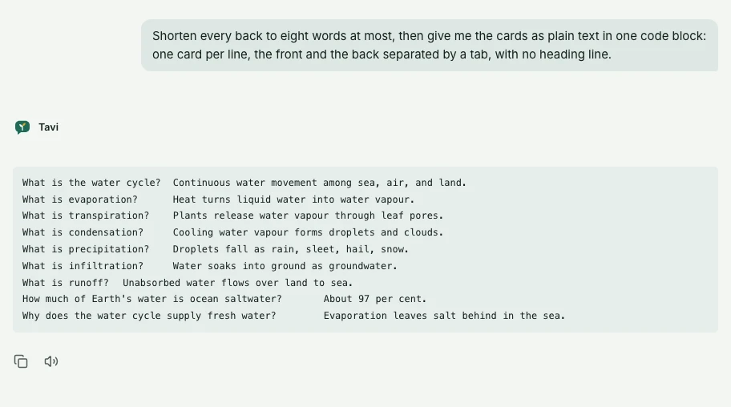
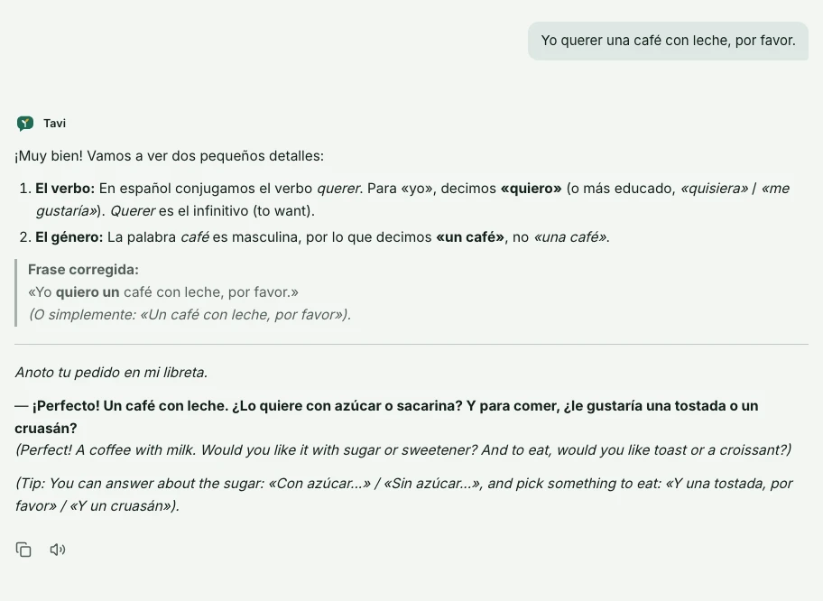
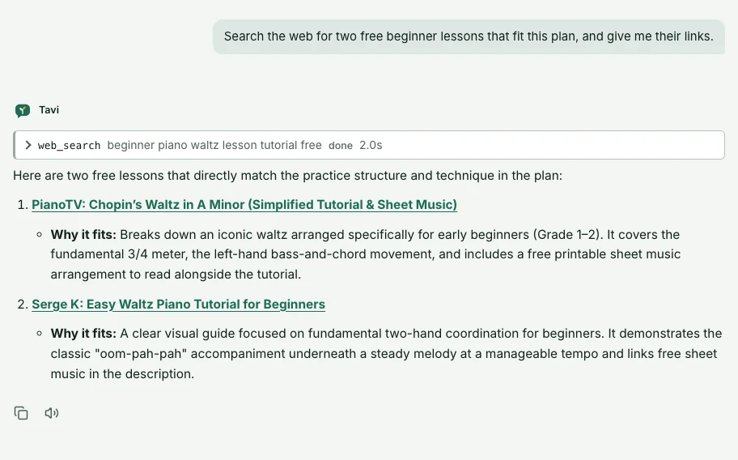
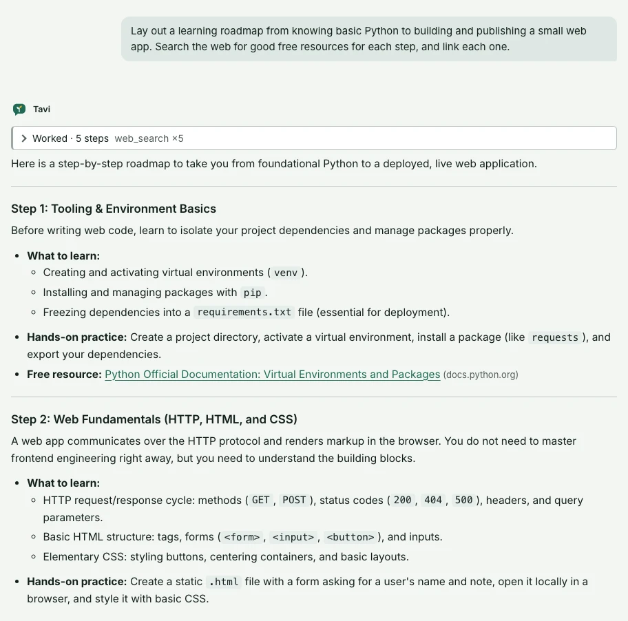
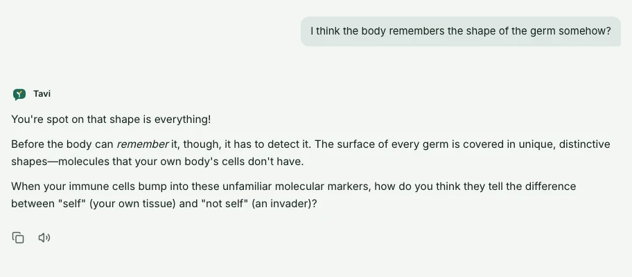

<!-- Generated by scripts/docs/guide-indexes.mjs from the guides: edit the guides, not this file. -->

# Learning

Tutoring, languages, flashcards, roadmaps and exams.

| | Guide |
| :--- | :--- |
|  | [Prepare for an exam](exam-prep.md) Tavi quizzes you to find your weak areas, plans study sessions around them, and reminds you when each one is due. |
|  | [Turn a chapter into flashcards](flashcards.md) Give Tavi a PDF of a chapter or article, and it writes flashcards on the key ideas, ready to bring into Anki. |
|  | [Practise a language in a role-play](language.md) Tavi plays the other person in an everyday scene, in the language you're learning, and corrects your mistakes as you go. |
|  | [Plan your weekly practice](mix-practice.md) Tell Tavi your instrument, your level and what you're aiming for, and it builds a week of practice around that. |
|  | [Plan a learning path](tech-roadmap.md) Say where you are and where you want to get to, and Tavi lays out the steps between them, with free resources for each. |
|  | [Have Tavi tutor you, one question at a time](tutor.md) Tavi teaches the way a good tutor does: it asks you questions and guides you to the answer, rather than handing it over. |

[All everyday recipes](../README.md)
