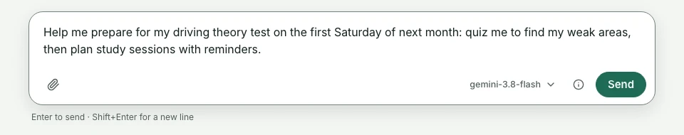
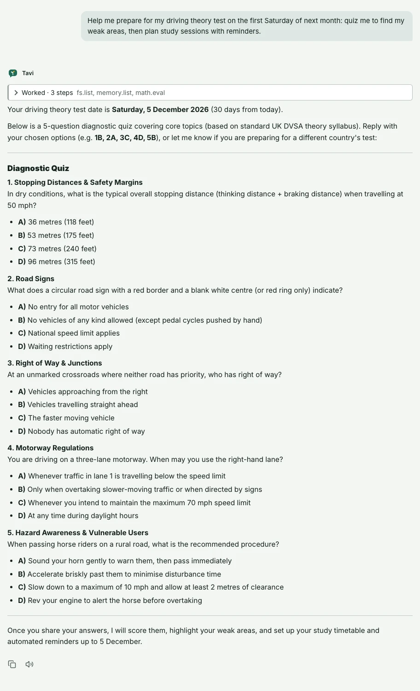
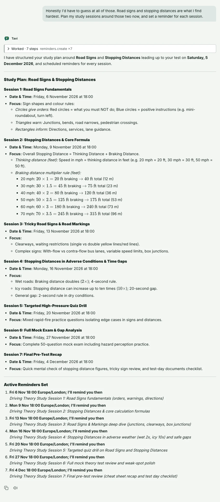
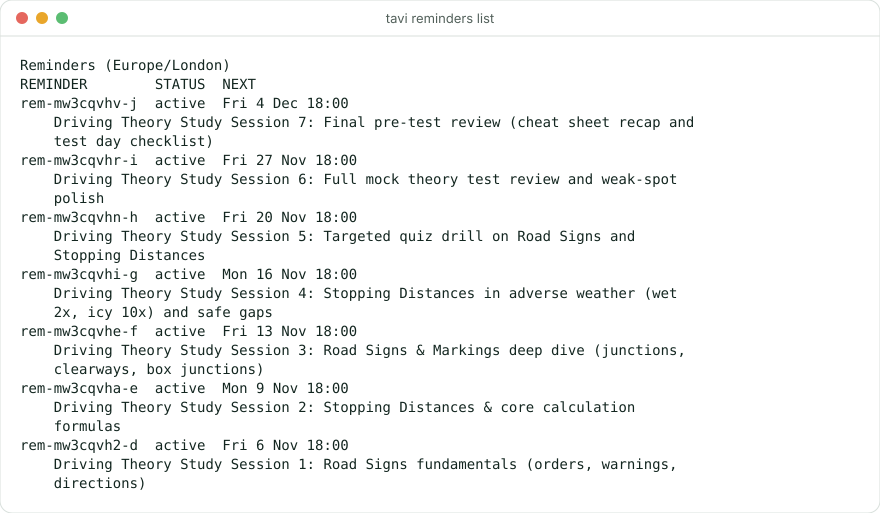

# Prepare for an exam

Tavi quizzes you to find your weak areas, plans study sessions around them, and reminds you when each one is due.

> **Uses:** Memory · Reminders
> **Asks first:** Nothing — it only reads and suggests
> **Runs:** When you ask
> **Idea card:** "Prep for an exam" (`learning.exam-prep`)
> **Before you start:** a model connected ([Connect your first model](../../get-started/first-model.md)) · Tavi running in the background, so reminders fire ([Keep Tavi running in the background](../../get-started/keep-tavi-running.md)) · the canvas open ([Open the web canvas and walk through Welcome](../../get-started/web-canvas-tour.md))

## 1. Ask for it

Choose **New chat** above the chats to open a chat of its own and send the prompt with your exam and its date in it: `Help me prepare for my driving theory test on the first Saturday of next month: quiz me to find my weak areas, then plan study sessions with reminders.` Once Tavi knows this is something you do, **Ideas** may offer it as a card in its own words; **Try it** there starts the same chat.

## 2. Take the quiz

Tavi starts with questions. Answer them, and don't look anything up: a wrong answer is what shows it where to spend your time.

## 3. Get your study plan

Reply with your answers, and say what you find hardest. Tavi plans sessions around your weak areas. If it doesn't set reminders by itself, ask: `Set a reminder for each session.`

<!-- cover -->

## 4. Check the reminders

Run `tavi reminders list` to see them, or open **Center → Schedule**. To move one, tell Tavi in the chat; delete one from its page in **Center → Schedule** ([Set a reminder (once, on an event, or repeating)](../../automation/set-a-reminder.md)).

<picture>
  <source media="(prefers-color-scheme: dark)" srcset="../../../assets/use-cases/everyday/learning/exam-prep/04-check-the-reminders-dark.svg">
  
</picture>

## Variations

- `Help me prepare for my AWS Cloud Practitioner exam on 20 March: quiz me to find my weak areas, then plan study sessions with reminders.`
- Tell Tavi `Remember that I keep mixing up stopping distances`, and later chats can pick up from there ([Teach Tavi a fact, and make it forget one](../../memory-and-skills/remember-and-forget.md)).

Tavi's questions come from the model, not from your exam board: check them against your official material, which is what the exam follows.

## Related

- [Have Tavi tutor you, one question at a time](tutor.md)
- [Set a reminder (once, on an event, or repeating)](../../automation/set-a-reminder.md)
