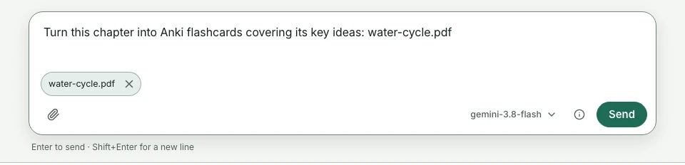
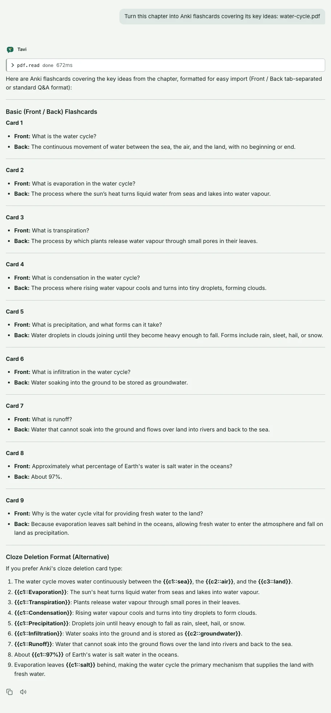
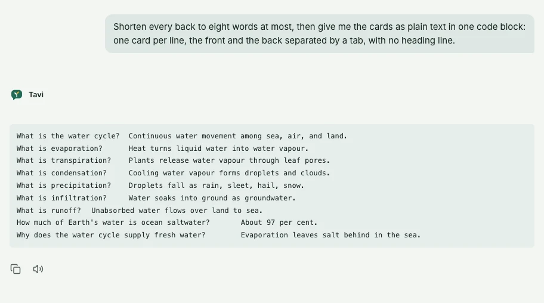

# Turn a chapter into flashcards

Give Tavi a PDF of a chapter or article, and it writes flashcards on the key ideas, ready to bring into Anki.

> **Uses:** PDFs
> **Asks first:** Nothing — it only reads and suggests
> **Runs:** When you ask
> **Idea card:** "Make flashcards" (`learning.flashcards`)
> **Before you start:** a model connected ([Connect your first model](../../get-started/first-model.md)) · the canvas open ([Open the web canvas and walk through Welcome](../../get-started/web-canvas-tour.md)) · a PDF of what you're studying ([Summarise a PDF and pull out tables](../../documents/read-a-pdf.md))

## 1. Attach the chapter

Choose **New chat** above the chats to open a chat of its own, attach the PDF with the paperclip, and send the prompt: `Turn this chapter into Anki flashcards covering its key ideas: water-cycle.pdf` Once Tavi knows this is something you do, **Ideas** may offer it as a card in its own words; **Try it** there starts the same chat.

## 2. Read the cards

Tavi reads the PDF with `pdf.read` and writes a card for each key idea, with a question on the front and the answer on the back. Read them through, and ask for fewer, simpler or harder ones until they're what you'd want to revise from.

## 3. Get them ready for Anki

Tavi doesn't add cards to Anki itself, so ask for them short and in the plain form Anki imports: `Shorten every back to eight words at most, then give me the cards as plain text in one code block: one card per line, the front and the back separated by a tab, with no heading line.` Copy the block into a text file, and open it with **File → Import** in Anki.

<!-- cover -->

## Variations

- `Turn this article into Anki flashcards covering its key ideas:` and a link to a page Tavi can reach. Reading it can stop on a browser card: check the address and choose **Allow once** ([Research a question with cited sources](../../web-and-browser/research-with-sources.md)).
- `Make cloze-deletion cards instead.`
- A scanned chapter is read with OCR first ([Read a scanned document (local OCR)](../../documents/read-a-scan.md)).

## Related

- [Summarise a PDF and pull out tables](../../documents/read-a-pdf.md)
- [Send a file or image with your message](../../chat/attach-files-to-chat.md)
- [Have Tavi tutor you, one question at a time](tutor.md)
