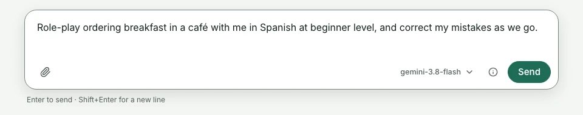
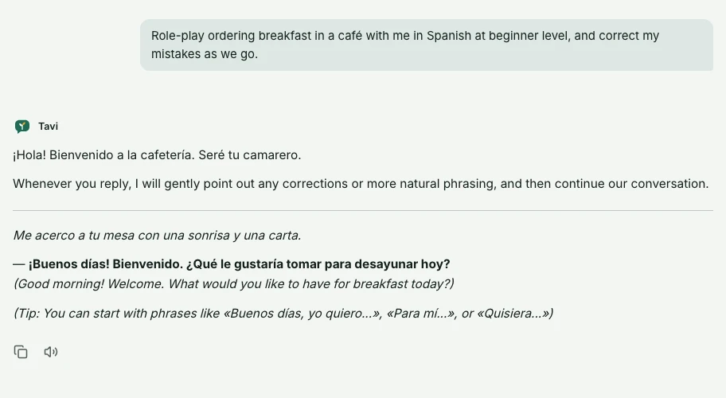
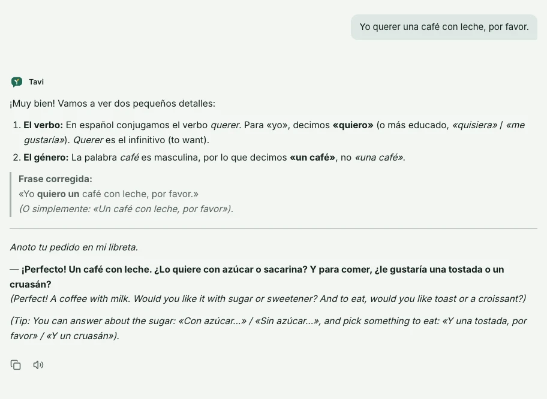

# Practise a language in a role-play

Tavi plays the other person in an everyday scene, in the language you're learning, and corrects your mistakes as you go.

> **Uses:** Memory
> **Asks first:** Nothing — it only reads and suggests
> **Runs:** When you ask
> **Idea card:** "Practise a language" (`learning.language`)
> **Before you start:** a model connected ([Connect your first model](../../get-started/first-model.md)) · the canvas open ([Open the web canvas and walk through Welcome](../../get-started/web-canvas-tour.md))

## 1. Ask for it

Choose **New chat** above the chats to open a chat of its own and send the prompt with your scene, language and level in it: `Role-play ordering breakfast in a café with me in Spanish at beginner level, and correct my mistakes as we go.` Once Tavi knows this is something you do, **Ideas** may offer it as a card in its own words; **Try it** there starts the same chat.

## 2. Play your part

Tavi sets the scene and speaks first, in character. Reply as you would in the café, in the language you're learning.

## 3. Get corrected as you go

Don't polish your replies: mistakes are the point. Tavi shows you what to say instead, then carries on with the scene.

<!-- cover -->

## Variations

- `Role-play a job interview with me in German at B1 level, and correct my mistakes as we go.`
- Tell Tavi `Remember that I'm learning Spanish at beginner level`, and later chats can start from there ([Teach Tavi a fact, and make it forget one](../../memory-and-skills/remember-and-forget.md)).

This is text practice: Tavi can't hear your accent here, and a model can miss a mistake or two, so treat a correction you doubt as a question for a teacher or a dictionary.

## Related

- [Have Tavi tutor you, one question at a time](tutor.md)
- [Keep one conversation, branch side chats](../../chat/home-and-side-chats.md)
- [Pin an idea, make it recurring, or try it](../../automation/ideas-tab.md)
