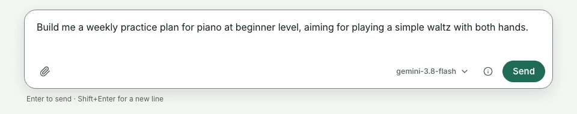
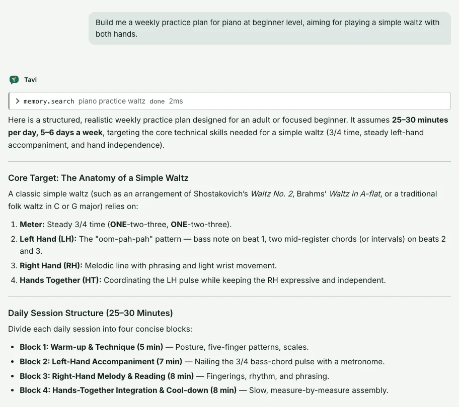
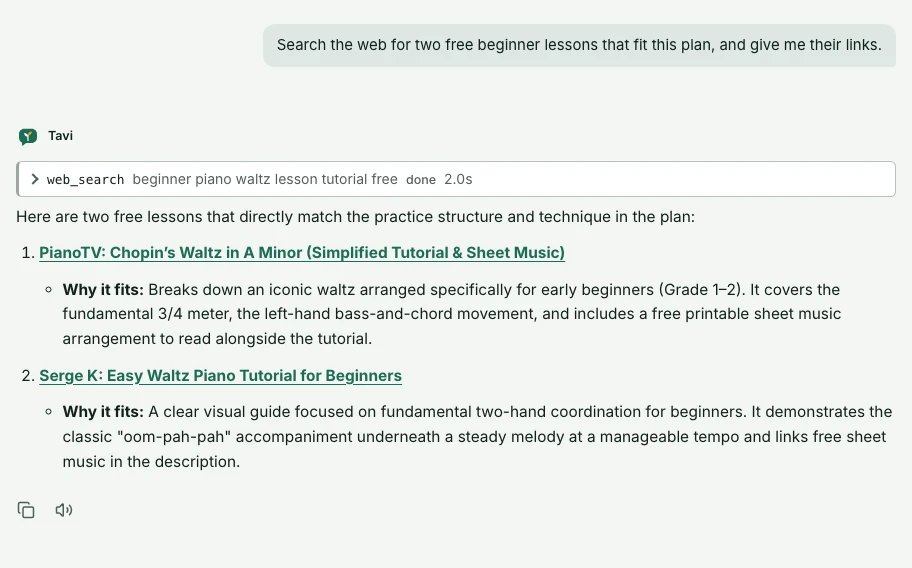

# Plan your weekly practice

Tell Tavi your instrument, your level and what you're aiming for, and it builds a week of practice around that.

> **Uses:** Web
> **Asks first:** Nothing — it only reads and suggests
> **Runs:** When you ask
> **Idea card:** "Plan my practice" (`learning.mix-practice`)
> **Before you start:** a model connected ([Connect your first model](../../get-started/first-model.md)) · web search on ([Set up web search](../../web-and-browser/set-up-web-search.md)) · the canvas open ([Open the web canvas and walk through Welcome](../../get-started/web-canvas-tour.md))

## 1. Ask for it

Choose **New chat** above the chats to open a chat of its own and send the prompt with your details in it: `Build me a weekly practice plan for piano at beginner level, aiming for playing a simple waltz with both hands.` Once Tavi knows this is something you do, **Ideas** may offer it as a card in its own words; **Try it** there starts the same chat.

## 2. Read the plan

Tavi sets out a plan you can repeat through the week. Tell it what doesn't fit, such as `I only have twenty minutes a day`, and it reworks the plan. It can't hear you play, so it can't tell you how a piece sounds: that part is yours, or a teacher's.

## 3. Find free lessons to go with it

Ask for lessons that fit the plan: `Search the web for two free beginner lessons that fit this plan, and give me their links.` Tavi searches and answers with links. Once a chat has read the web, a further search can stop on a card: check the words it would search for, and choose **Allow once**. Try each lesson yourself before you build on it.

<!-- cover -->

## Variations

- `Build me a weekly practice plan for mixing and mastering at intermediate level, aiming for finishing one track a month.`
- `Build me a weekly practice plan for guitar at beginner level, aiming for changing chords in time.`
- To be reminded when to practise, say so: `Remind me to practise every evening at 7.` In this chat, which has read the web, that stops on a card first ([Set a reminder (once, on an event, or repeating)](../../automation/set-a-reminder.md)).

## Related

- [Have Tavi tutor you, one question at a time](tutor.md)
- [Research a question with cited sources](../../web-and-browser/research-with-sources.md)
- [Set up web search](../../web-and-browser/set-up-web-search.md)
