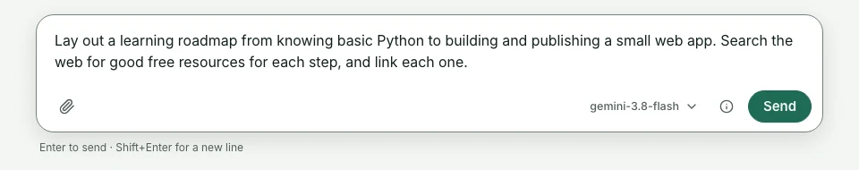
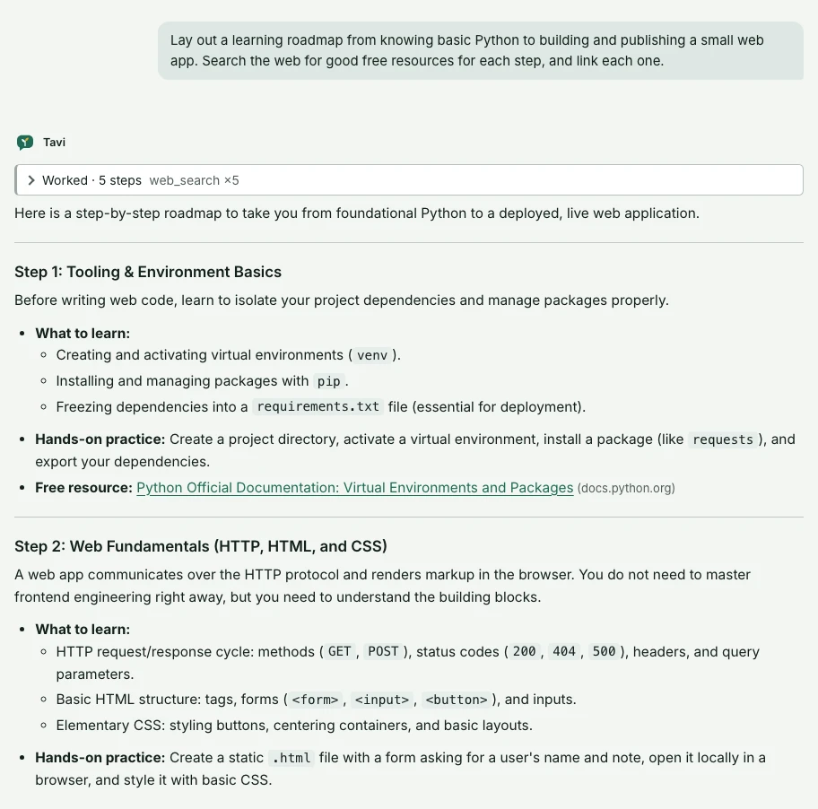

# Plan a learning path

Say where you are and where you want to get to, and Tavi lays out the steps between them, with free resources for each.

> **Uses:** Web
> **Asks first:** Nothing — it only reads and suggests
> **Runs:** When you ask
> **Idea card:** "Plan my learning path" (`learning.tech-roadmap`)
> **Before you start:** a model connected ([Connect your first model](../../get-started/first-model.md)) · web search on ([Set up web search](../../web-and-browser/set-up-web-search.md)) · the canvas open ([Open the web canvas and walk through Welcome](../../get-started/web-canvas-tour.md))

## 1. Ask for it

Choose **New chat** above the chats to open a chat of its own and send the prompt with your start and your goal in it: `Lay out a learning roadmap from knowing basic Python to building and publishing a small web app. Search the web for good free resources for each step, and link each one.` Once Tavi knows this is something you do, **Ideas** may offer it as a card in its own words; **Try it** there starts the same chat.

## 2. Read the result

Tavi searches, then answers with the steps in order, each with resources and their links. A search shows a page exists, not that it is still free, so follow each link yourself before you plan around it.

<!-- cover -->

## Variations

- `Lay out a learning roadmap from spreadsheet user to writing SQL at work. Search the web for good free resources for each step, and link each one.`
- Add how long you have: `I have five hours a week.`
- Work through a step with [Have Tavi tutor you, one question at a time](tutor.md).

## Related

- [Research a question with cited sources](../../web-and-browser/research-with-sources.md)
- [Set up web search](../../web-and-browser/set-up-web-search.md)
- [Pin an idea, make it recurring, or try it](../../automation/ideas-tab.md)
