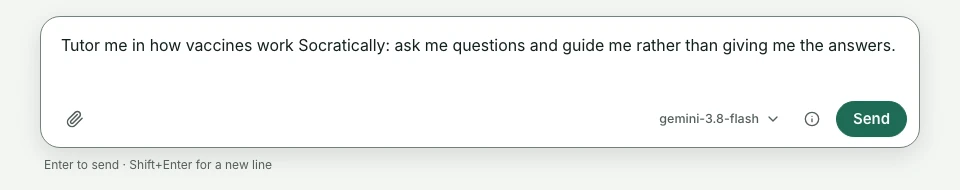
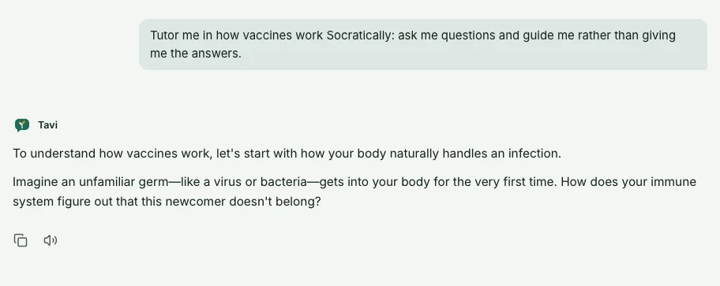
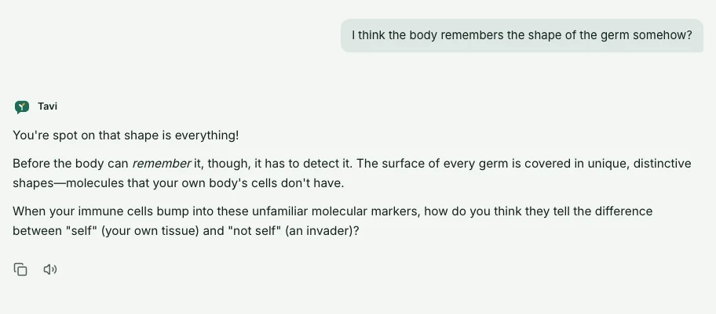

# Have Tavi tutor you, one question at a time

Tavi teaches the way a good tutor does: it asks you questions and guides you to the answer, rather than handing it over.

> **Uses:** Memory
> **Asks first:** Nothing — it only reads and suggests
> **Runs:** When you ask
> **Idea card:** "Tutor me" (`learning.tutor`)
> **Before you start:** a model connected ([Connect your first model](../../get-started/first-model.md)) · the canvas open ([Open the web canvas and walk through Welcome](../../get-started/web-canvas-tour.md))

## 1. Ask for it

Choose **New chat** above the chats to open a chat of its own and send the prompt with your topic in it: `Tutor me in how vaccines work Socratically: ask me questions and guide me rather than giving me the answers.` Once Tavi knows this is something you do, **Ideas** may offer it as a card in its own words; **Try it** there starts the same chat.

## 2. Answer its question

Tavi doesn't start with a lecture. It finds out what you already know with a question of its own.

## 3. Work it out together

Answer in your own words, even if you're unsure. Tavi picks up what you got right and asks the next question from there.

<!-- cover -->

## Variations

- `Tutor me in long division Socratically, for a ten-year-old.`
- Tell Tavi `Remember that I'm learning Spanish verbs`, and later tutoring chats start from there ([Teach Tavi a fact, and make it forget one](../../memory-and-skills/remember-and-forget.md)).

## Related

- [Keep one conversation, branch side chats](../../chat/home-and-side-chats.md)
- [Pin an idea, make it recurring, or try it](../../automation/ideas-tab.md)
