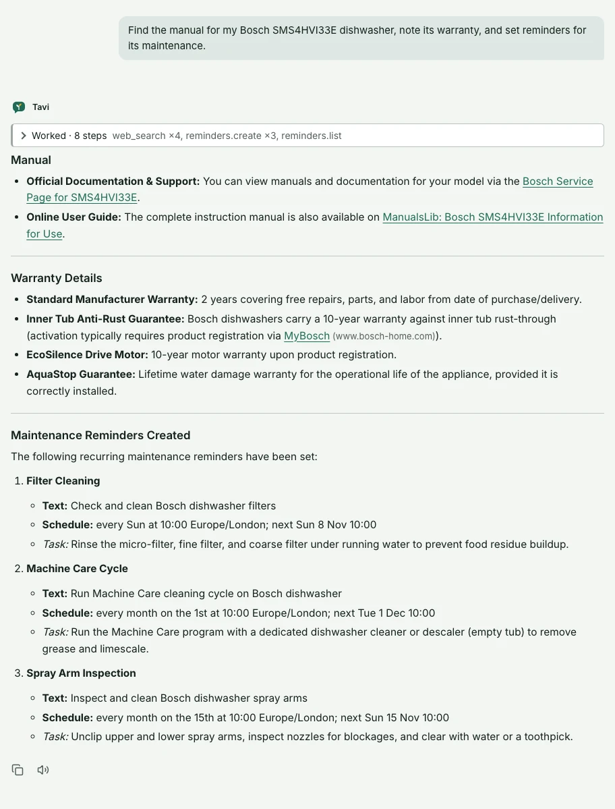
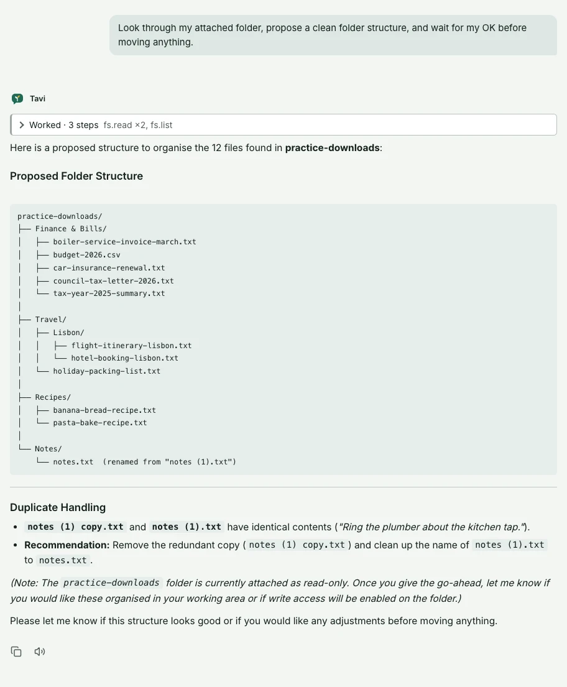
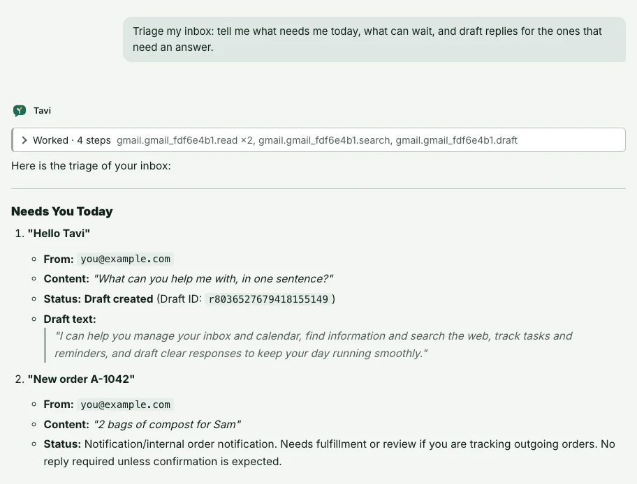
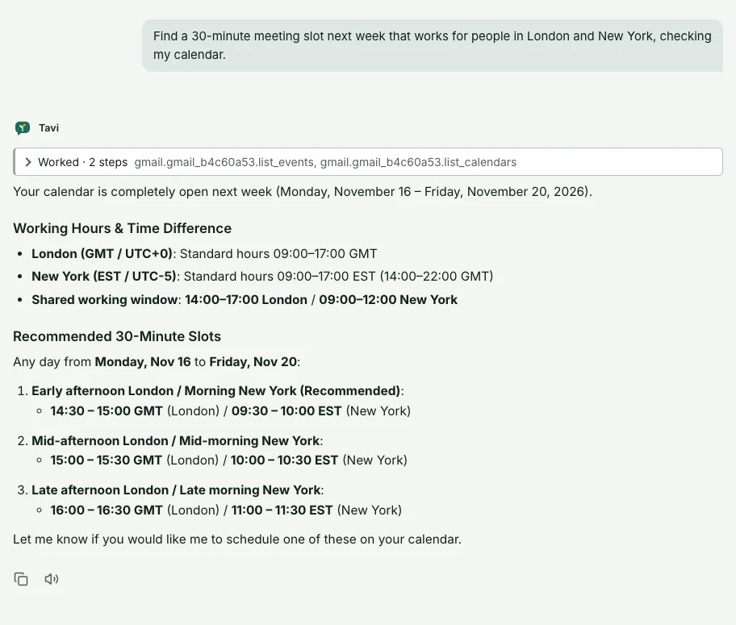
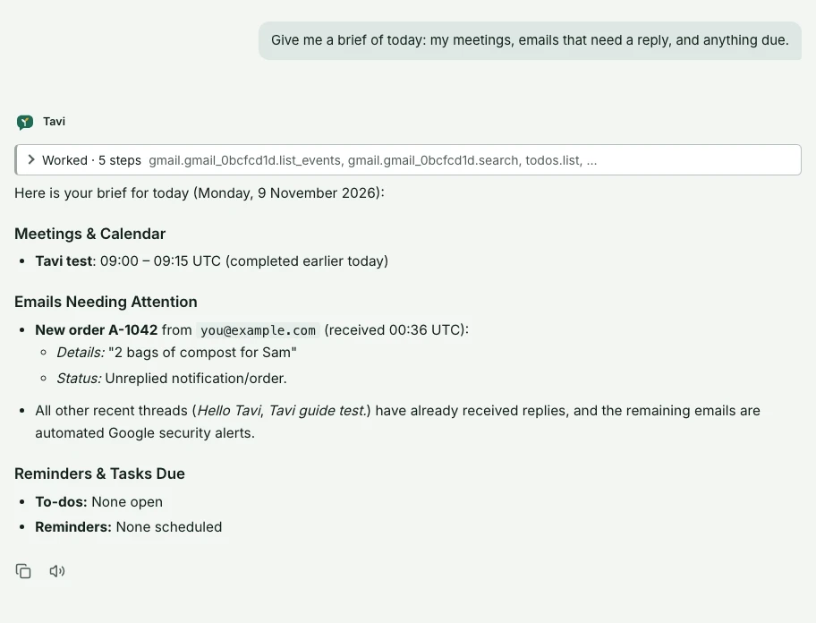
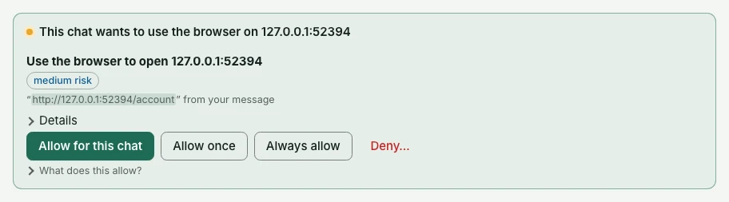

<!-- Generated by scripts/docs/guide-indexes.mjs from the guides: edit the guides, not this file. -->

# Life admin

Morning briefs, meetings, inboxes, folders and subscriptions.

| | Guide |
| :--- | :--- |
|  | [Keep your appliance manuals and service dates](appliance-records.md) Give Tavi a model number. |
|  | [Tidy a messy folder](downloads-cleanup.md) Give Tavi a cluttered folder. |
|  | [Triage your inbox and draft the replies](inbox-triage.md) Tavi sorts your inbox into what needs you today and what can wait, and drafts replies for the messages that need an answer. |
|  | [Find a meeting time across time zones](meeting-slots.md) Tell Tavi how long the meeting is and where people are. |
|  | [Get a short brief of your day](morning-brief.md) Ask Tavi for your day in one read: today's meetings from your calendar, the emails that need a reply, and anything due on your to-do list or reminders. |
|  | [Audit your subscriptions and stage the cancellations](subscriptions.md) Tell Tavi what you pay for and how much you use it. |

[All everyday recipes](../README.md)
