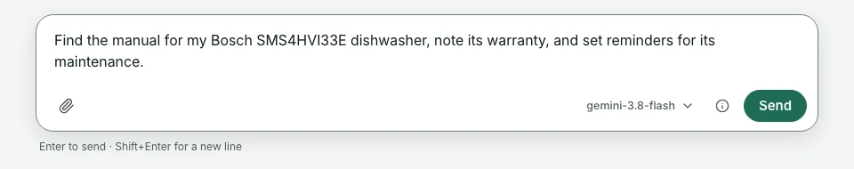
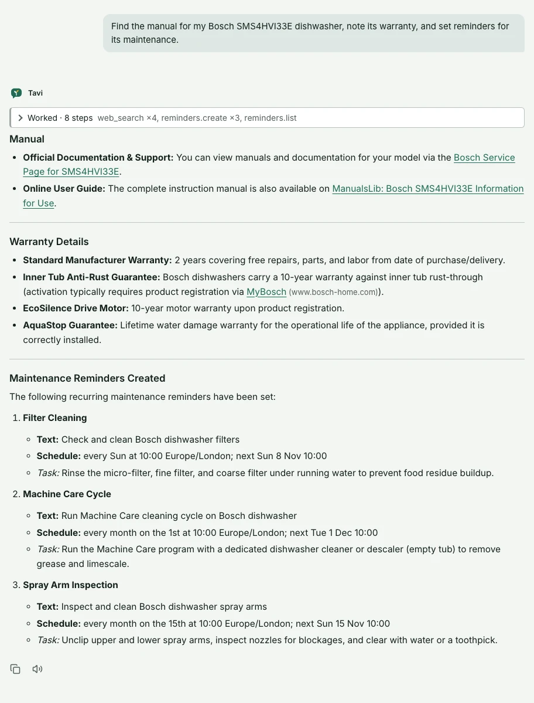
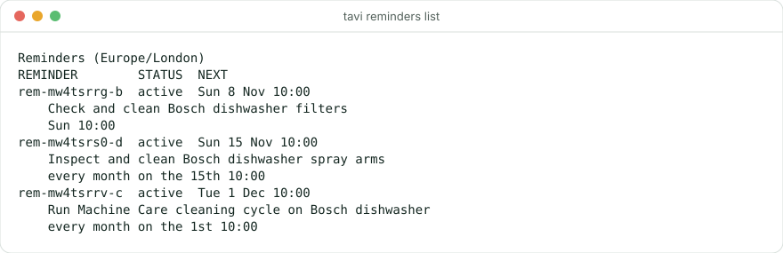

# Keep your appliance manuals and service dates

Give Tavi a model number. It finds the manual on the web, notes the warranty, and sets reminders for the upkeep.

> **Uses:** Web · Reminders
> **Asks first:** Nothing — it only reads and suggests
> **Runs:** When you ask
> **Idea card:** "Track appliance upkeep" (`health-home.appliance-records`)
> **Before you start:** a model connected ([Connect your first model](../../get-started/first-model.md)) · the canvas open ([Open the web canvas and walk through Welcome](../../get-started/web-canvas-tour.md)) · web search set up ([Set up web search](../../web-and-browser/set-up-web-search.md)) · Tavi running in the background with `tavi serve` so reminders fire ([Keep Tavi running in the background](../../get-started/keep-tavi-running.md))

## 1. Ask for it

Choose **New chat** above the chats to open a chat of its own and send the prompt with your appliance in it: `Find the manual for my Bosch SMS4HVI33E dishwasher, note its warranty, and set reminders for its maintenance.` The model number is on the appliance's label, often inside the door. Once Tavi knows this is something you do, **Ideas** may offer it as a card in its own words; **Try it** there starts the same chat.

## 2. Read the result

Tavi searches the web, links the manual it found, says what the warranty covers, and sets the reminders. A reminder set after reading the web can stop on a card: check it and choose **Allow once**, or for several reminders together **Allow selected; deny unchecked**. Unticking a reminder refuses it.

<!-- cover -->

The warranty Tavi finds is the maker's usual one, not yours: it doesn't know when you bought the appliance, and your receipt says what you actually have. Tell it the date and it can work out when the warranty ends. Check the maintenance against the manual too, since a search can turn up the wrong model's page. Anything to do with gas or mains wiring is for a qualified engineer, and Tavi isn't one.

## 3. Check the reminders

Run `tavi reminders list`, or open **Center → Schedule**, to see each reminder and when it fires. To move or change one, tell Tavi in the chat.

<picture>
  <source media="(prefers-color-scheme: dark)" srcset="../../../assets/use-cases/everyday/life-admin/appliance-records/03-check-the-reminders-dark.svg">
  
</picture>

## Variations

- Give what you know: `Find the manual for my Worcester Greenstar 4000 boiler, bought in March 2024, note its warranty, and set reminders for its maintenance.`
- Ask a follow-up in the same chat: `The drain light is on. What does the manual say to do?`

## Related

- [Set a reminder (once, on an event, or repeating)](../../automation/set-a-reminder.md)
- [Research a question with cited sources](../../web-and-browser/research-with-sources.md)
- [Tidy a messy folder](downloads-cleanup.md)
