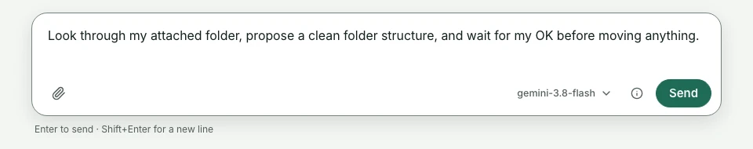
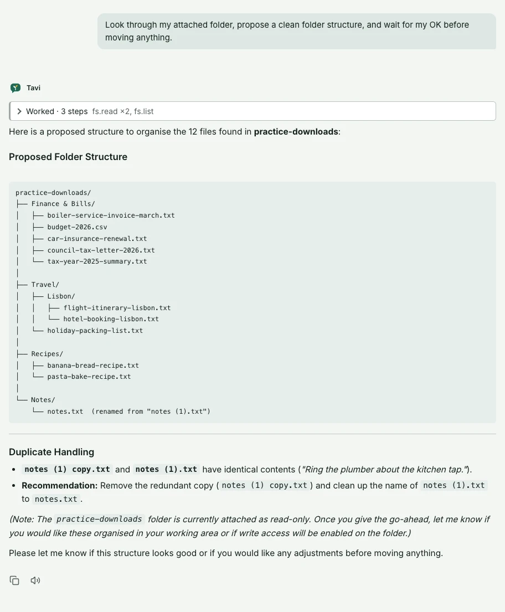
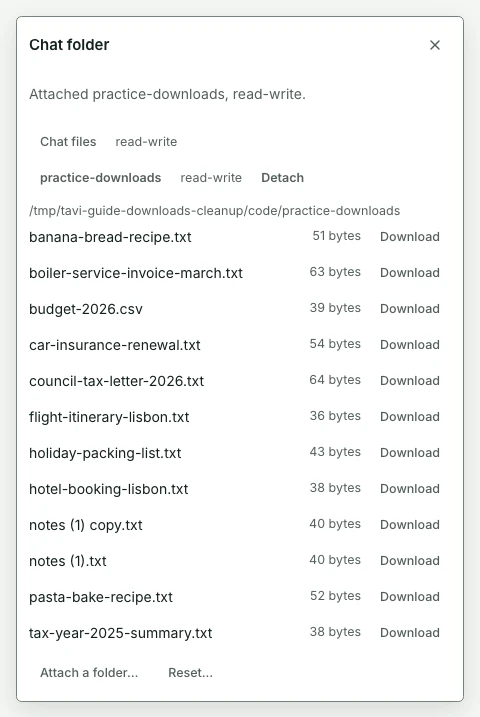
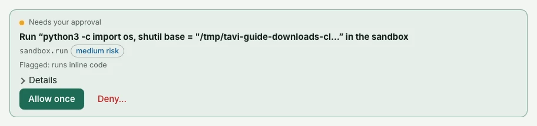
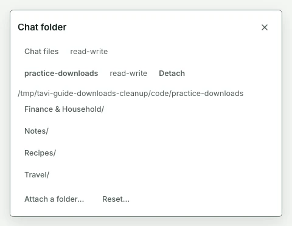

# Tidy a messy folder

Give Tavi a cluttered folder. It looks through the files, proposes a clear structure, and moves things only after you say so.

> **Uses:** Files
> **Asks first:** Files
> **Runs:** When you ask
> **Idea card:** "Tidy a folder" (`productivity.downloads-cleanup`)
> **Before you start:** a model connected ([Connect your first model](../../get-started/first-model.md)) · the canvas open ([Open the web canvas and walk through Welcome](../../get-started/web-canvas-tour.md)) · `tavi serve` started with the folder by its full path, here `tavi serve --fs-root /Users/you/practice-downloads` ([Give Tavi a working folder](../../files-and-code/attach-a-folder.md)) · the shell sandbox working, which moves the files ([Build and test a real project in the sandbox](../../files-and-code/build-a-real-project.md))

## 1. Ask for it

Try this on a copy first. The folder here, `practice-downloads`, holds a dozen made-up files. Your first `--fs-root` folder is attached read-only to each new chat, so Tavi can look but can't move anything yet.

Choose **New chat** above the chats to open a chat of its own and send the prompt: `Look through my attached folder, propose a clean folder structure, and wait for my OK before moving anything.` Once Tavi knows this is something you do, **Ideas** may offer it as a card in its own words; **Try it** there starts the same chat.

## 2. Read the plan

Tavi lists the folder with `fs.list`, opens a file with `fs.read` where a name doesn't say enough, and proposes where each file goes. Nothing has moved, and a read-only folder can't be changed. Here it suggests deleting the duplicate notes, which it won't do unless you say so. Change anything you like by saying so in the chat.

<!-- cover -->

## 3. Open the folder for writing

Happy with the plan? Choose the folder chip in the chat's header (**Chat files**) to open the **Chat folder** panel. Choose **Detach** beside your folder, then **Attach a folder…** and **Attach read-write** beside it. The change applies from the chat's next message.

## 4. Approve the moves

Send `OK, go ahead. Don't delete anything.` Tavi moves the files with `sandbox.run`, and each command stops on a card. Choose **Details** to read it, then **Allow once**. **Deny…** stops that command and leaves the files where they are.

## 5. Check the folder

Open the **Chat folder** panel again and choose your folder: the new folders are there, and you can open each one. Tavi moved every file here and deleted none, the two copies of the notes included. A command that deletes would stop on a card like any other, so read each one before you allow it.

When you're done, choose **Reset…** in the panel so the chat goes back to its own folder. To put a file back, ask Tavi or move it yourself. Tavi reads your files' names and any it opens, so leave out a folder holding what you wouldn't send to your model.

## Variations

- Say how you want it sorted: `Look through my attached folder, propose a folder for each year, and wait for my OK before moving anything.`
- Ask about repeats first: `Which files in my attached folder look like copies of each other? Don't change anything.`

## Related

- [Give Tavi a working folder](../../files-and-code/attach-a-folder.md)
- [Approve, reject or always-allow a tool call](../../chat/approve-tool-calls.md)
- [Keep your appliance manuals and service dates](appliance-records.md)
