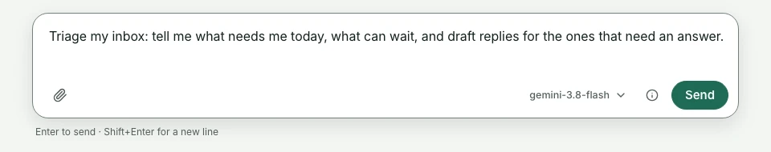
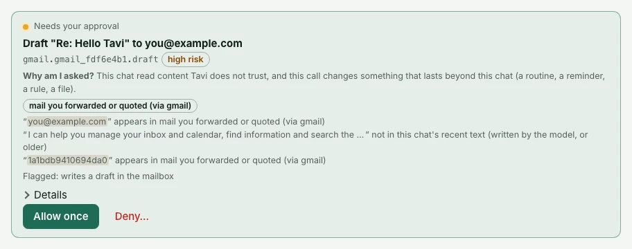
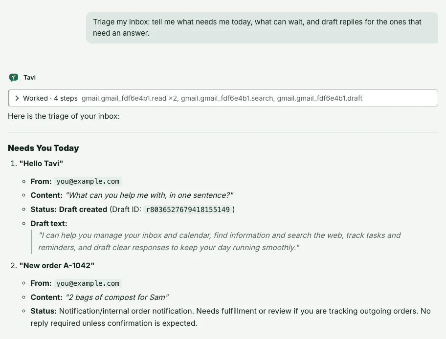

# Triage your inbox and draft the replies

Tavi sorts your inbox into what needs you today and what can wait, and drafts replies for the messages that need an answer. The drafts wait in Gmail for you to check; nothing is sent.

> **Uses:** Mail
> **Asks first:** Mail
> **Runs:** When you ask
> **Idea card:** "Triage my inbox" (`productivity.inbox-triage`)
> **Before you start:** a model connected ([Connect your first model](../../get-started/first-model.md)) · the canvas open ([Open the web canvas and walk through Welcome](../../get-started/web-canvas-tour.md)) · your Google account connected with its mailbox set to read and draft ([Let Tavi read (or send) your Gmail](../../connected-apps/connect-gmail-app.md))

## 1. Ask for it

Choose **New chat** above the chats to open a chat of its own and send the prompt: `Triage my inbox: tell me what needs me today, what can wait, and draft replies for the ones that need an answer.` Once Tavi knows this is something you do, **Ideas** may offer it as a card in its own words; **Try it** there starts the same chat.

## 2. Approve each draft

Tavi searches and reads your mail without asking. Each reply it drafts stops on a card first, showing the draft: choose **Allow once** for a draft you want, or **Deny** for one you would rather write yourself. When several drafts wait on one card, untick the ones you don't want and choose **Allow selected; deny unchecked**. With the mailbox set to read and draft, Tavi has no way to send; the drafts land in Gmail's **Drafts**.

## 3. Read the triage

Tavi lists what needs you today and what can wait, and which replies it drafted. Open Gmail's **Drafts** to check each one, change what you like and send it yourself. Its sense of what "needs you" is a judgement from what it read, so skim the rest before you archive anything.

<!-- cover -->

## Variations

- `Triage only the mail from the last two days, and skip newsletters.`
- To have Tavi send a draft you approve, turn on **Send drafts I approve** for the account; each send then asks, showing the draft whole ([Let Tavi read (or send) your Gmail](../../connected-apps/connect-gmail-app.md)).

## Related

- [Let Tavi read (or send) your Gmail](../../connected-apps/connect-gmail-app.md)
- [Get a short brief of your day](morning-brief.md)
- [Approve, reject or always-allow a tool call](../../chat/approve-tool-calls.md)
