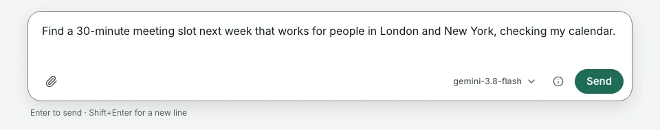
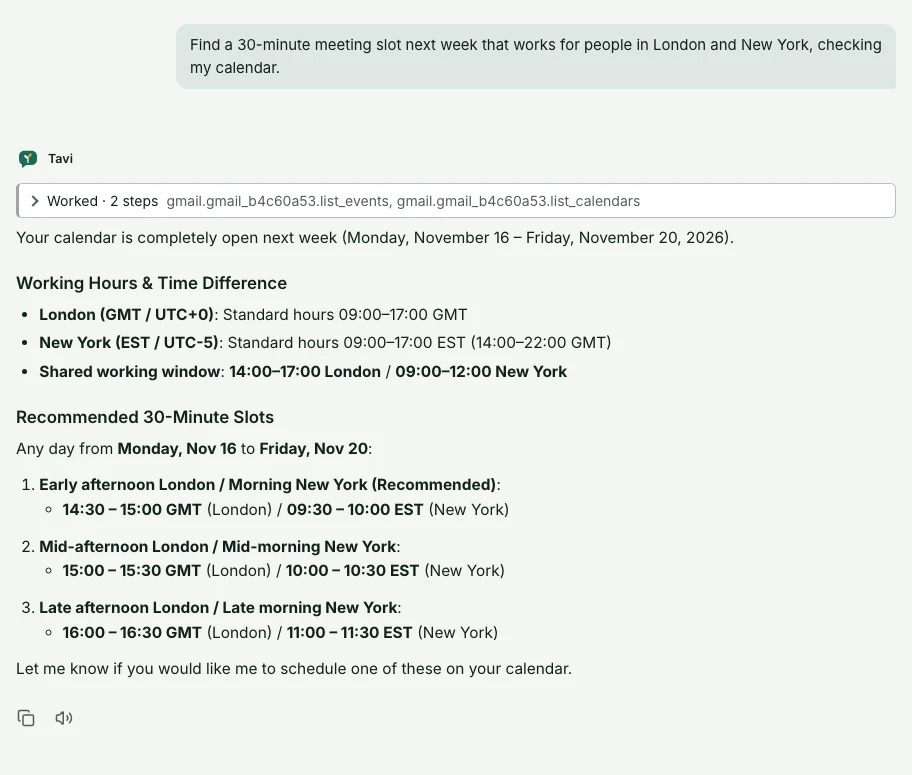

# Find a meeting time across time zones

Tell Tavi how long the meeting is and where people are. It checks your calendar and suggests slots inside everyone's working day, or says plainly when there are none.

> **Uses:** Calendar
> **Asks first:** Nothing — it only reads and suggests
> **Runs:** When you ask
> **Idea card:** "Find a meeting time" (`productivity.meeting-slots`)
> **Before you start:** a model connected ([Connect your first model](../../get-started/first-model.md)) · the canvas open ([Open the web canvas and walk through Welcome](../../get-started/web-canvas-tour.md)) · your Google account connected with its calendar on ([Connect Google Calendar](../../connected-apps/connect-google-calendar.md))

## 1. Ask for it

Choose **New chat** above the chats to open a chat of its own and send the prompt, with the meeting's length and the places in it: `Find a 30-minute meeting slot next week that works for people in London and New York, checking my calendar.` Once Tavi knows this is something you do, **Ideas** may offer it as a card in its own words; **Try it** there starts the same chat.

## 2. Pick a slot

Tavi reads next week's events and when you are busy, then lists slots that fall in working hours in both places, each in both local times. It sees only your calendar, not the other people's, so send the slot as a suggestion. It books nothing: ask it to add the one you pick, and that event waits for your approval ([Connect Google Calendar](../../connected-apps/connect-google-calendar.md)).

<!-- cover -->

## Variations

- `Find a 45-minute slot next week for people in Berlin, Singapore and San Francisco, checking my calendar.` With no hours that suit everyone, Tavi says so and offers the least bad times.
- `Add the Tuesday slot to my calendar as "Planning call".`

## Related

- [Connect Google Calendar](../../connected-apps/connect-google-calendar.md)
- [Get a short brief of your day](morning-brief.md)
