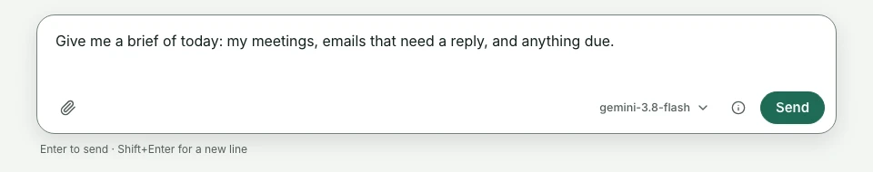
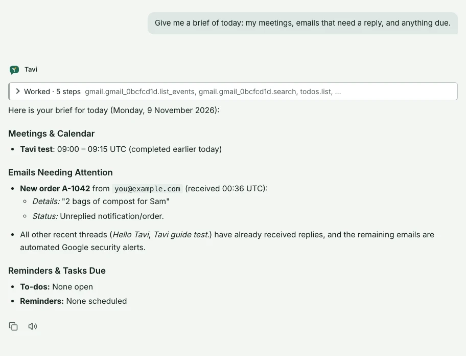

# Get a short brief of your day

Ask Tavi for your day in one read: today's meetings from your calendar, the emails that need a reply, and anything due on your to-do list or reminders.

> **Uses:** Calendar · Mail
> **Asks first:** Nothing — it only reads and suggests
> **Runs:** When you ask
> **Idea card:** "Brief me on my day" (`productivity.morning-brief`)
> **Before you start:** a model connected ([Connect your first model](../../get-started/first-model.md)) · the canvas open ([Open the web canvas and walk through Welcome](../../get-started/web-canvas-tour.md)) · your Google account connected with its calendar on ([Connect Google Calendar](../../connected-apps/connect-google-calendar.md)) and its mailbox readable ([Let Tavi read (or send) your Gmail](../../connected-apps/connect-gmail-app.md))

## 1. Ask for it

Choose **New chat** above the chats to open a chat of its own and send the prompt: `Give me a brief of today: my meetings, emails that need a reply, and anything due.` Once Tavi knows this is something you do, **Ideas** may offer it as a card in its own words; **Try it** there starts the same chat.

## 2. Read your brief

Tavi lists today's events from your calendar and searches your mailbox for what is waiting on you, then sums it up with anything due from your to-dos and reminders. It only reads: it drafts or sends nothing unless you ask, and a reply you ask for waits for your approval. Its sense of which emails "need a reply" is a guess from what it read, so glance at your inbox before you count on it.

<!-- cover -->

## Variations

- `Give me a brief of tomorrow, and flag anything that clashes.`
- Have it every weekday morning: once the brief is the one you want, **Repeat this…** turns the chat into a schedule ([Turn a chat that worked into a schedule](../../automation/repeat-this.md)).

## Related

- [Connect Google Calendar](../../connected-apps/connect-google-calendar.md)
- [Let Tavi read (or send) your Gmail](../../connected-apps/connect-gmail-app.md)
- [Keep a to-do list](../../automation/keep-a-todo-list.md)
