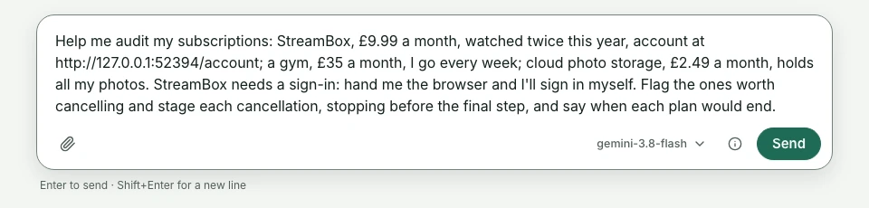
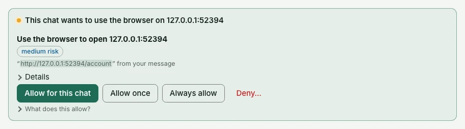
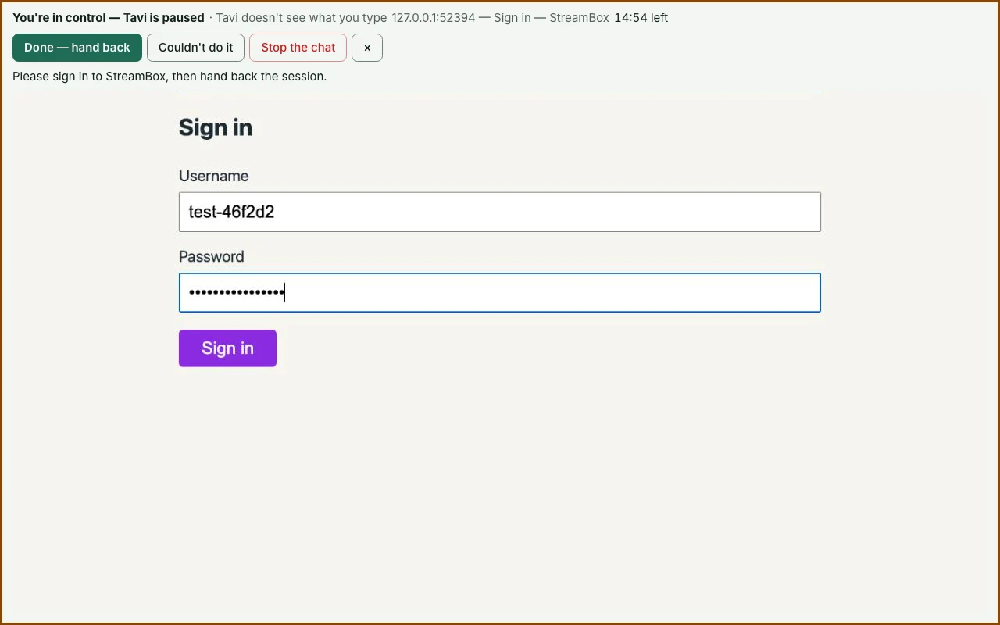
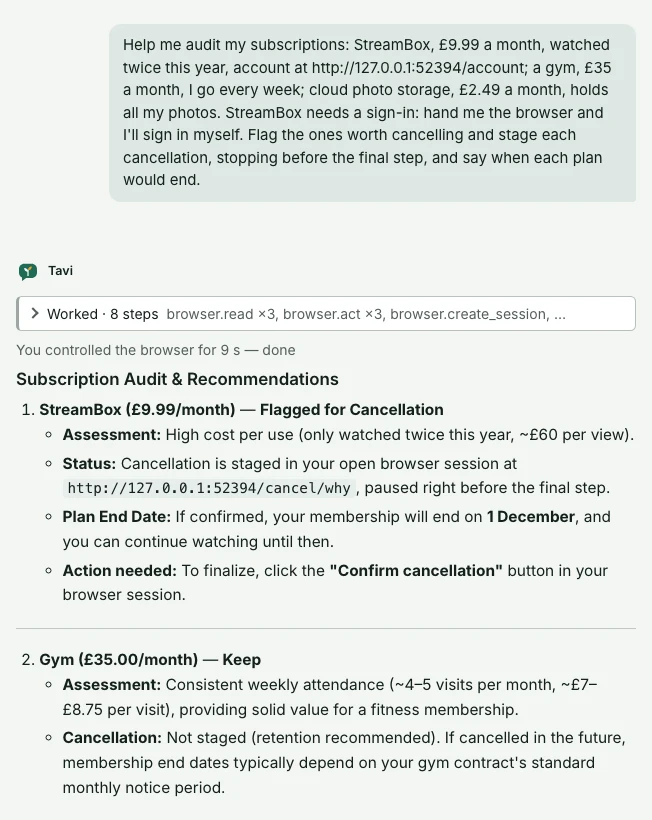

# Audit your subscriptions and stage the cancellations

Tell Tavi what you pay for and how much you use it. It flags the ones worth cancelling, then walks each cancellation in its browser, with you signing in, and stops before the final click so the last word is yours.

> **Uses:** Browser · Web
> **Asks first:** Browser
> **Runs:** When you ask
> **Idea card:** "Audit subscriptions" (`productivity.subscriptions`)
> **Before you start:** a model connected ([Connect your first model](../../get-started/first-model.md)) · the canvas open on this computer ([Open the web canvas and walk through Welcome](../../get-started/web-canvas-tour.md)) · the agent's browser working ([Let Tavi drive a browser while you watch, signed in or signed out](../../web-and-browser/browse-with-tavi.md)) · your sign-in for each service you might cancel

## 1. Ask for it

Choose **New chat** above the chats to open a chat of its own and send the prompt with your subscriptions in it, what each costs, how much you use it, and each account page's address. Say you will sign in yourself, such as: `Help me audit my subscriptions: StreamBox, £9.99 a month, watched twice this year, account at https://streambox.example.com/account; a gym, £35 a month, I go every week; cloud photo storage, £2.49 a month, holds all my photos. StreamBox needs a sign-in: hand me the browser and I'll sign in myself. Flag the ones worth cancelling and stage each cancellation, stopping before the final step, and say when each plan would end.` Once Tavi knows this is something you do, **Ideas** may offer it as a card in its own words; **Try it** there starts the same chat.

## 2. Allow the browser

Tavi flags what you barely use and asks before it opens that service's site in its browser: choose **Allow for this chat**, so the pages that follow ask no more.

<!-- cover -->

## 3. Sign in yourself

At the sign-in page Tavi stops and asks for you: choose **Take control**, sign in in the page, then **Done — hand back**. Tavi doesn't see what you type ([Take over for a login or a final checkout](../../web-and-browser/take-over-the-browser.md)).

## 4. Make the last click yourself

Tavi goes through the cancellation pages; if it stops at the account page instead, say `Go on and stage the StreamBox cancellation, stopping before the final step.` Each page's button asks you first, naming the button it would press: choose **Allow once** for each step you agree with. It stops on the last page, before **Confirm cancellation**; should it ever ask to press that, choose **Deny**. It then says what it flagged and why, what it staged, and when the plan would end. If you still want to cancel, take over and confirm it yourself; if not, close the page and nothing changes.

A press that cancels or pays is refused when its card didn't ask about it as one: Tavi looks at the page again and asks you about that press, and its step list counts each refused one as failed. Tavi goes by what you tell it about your use; it doesn't read your bank statements. It never confirms a cancellation, a refund or a payment: those clicks are yours.

## Variations

- `Which of my subscriptions renew this month? StreamBox on the 1st, the gym on the 15th, photo storage on the 28th.`
- Leave out the account pages, and Tavi only flags; ask for the cancellations afterwards.

## Related

- [Take over for a login or a final checkout](../../web-and-browser/take-over-the-browser.md)
- [Let Tavi drive a browser while you watch, signed in or signed out](../../web-and-browser/browse-with-tavi.md)
- [Get a short brief of your day](morning-brief.md)
