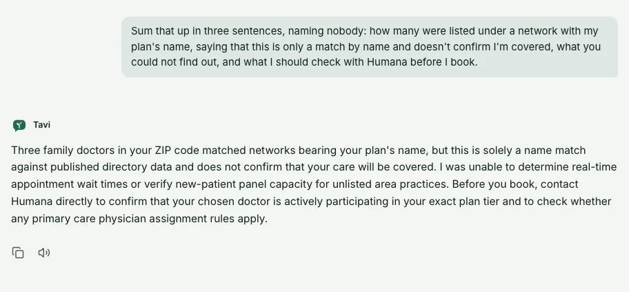
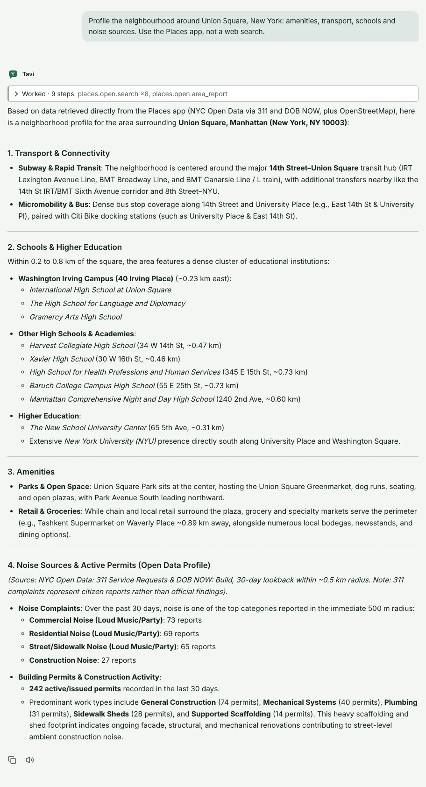
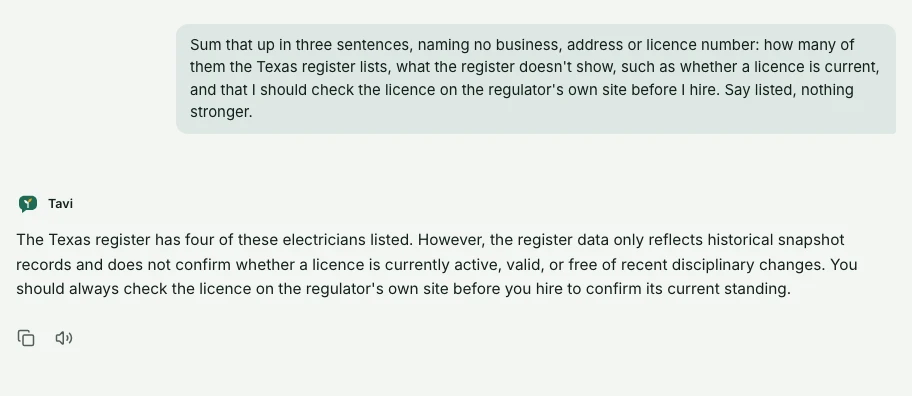

<!-- Generated by scripts/docs/guide-indexes.mjs from the guides: edit the guides, not this file. -->

# Local services

Licensed specialists, in-network doctors and neighbourhoods.

| | Guide |
| :--- | :--- |
|  | [Find care in your insurance network](in-network.md) Say what kind of provider you need, your plan and your ZIP code. |
|  | [Profile a neighbourhood before you move](neighbourhood.md) Give Tavi a place. |
|  | [Find a licensed specialist near you](specialist.md) Name the trade and your area. |

[All everyday recipes](../README.md)
