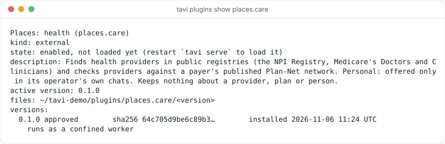
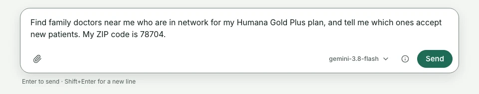
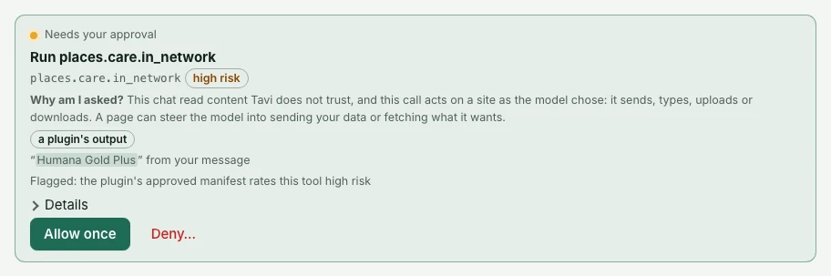
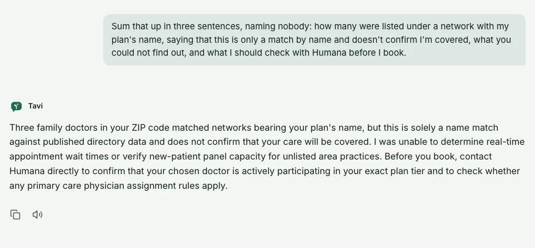

# Find care in your insurance network

Say what kind of provider you need, your plan and your ZIP code. Tavi lists nearby US providers from public registries and, for Humana, looks for your plan's name among the networks its directory gives for each one. It's a place to start, and your insurer has the final word.

> **Uses:** Care finder · Web
> **Asks first:** Nothing — it only reads and suggests
> **Runs:** When you ask
> **Idea card:** "Find in-network care" (`health-home.in-network`)
> **Before you start:** a model connected ([Connect your first model](../../get-started/first-model.md)) · the canvas open ([Open the web canvas and walk through Welcome](../../get-started/web-canvas-tour.md)) · Tavi running in the background with `tavi serve` ([Keep Tavi running in the background](../../get-started/keep-tavi-running.md)) · web search set up ([Set up web search](../../web-and-browser/set-up-web-search.md)) · the care app built from the repository with `pnpm --filter @tavi/plugin-places-care build` ([Install and enable a plugin](../../extend/install-a-plugin.md), [Places](../../../PLACES.md#placescare-health-providers))

## 1. Add the care app

Run `tavi plugins install packages/external/places-care/dist-plugin`, then `tavi plugins approve places.care 0.1.1` and `tavi plugins enable places.care`, and restart `tavi serve`: a plugin loads when Tavi starts. `tavi plugins show places.care` shows what you added. It keeps nothing about a provider, a plan or you, and needs no account.

<picture>
  <source media="(prefers-color-scheme: dark)" srcset="../../../assets/use-cases/everyday/local-services/in-network/01-add-the-care-app-dark.svg">
  
</picture>

## 2. Ask for it

Choose **New chat** above the chats to open a chat of its own and send the prompt with the provider and your plan's name as printed on the card, and say where you are: `Find family doctors near me who are in network for my Humana Gold Plus plan, and tell me which ones accept new patients. My ZIP code is 78704.` Never give your member ID: Tavi doesn't need it, and refuses anything shaped like one. Once Tavi knows this is something you do, **Ideas** may offer it as a card in its own words; **Try it** there starts the same chat.

## 3. Allow the network check

Tavi finds providers with `places.care.providers`, then asks before it calls `places.care.in_network`: the card shows the insurer, the plan and the providers' NPI numbers, which the picture leaves out. Tavi also gives the check your ZIP code's state, which isn't sent either, so another state's network isn't counted. Choose **Allow once**. Only those numbers go to Humana's public directory: your plan's name isn't sent to Humana. It's still in the chat, so it goes to your model, and with a hosted model it leaves your computer. Tavi may then search the web for each office, and those searches stop on a card too, one at a time or together: tick the ones you're happy with and choose **Allow once** or **Allow selected; deny unchecked**.

## 4. Read the result

Tavi lists each provider with what the directory says: listed, possible (a weaker match by name, which the answer should say), under other networks only, or not in the directory. Ask for the short version in the same chat: `Sum that up in three sentences, naming nobody: how many were listed under a network with my plan's name, saying that this is only a match by name and doesn't confirm I'm covered, what you could not find out, and what I should check with Humana before I book.` The picture shows that summary, since the list names real doctors.

<!-- cover -->

## What this is not

Tavi isn't a medical or insurance adviser, and your insurer decides what's covered. A directory listing is the insurer's publication, and it can be out of date. Before you book, call the insurer and the provider's office and ask whether they take your exact plan.

"Listed" means one thing: a network the directory gives for that provider has a name carrying your plan's own words. It means nothing more. Tavi leaves out a dental or vision network unless your plan says dental or vision, and a network whose name gives another state than the one your ZIP code is in. "Possible" is weaker still: a plan named only by its type, such as Medicare PPO, matches on those words alone, and many plans share them; so does a network naming a state when Tavi didn't know yours. The name check can also miss a plan written differently from the directory's name, so "not listed" proves nothing either. Don't rely on any of it. Read the network's name in the answer, and take only Humana's own directory or a call to Humana as confirmation.

What it can do depends on your insurer and where you are:

- **Humana:** the only insurer whose directory answers by provider. An employer's plan may not be in it.
- **Cigna, Aetna, Anthem, Kaiser and Blue Cross Blue Shield:** Tavi gives you the insurer's own directory to check yourself.
- **New patients:** no registry says who's accepting them. Only the office can tell you, however an answer reads.
- **Outside the US:** the registries don't cover you. With the [Places](../../../PLACES.md) app, Tavi can list doctors and dentists from OpenStreetMap, with no network check.

## Variations

- `Find a family doctor near me who is in network for my Humana Medicare PPO plan, and tell me which ones accept new patients. My ZIP code is 33101.`
- `Check the NPI record of Bright Smiles Dental in Texas.` This reads the public registry, and the state board's own search is the record.

## Related

- [Places](../../../PLACES.md)
- [Install and enable a plugin](../../extend/install-a-plugin.md)
- [Approve, reject or always-allow a tool call](../../chat/approve-tool-calls.md)
- [Find a licensed specialist near you](specialist.md)
