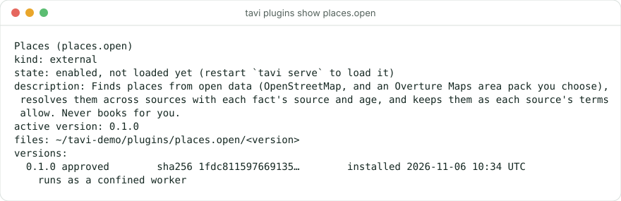
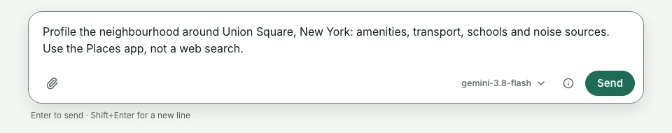
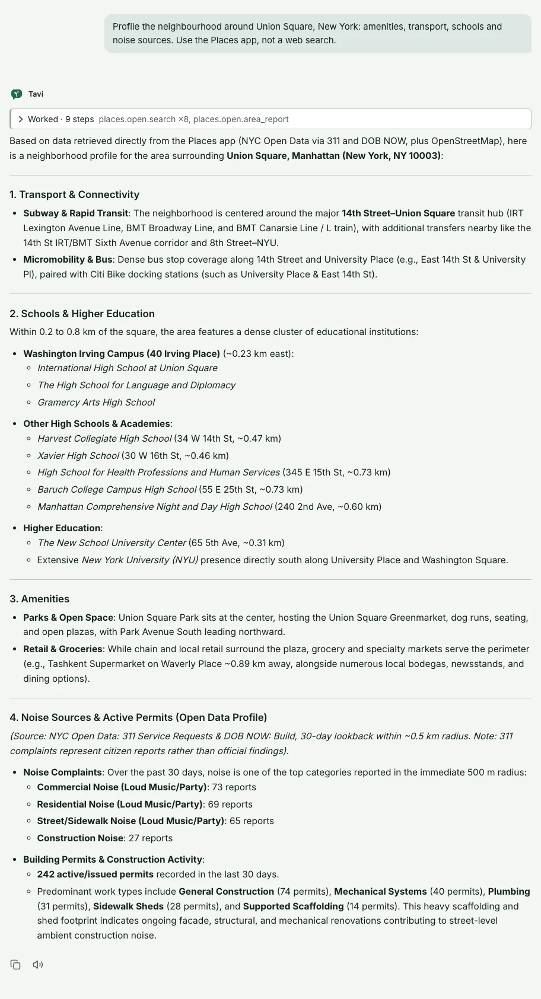

# Profile a neighbourhood before you move

Give Tavi a place. It reports what's nearby, how you'd get around, and what open data says about noise, from sources you can check.

> **Uses:** Places
> **Asks first:** Nothing — it only reads and suggests
> **Runs:** When you ask
> **Idea card:** "Profile a neighbourhood" (`health-home.neighbourhood`)
> **Before you start:** a model connected ([Connect your first model](../../get-started/first-model.md)) · the canvas open ([Open the web canvas and walk through Welcome](../../get-started/web-canvas-tour.md)) · Tavi running in the background with `tavi serve` ([Keep Tavi running in the background](../../get-started/keep-tavi-running.md)) · the Places app built from the repository with `pnpm --filter @tavi/plugin-places-open build` ([Install and enable a plugin](../../extend/install-a-plugin.md), [Places](../../../PLACES.md#install))

## 1. Add the Places app

Run `tavi plugins install packages/external/places-open/dist-plugin`, then `tavi plugins approve places.open 0.1.0` and `tavi plugins enable places.open`, and restart `tavi serve`: a plugin loads when Tavi starts. `tavi plugins show places.open` shows what you added. It runs as a confined worker and never books for you.

<picture>
  <source media="(prefers-color-scheme: dark)" srcset="../../../assets/use-cases/everyday/local-services/neighbourhood/01-add-the-places-app-dark.svg">
  
</picture>

## 2. Ask for it

Choose **New chat** above the chats to open a chat of its own and send the prompt with the place in it: `Profile the neighbourhood around Union Square, New York: amenities, transport, schools and noise sources. Use the Places app, not a web search.` Once Tavi knows this is something you do, **Ideas** may offer it as a card in its own words; **Try it** there starts the same chat.

## 3. Read the result

Tavi looks up what's nearby with `places.open.search` and asks open data about complaints and building permits with `places.open.area_report`.

<!-- cover -->

How much you get depends on the place:

- **Amenities, transport and schools:** from OpenStreetMap, anywhere, as complete as its mappers have made it. Its servers are busy at times: after one fails or times out five times in a row, Tavi pauses it for an hour (a day if it sends an answer Tavi can't read), and the answer should say which one is paused, until when, and that the list may be thin. Ask again after that time for a fuller one.
- **Complaints and permits:** New York City has both. A busy area can reach a source's limit of 1,000 rows, so read such a count as at least that many. The source counts permits by the day they were issued, so a permit in the count isn't necessarily active, whatever the answer calls it. San Francisco and Boston have a sample of recent complaints.
- **Crime:** England, Wales and Northern Ireland have the police's latest month, with its locations moved to anonymised points.
- **Elsewhere:** no such data, and Tavi says so.

Complaints are what people reported, not findings. A list of places isn't a judgement on the area either, so walk around at the times you'd live there.

## Variations

- Ask a follow-up in the same chat: `How does it look for permits in the last 90 days?`
- `Profile the neighbourhood around Clifton, Bristol: amenities, transport, schools and noise sources. Use the Places app, not a web search.`

## Related

- [Places](../../../PLACES.md)
- [Install and enable a plugin](../../extend/install-a-plugin.md)
- [Find a licensed specialist near you](specialist.md)
