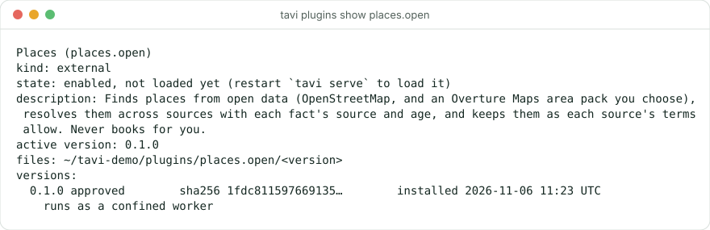
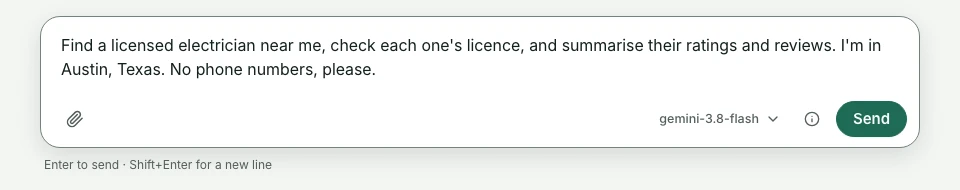
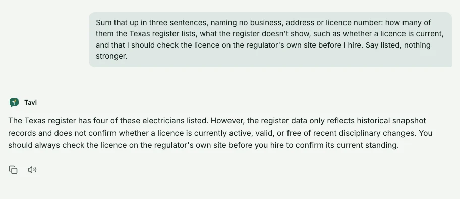

# Find a licensed specialist near you

Name the trade and your area. Tavi finds businesses nearby, checks what licence the trade needs and whether each one holds it, and sums up what people say of them.

> **Uses:** Places · Web
> **Asks first:** Nothing — it only reads and suggests
> **Runs:** When you ask
> **Idea card:** "Find a licensed specialist" (`travel.specialist`)
> **Before you start:** a model connected ([Connect your first model](../../get-started/first-model.md)) · the canvas open ([Open the web canvas and walk through Welcome](../../get-started/web-canvas-tour.md)) · Tavi running in the background with `tavi serve` ([Keep Tavi running in the background](../../get-started/keep-tavi-running.md)) · web search set up ([Set up web search](../../web-and-browser/set-up-web-search.md)) · the Places app built from the repository with `pnpm --filter @tavi/plugin-places-open build` ([Install and enable a plugin](../../extend/install-a-plugin.md), [Places](../../../PLACES.md#install))

## 1. Add the Places app

Run `tavi plugins install packages/external/places-open/dist-plugin`, then `tavi plugins approve places.open 0.1.0` and `tavi plugins enable places.open`, and restart `tavi serve`: a plugin loads when Tavi starts. `tavi plugins show places.open` shows what you added. It runs as a confined worker and never books for you.

<picture>
  <source media="(prefers-color-scheme: dark)" srcset="../../../assets/use-cases/everyday/local-services/specialist/01-add-the-places-app-dark.svg">
  
</picture>

## 2. Ask for it

Choose **New chat** above the chats to open a chat of its own and send the prompt with the trade in it, and say where you are: `Find a licensed electrician near me, check each one's licence, and summarise their ratings and reviews. I'm in Austin, Texas. No phone numbers, please.` Once Tavi knows this is something you do, **Ideas** may offer it as a card in its own words; **Try it** there starts the same chat.

## 3. Read the result

Tavi looks for businesses with `places.open.search` and searches the web, which also tells it what people say. It then checks each name or licence number with `places.open.verify_license`. When OpenStreetMap finds nobody or doesn't answer in time, the businesses all come from the web search, and the licence check is what ties them to the register. A chat that has read the web can stop on a card before its next search: check it and choose **Allow once**. Tavi doesn't need the browser here, so you can deny a card for it.

Tavi lists each business with what the register says. Ask for the short version in the same chat: `Sum that up in three sentences, naming no business, address or licence number: how many of them the Texas register lists, what the register doesn't show, such as whether a licence is current, and that I should check the licence on the regulator's own site before I hire. Say listed, nothing stronger.` The picture shows that summary, since the list names real businesses.

<!-- cover -->

How far the check goes depends on the trade and the place:

- **Looked up:** only Texas electricians and A/C contractors, from the state's own register. No match there isn't proof of no licence: a business may trade under another name. The register says a licence is listed and here gave no expiry date, so an answer that says "active" goes further than it does.
- **Pointed to:** for other trades and states Tavi gives the regulator's own search, such as California's CSLB or Gas Safe in Britain, for you to check.
- **Not needed:** a Texas mechanic, or an English electrician, needs no licence of this kind, and Tavi says so.
- **Ratings:** these come from what a web search turns up, so they can be old or partial. Places itself holds no ratings, and Tavi says when it found none.

Before you hire anyone, check the licence yourself on the regulator's site, using the number the business gives you. Tavi isn't a regulator, and its lists come from open data that can be out of date ([Places](../../../PLACES.md#tools)).

## Variations

- `Find a licensed A/C contractor near me, check each one's licence, and summarise their ratings and reviews. I'm in Dallas, Texas. No phone numbers, please.`
- `Do I need a licensed plumber to replace a bath tap in Florida? How would I check one?`

## Related

- [Places](../../../PLACES.md)
- [Install and enable a plugin](../../extend/install-a-plugin.md)
- [Research a question with cited sources](../../web-and-browser/research-with-sources.md)
- [Profile a neighbourhood before you move](neighbourhood.md)
