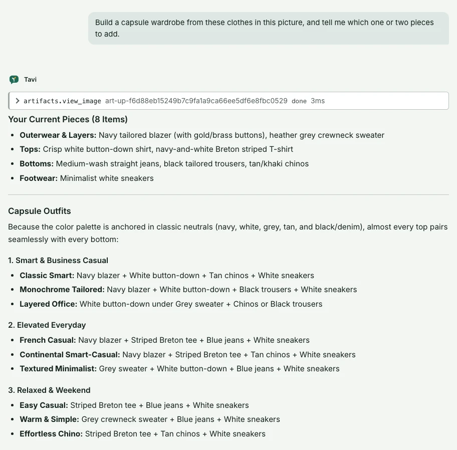
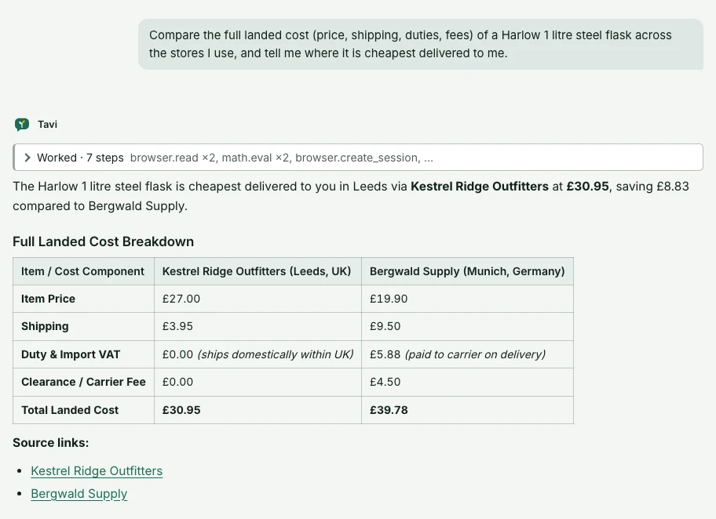
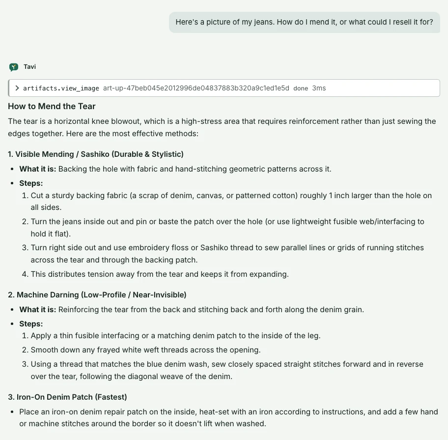
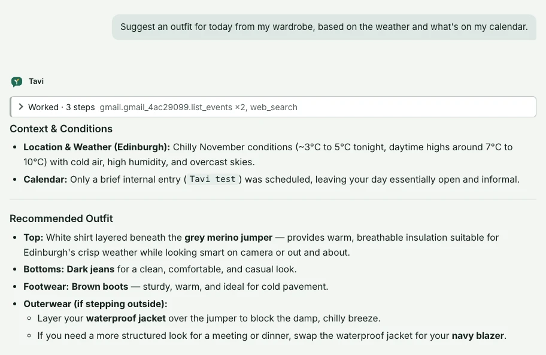
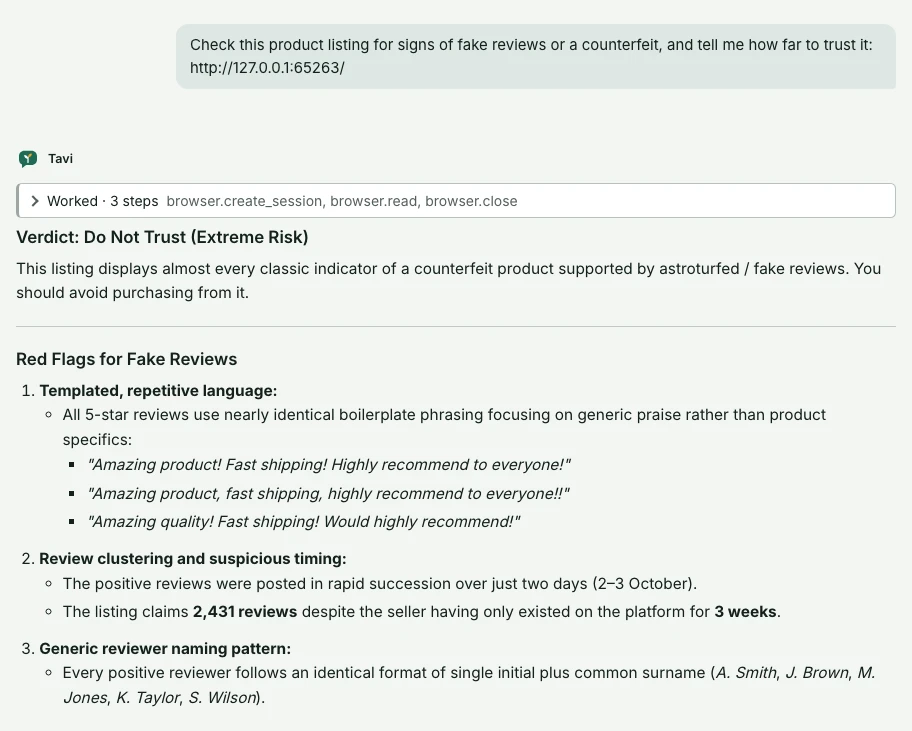

<!-- Generated by scripts/docs/guide-indexes.mjs from the guides: edit the guides, not this file. -->

# Shopping and style

Landed costs, reviews, wardrobes and mending.

| | Guide |
| :--- | :--- |
|  | [Build a capsule wardrobe from what you own](capsule.md) Send Tavi a picture or a list of your clothes and it makes outfits that mix and match, then names the one or two pieces worth adding. |
|  | [Compare what a product really costs delivered](landed-cost.md) The lowest price isn't always the cheapest once shipping, duties and fees are added. |
|  | [Mend a garment, or see what it would resell for](mending.md) Send Tavi a picture of something damaged or unworn, and it walks you through the repair and looks up what it might fetch if you'd rather sell it. |
|  | [Get an outfit for today's weather and plans](outfit.md) Tell Tavi once what's in your wardrobe and where you live. |
|  | [Check a listing's reviews before you buy](review-check.md) Send Tavi a product listing and it looks for the signs of fake reviews and knock-offs, then says how far to trust it. |

[All everyday recipes](../README.md)
