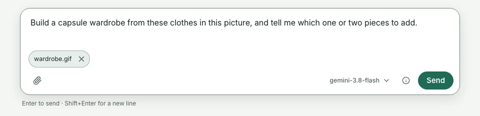
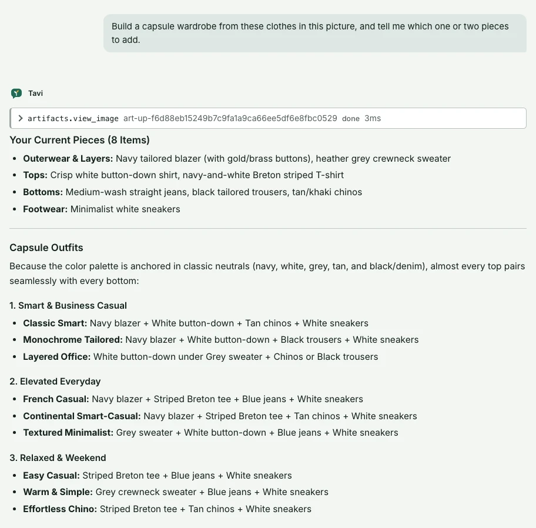

# Build a capsule wardrobe from what you own

Send Tavi a picture or a list of your clothes and it makes outfits that mix and match, then names the one or two pieces worth adding.

> **Uses:** Images
> **Asks first:** Nothing — it only reads and suggests
> **Runs:** When you ask
> **Idea card:** "Build a capsule wardrobe" (`shopping.capsule`)
> **Before you start:** a model that reads images connected ([Ask about a photo](../../photos-and-video/ask-about-a-photo.md)) · the canvas open ([Open the web canvas and walk through Welcome](../../get-started/web-canvas-tour.md)) · one picture of your clothes laid out, saved as a GIF

## 1. Ask for it

Lay your clothes out and take one picture of them. The canvas takes a picture as a GIF, so save it as one first ([Send a file or image with your message](../../chat/attach-files-to-chat.md)). Choose **New chat** above the chats to open a chat of its own. Choose the paperclip, pick the picture, and send the prompt: `Build a capsule wardrobe from these clothes in this picture, and tell me which one or two pieces to add.` Once Tavi knows this is something you do, **Ideas** may offer it as a card in its own words; **Try it** there starts the same chat.

## 2. Read the result

Tavi opens the picture with `artifacts.view_image`, named on the line above its answer, lists the pieces it sees, and builds outfits from them. The one or two pieces worth adding come after the outfits.

<!-- cover -->

Tavi goes by the look of a picture. It can't feel a fabric or know what fits you, so correct it when it gets a piece wrong, and it builds again from there. What you add is your call: it doesn't look at prices or shops here.

## Variations

- No picture: `Build a capsule wardrobe from these clothes: navy blazer, white shirt, grey jumper, dark jeans, black trousers, white trainers. Tell me which one or two pieces to add.`
- Add what it's for: `I work in an office and walk to work.`

## Related

- [Ask about a photo](../../photos-and-video/ask-about-a-photo.md)
- [Send a file or image with your message](../../chat/attach-files-to-chat.md)
- [Mend a garment, or see what it would resell for](mending.md)
