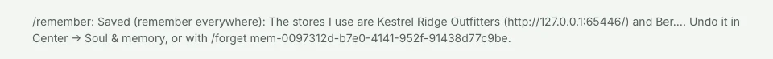
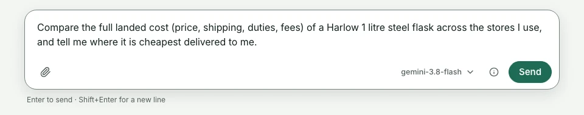
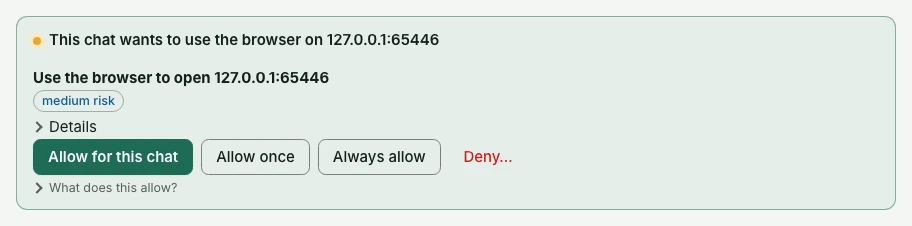
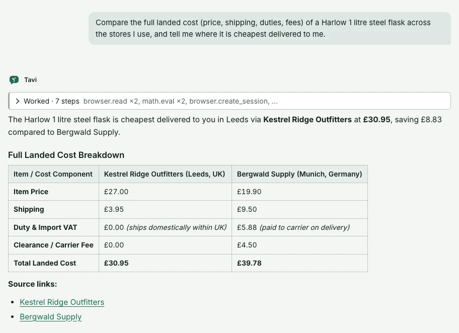

# Compare what a product really costs delivered

The lowest price isn't always the cheapest once shipping, duties and fees are added. Tavi opens the stores you use, adds up what each one would really cost delivered to you, and says where it's cheapest.

> **Uses:** Browser · Web
> **Asks first:** Nothing — it only reads and suggests
> **Runs:** When you ask
> **Idea card:** "Compare landed cost" (`shopping.landed-cost`)
> **Before you start:** a model connected ([Connect your first model](../../get-started/first-model.md)) · the canvas open ([Open the web canvas and walk through Welcome](../../get-started/web-canvas-tour.md)) · web search set up ([Set up web search](../../web-and-browser/set-up-web-search.md)) · the browser, which opens each store once you allow it ([Let Tavi drive a browser while you watch, signed in or signed out](../../web-and-browser/browse-with-tavi.md))

## 1. Tell Tavi your stores

The prompt says "the stores I use" and "delivered to me", so tell Tavi those once. In a new chat, type `/remember`, then your stores' addresses and where you live ([Teach Tavi a fact, and make it forget one](../../memory-and-skills/remember-and-forget.md)). The walk behind this page uses two made-up stores on this computer; yours will be ordinary web addresses.

## 2. Ask for it

Choose **New chat** above the chats to open a chat of its own and send the prompt with your product in it: `Compare the full landed cost (price, shipping, duties, fees) of a Harlow 1 litre steel flask across the stores I use, and tell me where it is cheapest delivered to me.` Once Tavi knows this is something you do, **Ideas** may offer it as a card in its own words; **Try it** there starts the same chat.

## 3. Let it open the stores

If Tavi asks which stores you mean, name them in your reply. It asks before the browser opens each site: **This chat wants to use the browser on** the store. Choose **Allow for this chat** for each store you named. It only reads: paying and sending a form are asked about on their own, even on a site you allowed.

## 4. Read the result

Tavi reads each store's page, lists what it charges, item by item, in a table or a list, adds it up with `math.eval`, and says where it's cheapest. Here the store with the lower price is the dearer one delivered.

<!-- cover -->

These are Tavi's estimates from what the store pages show, so check them before you buy. Duties and fees can change at the border, and a store that shows them only at checkout leaves Tavi less to go on: the checkout page is the real figure. Tavi only reads here, and buys nothing.

## Variations

- Name the stores in the chat instead of remembering them: add `The stores are <one address> and <another address>.`
- `Do the same in euros, for delivery to Lyon.`

## Related

- [Let Tavi drive a browser while you watch, signed in or signed out](../../web-and-browser/browse-with-tavi.md)
- [Teach Tavi a fact, and make it forget one](../../memory-and-skills/remember-and-forget.md)
- [Check a listing's reviews before you buy](review-check.md)
