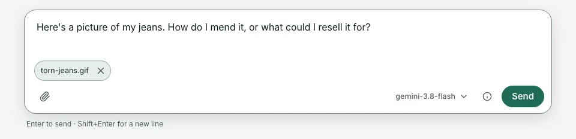
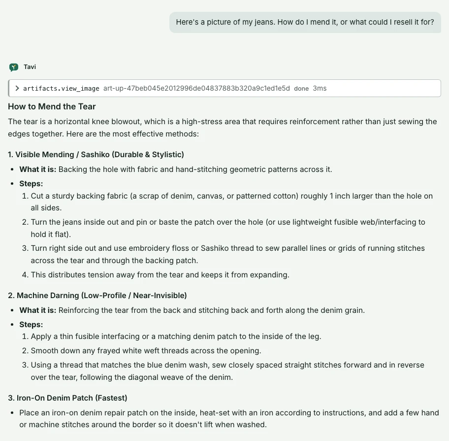
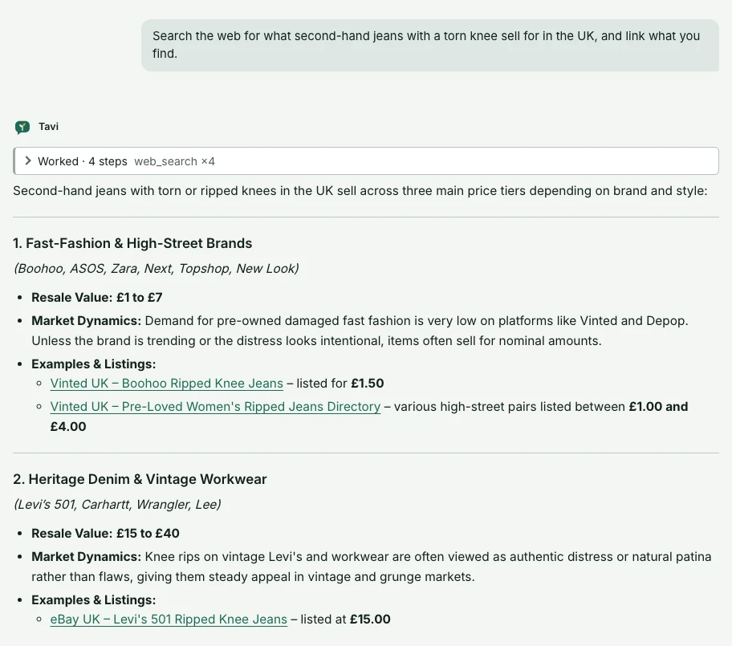

# Mend a garment, or see what it would resell for

Send Tavi a picture of something damaged or unworn, and it walks you through the repair and looks up what it might fetch if you'd rather sell it.

> **Uses:** Images · Web
> **Asks first:** Nothing — it only reads and suggests
> **Runs:** When you ask
> **Idea card:** "Mend or resell" (`shopping.mending`)
> **Before you start:** a model that reads images connected ([Ask about a photo](../../photos-and-video/ask-about-a-photo.md)) · the canvas open ([Open the web canvas and walk through Welcome](../../get-started/web-canvas-tour.md)) · web search set up ([Set up web search](../../web-and-browser/set-up-web-search.md)) · a picture of the garment, saved as a GIF

## 1. Ask for it

Take a picture that shows the damage, and save it as a GIF, which is how the canvas takes a picture ([Send a file or image with your message](../../chat/attach-files-to-chat.md)). Choose **New chat** above the chats to open a chat of its own. Choose the paperclip, pick the picture, and send the prompt with your garment in it: `Here's a picture of my jeans. How do I mend it, or what could I resell it for?` Once Tavi knows this is something you do, **Ideas** may offer it as a card in its own words; **Try it** there starts the same chat.

## 2. Read the repair

Tavi opens the picture with `artifacts.view_image`, named on the line above its answer, and gives the steps of the repair for the tear it sees, usually with more than one way to do it. Further down it gives a rough idea of what the garment might resell for, from what it knows.

<!-- cover -->

Try a repair on an inside seam first, and take anything valuable to a tailor.

## 3. Check the resale price

To base the price on real listings, ask Tavi to look: `Search the web for what second-hand jeans with a torn knee sell for in the UK, and link what you find.` Tavi searches, answers with the prices it found, and links the listings. It may ask to open a page in the browser: allow it for a fuller answer, or deny it and Tavi answers from its search.

These figures are Tavi's estimates from what it found, not a valuation. Brand, size and condition move them a lot, and an asking price isn't a selling price, so check what the same item actually sold for on the site you'd use.

## Variations

- `Here's a picture of my wool jumper with a moth hole. How do I mend it, or what could I resell it for?`
- Name the brand and size in the prompt for a closer resale estimate.

## Related

- [Ask about a photo](../../photos-and-video/ask-about-a-photo.md)
- [Research a question with cited sources](../../web-and-browser/research-with-sources.md)
- [Build a capsule wardrobe from what you own](capsule.md)
