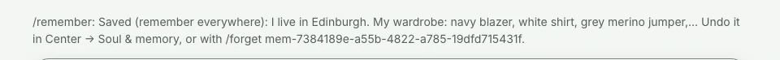
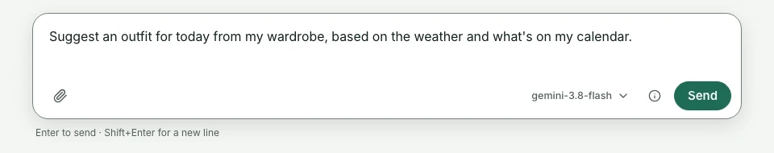
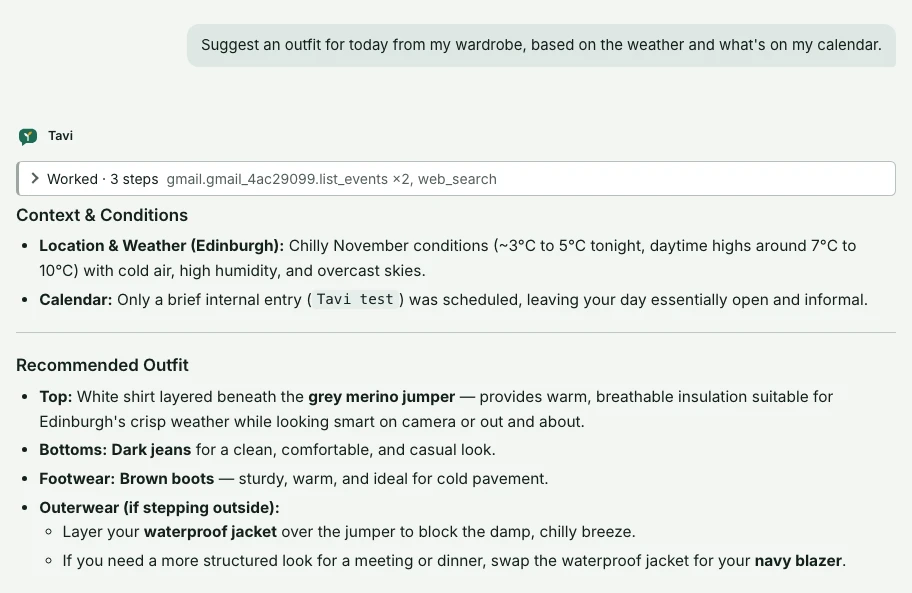

# Get an outfit for today's weather and plans

Tell Tavi once what's in your wardrobe and where you live. Then ask, any morning, and it picks an outfit from those clothes for the day's forecast and what's on your calendar.

> **Uses:** Calendar · Web
> **Asks first:** Nothing — it only reads and suggests
> **Runs:** When you ask
> **Idea card:** "Suggest today's outfit" (`shopping.outfit`)
> **Before you start:** a model connected ([Connect your first model](../../get-started/first-model.md)) · the canvas open ([Open the web canvas and walk through Welcome](../../get-started/web-canvas-tour.md)) · your Google account connected with its calendar on ([Connect Google Calendar](../../connected-apps/connect-google-calendar.md)) · web search set up, for the forecast ([Set up web search](../../web-and-browser/set-up-web-search.md))

## 1. Tell Tavi your wardrobe and town

In any chat, type `/remember` and the clothes you wear and where you live, such as `/remember I live in Edinburgh. My wardrobe: navy blazer, white shirt, grey merino jumper, dark jeans, black trousers, waterproof jacket, white trainers, brown boots.` It's kept at once, in your words, and every later chat it fits is given it ([Teach Tavi a fact, and make it forget one](../../memory-and-skills/remember-and-forget.md)).

## 2. Ask for it

Choose **New chat** above the chats to open a chat of its own and send the prompt: `Suggest an outfit for today from my wardrobe, based on the weather and what's on my calendar.` Once Tavi knows this is something you do, **Ideas** may offer it as a card in its own words; **Try it** there starts the same chat.

## 3. Read the suggestion

Tavi looks up today's forecast for your town on the web, reads today's events from your calendar, and picks from the clothes you told it about, saying why. A forecast is only a forecast: look out of the window before you leave. Step 1 kept your town and wardrobe as one note, so when your wardrobe changes, `/remember` the town and the whole wardrobe again, then send `/forget wardrobe`: it lists both notes, numbered, with when each was saved and which is the newest, and `/forget <n>` with the older one's number drops it.

<!-- cover -->

## Variations

- `Suggest an outfit for tomorrow: I have a client meeting at 10.`
- Have it every weekday morning: once the suggestion is the one you want, **Repeat this…** turns the chat into a schedule ([Turn a chat that worked into a schedule](../../automation/repeat-this.md)).

## Related

- [Build a capsule wardrobe from what you own](capsule.md)
- [Get a short brief of your day](../life-admin/morning-brief.md)
- [Teach Tavi a fact, and make it forget one](../../memory-and-skills/remember-and-forget.md)
