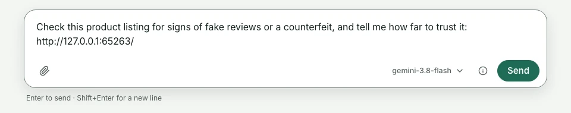
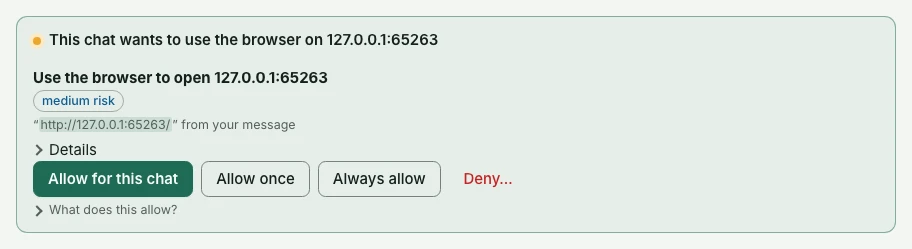
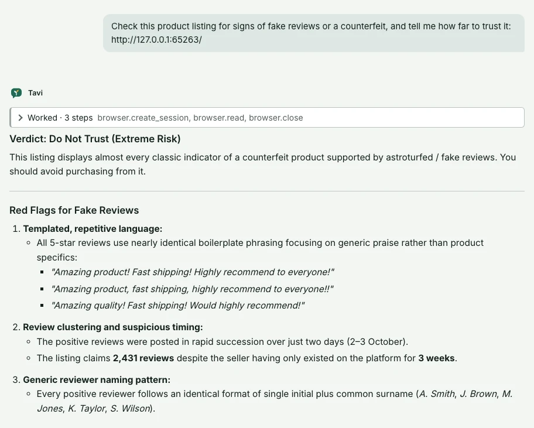

# Check a listing's reviews before you buy

Send Tavi a product listing and it looks for the signs of fake reviews and knock-offs, then says how far to trust it.

> **Uses:** Browser · Web
> **Asks first:** Nothing — it only reads and suggests
> **Runs:** When you ask
> **Idea card:** "Check a listing's reviews" (`shopping.review-check`)
> **Before you start:** a model connected ([Connect your first model](../../get-started/first-model.md)) · the canvas open ([Open the web canvas and walk through Welcome](../../get-started/web-canvas-tour.md)) · web search set up ([Set up web search](../../web-and-browser/set-up-web-search.md)) · the browser, which opens the listing once you allow it ([Let Tavi drive a browser while you watch, signed in or signed out](../../web-and-browser/browse-with-tavi.md))

## 1. Ask for it

Copy the listing's address. Choose **New chat** above the chats to open a chat of its own and send the prompt with the link in it: `Check this product listing for signs of fake reviews or a counterfeit, and tell me how far to trust it: <the link>`. Once Tavi knows this is something you do, **Ideas** may offer it as a card in its own words; **Try it** there starts the same chat.

## 2. Let it open the listing

To read the page, Tavi asks to open it: **This chat wants to use the browser on** the shop's site. Choose **Allow for this chat**. The shop in this page's pictures is made up, and served on this computer.

## 3. Read the result

Tavi reads the page in the browser, named on the **Worked** line above its answer, says how far to trust the listing, and lists what looks wrong, quoting the reviews. It may also search for the brand or the seller.

<!-- cover -->

This is a judgement from what the page shows and what a search finds, not proof. Tavi sees only the reviews the page loads, and it can't tell who wrote them or inspect the product. A listing that looks clean can still sell a fake, and an odd one can be honest. For an expensive item, buy from the brand or a seller it names, and use a payment method that lets you claim your money back.

## Variations

- Paste the reviews into the chat if the site won't open: `Do these reviews look genuine?`
- `Compare this listing with the same product on the brand's own site.`

## Related

- [Research a question with cited sources](../../web-and-browser/research-with-sources.md)
- [Set up web search](../../web-and-browser/set-up-web-search.md)
- [Compare what a product really costs delivered](landed-cost.md)
