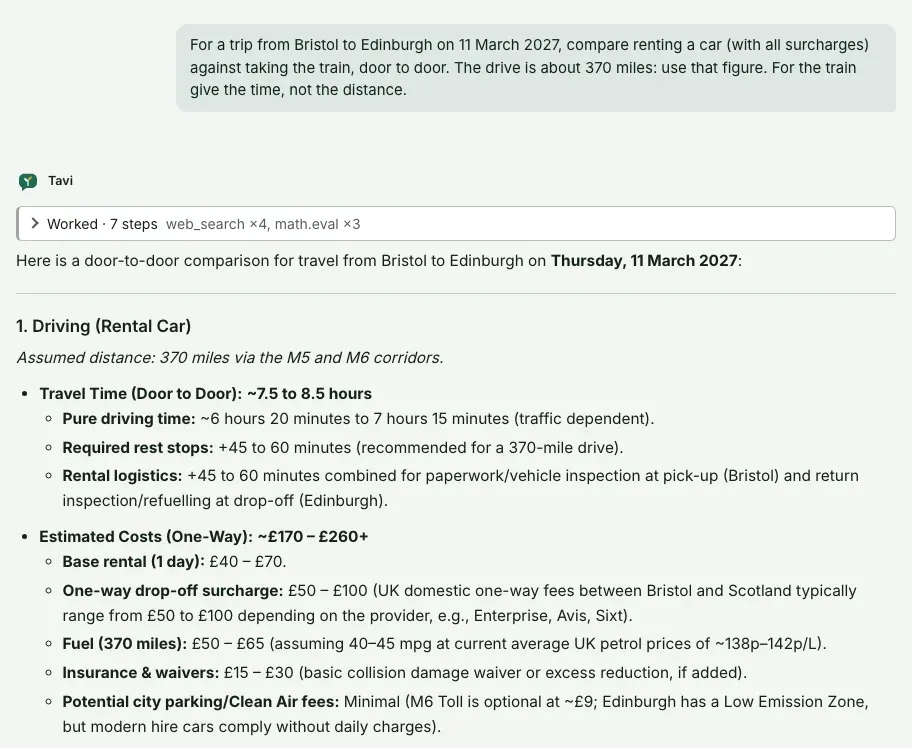
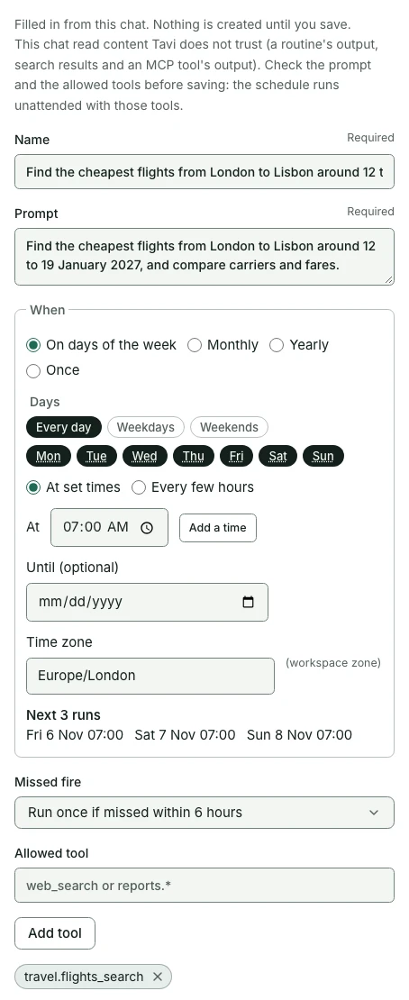
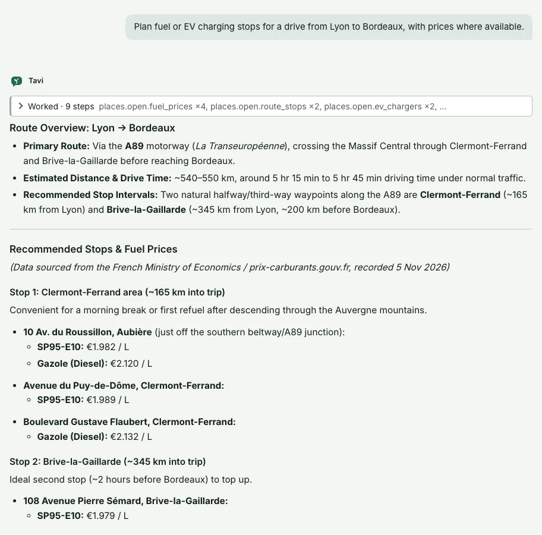
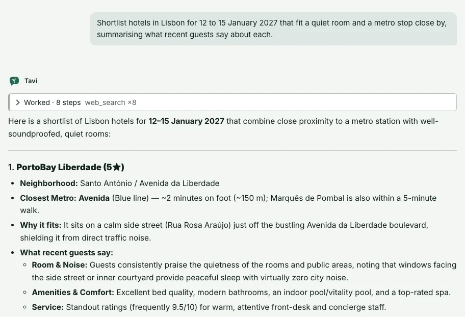
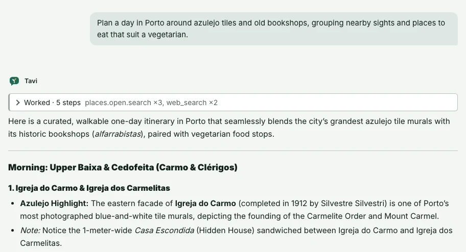
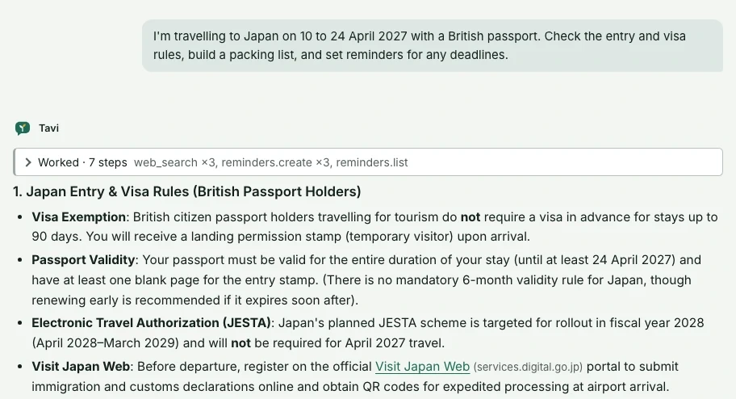

<!-- Generated by scripts/docs/guide-indexes.mjs from the guides: edit the guides, not this file. -->

# Travel

Fares, hotels, routes, itineraries and entry rules.

| | Guide |
| :--- | :--- |
|  | [Weigh a rental car against the train](car-or-rail.md) Tell Tavi the journey and it compares a rental, with its surcharges, against the train, door to door. |
|  | [Watch flight prices](fare-watch.md) Tavi compares flights for your route and dates across carriers, and a daily schedule looks them up again every morning and posts the fares it finds. |
|  | [Plan fuel stops](fuel-route.md) Give Tavi a road trip and it finds fuel or charging stops along it, with prices where a country publishes them. |
|  | [Shortlist hotels](hotels.md) Give Tavi the city, the dates and what matters to you, and it sums up what guests say into a shortlist, with each hotel's fit spelled out. |
|  | [Plan a city day](itinerary.md) Name the city and what you enjoy, and Tavi builds a day that groups nearby sights and places to eat, with your diet in mind. |
|  | [Check visa and packing](visa-packing.md) Tell Tavi where and when you're going and which passport you hold. |

[All everyday recipes](../README.md)
