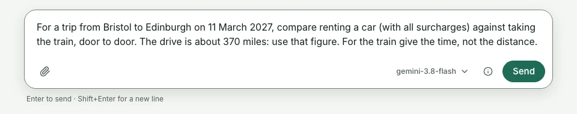
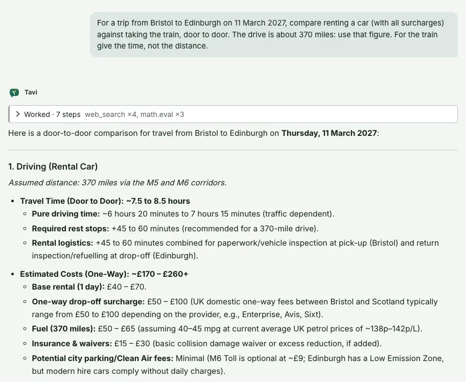
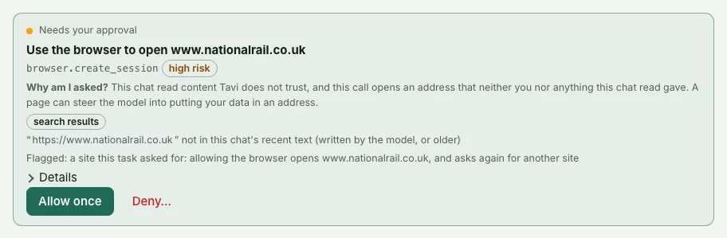
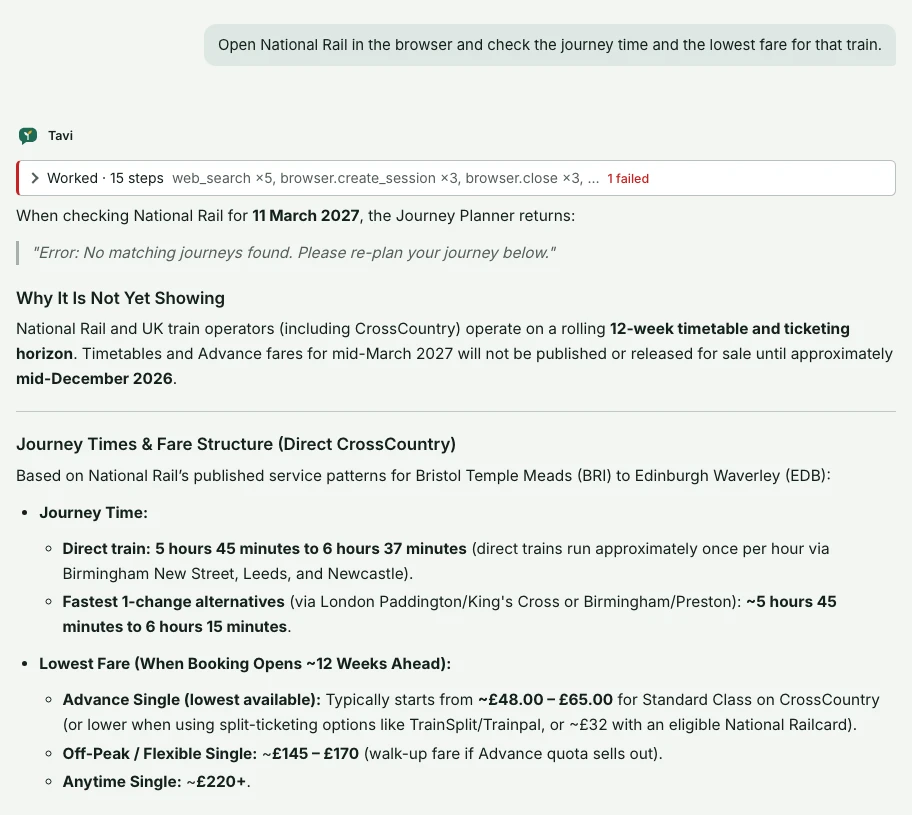

# Weigh a rental car against the train

Tell Tavi the journey and it compares a rental, with its surcharges, against the train, door to door. It can then open the rail site to check a fare.

> **Uses:** Web · Browser
> **Asks first:** Nothing — it only reads and suggests
> **Runs:** When you ask
> **Idea card:** "Car or train?" (`travel.car-or-rail`)
> **Before you start:** a model connected ([Connect your first model](../../get-started/first-model.md)) · the canvas open ([Open the web canvas and walk through Welcome](../../get-started/web-canvas-tour.md)) · web search set up ([Set up web search](../../web-and-browser/set-up-web-search.md)) · the browser, which needs nothing else ([Let Tavi drive a browser while you watch, signed in or signed out](../../web-and-browser/browse-with-tavi.md))

## 1. Ask for it

Choose **New chat** above the chats to open a chat of its own and send the prompt with your journey in it, and add the distance if you know it, because sources disagree and a model may guess: `For a trip from Bristol to Edinburgh on 11 March 2027, compare renting a car (with all surcharges) against taking the train, door to door. The drive is about 370 miles: use that figure. For the train give the time, not the distance.` Once Tavi knows this is something you do, **Ideas** may offer it as a card in its own words; **Try it** there starts the same chat.

## 2. Read the result

Tavi searches the web and sets the two side by side: time door to door, cost, and what a rental adds. Any card it stops on asks about one search or site at a time. Allow a search; if it asks to open a site in the browser, you can deny that for now and it answers from its search.

<!-- cover -->

The figures come from what search found, and the model's own sums: they are typical prices and rough distances and times, not offers for your date. Say which ones you want checked.

## 3. Check a fare on the site

Search only gets so far with fares, so ask Tavi to look: `Open National Rail in the browser and check the journey time and the lowest fare for that train.` The chat has read search results, so a card asks before the browser opens the site, and it may ask again for the next one. Read the address it names, then choose **Allow once**.

## 4. Read what the site says

Tavi answers from what the site showed. Advance fares only go on sale some weeks ahead, so for a date further off the site has none yet. A step in **Worked** can show as failed, because a site's planner often refuses a date this far off: Tavi gives the times and fares it read elsewhere, which are then only a guide. It signs in or buys nothing unless you ask, so check the fare on the site before you book ([Let Tavi drive a browser while you watch, signed in or signed out](../../web-and-browser/browse-with-tavi.md)).

## Variations

- `For a trip from Munich to Vienna on 6 March 2027, compare renting a car (with all surcharges) against taking the train, door to door.`
- Add who is going: `Compare it again for two adults and a child, with a car seat.`

## Related

- [Let Tavi drive a browser while you watch, signed in or signed out](../../web-and-browser/browse-with-tavi.md)
- [Research a question with cited sources](../../web-and-browser/research-with-sources.md)
- [Plan fuel stops](fuel-route.md)
- [Watch flight prices](fare-watch.md)
