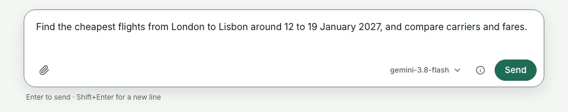
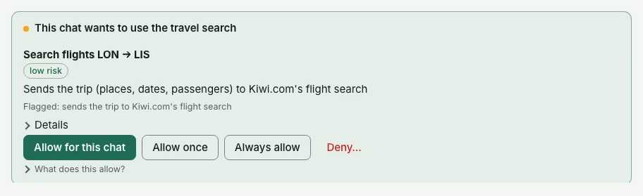
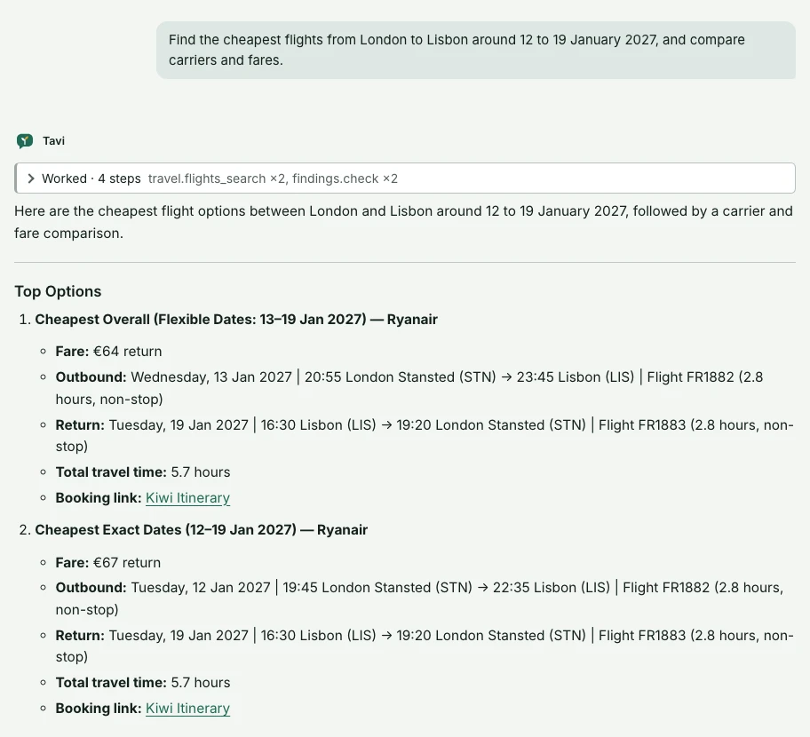
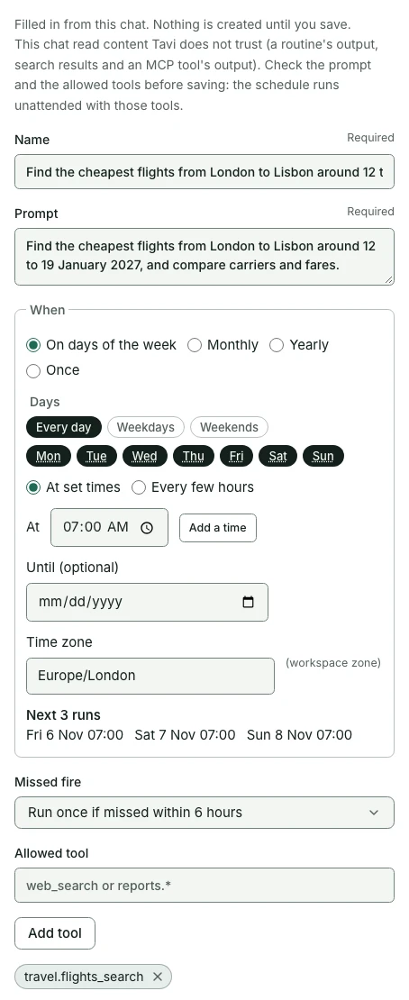

# Watch flight prices

Tavi compares flights for your route and dates across carriers, and a daily schedule looks them up again every morning and posts the fares it finds.

> **Uses:** Travel
> **Asks first:** Nothing — it only reads and suggests
> **Runs:** Daily
> **Idea card:** "Watch flight prices" (`travel.fare-watch`)
> **Before you start:** a model connected ([Connect your first model](../../get-started/first-model.md)) · the canvas open ([Open the web canvas and walk through Welcome](../../get-started/web-canvas-tour.md)) · flight search, on by default with no key to set up ([Compare flights](../../web-and-browser/search-flights.md)) · Tavi running in the background with `tavi serve` ([Keep Tavi running in the background](../../get-started/keep-tavi-running.md)), for the schedule ([Turn a chat that worked into a schedule](../../automation/repeat-this.md))

## 1. Ask for it

Choose **New chat** above the chats to open a chat of its own and send the prompt with your trip in it: `Find the cheapest flights from London to Lisbon around 12 to 19 January 2027, and compare carriers and fares.` Once Tavi knows this is something you do, **Ideas** may offer it as a card in its own words; **Try it** there starts the same chat.

## 2. Allow the search

Tavi changes nothing and books nothing, but a flight search leaves your machine, so a card asks first: **This chat wants to use the travel search**. Only the trip goes to Kiwi.com and Google Flights: the places, dates and passengers. Choose **Allow for this chat**, so that the further searches this question leads to don't ask again.

## 3. Read the result

Tavi lists the cheapest flights it found, with each one's carrier, flight numbers, times and fare, and a link to check it. It may try nearby days too, and says when a fare is for a day you didn't name.

The fares are Kiwi.com's and Google Flights' at that moment, and can change before you book. Booking is yours, on the airline's or the agent's own site.

## 4. Make it recurring

Point at your message and choose **Repeat this…**. **Create schedule** opens, filled in from the chat: your message as the prompt, every day at 07:00, with each result going to **Home**. The answer came from outside Tavi, so the flight search isn't filled in: under **Allowed tool**, choose `travel.flights_search` beside **Used in this chat — add**, or the morning run has no search to use. Then choose **Save schedule**. It is listed in **Center → Schedule**, where **Run now** tries it straight away.

<!-- cover -->

Each morning's run looks the fares up afresh and posts them to Home. If you have no Home yet, the first result starts one. A run doesn't remember yesterday's fare, so nothing compares the two for you: read the fare against what you were hoping to pay. Delete the schedule once you've booked, since its dates stay the ones you asked about.

## Variations

- `Find the cheapest flights from Manchester to Rome around 5 to 9 March 2027, and compare carriers and fares.`
- Add the price you'd pay to the schedule's prompt, as in `Tell me if any fare is under £60`, and set **Tell me** to **Only when there is something to tell** ([Hear from a schedule only when there's something new](../../automation/tell-me-only-when-it-changes.md)).

## Related

- [Compare flights](../../web-and-browser/search-flights.md)
- [Turn a chat that worked into a schedule](../../automation/repeat-this.md)
- [Hear from a schedule only when there's something new](../../automation/tell-me-only-when-it-changes.md)
- [Shortlist hotels](hotels.md)
