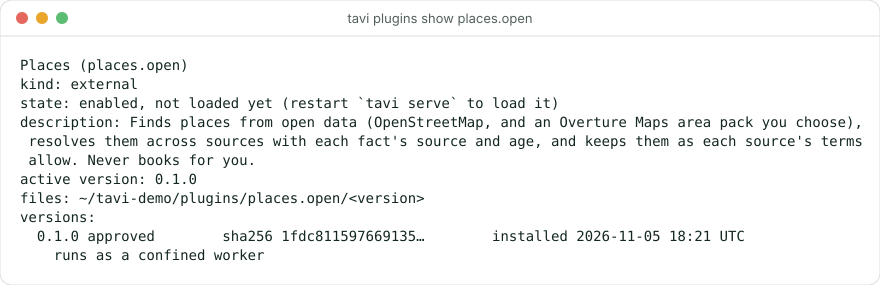
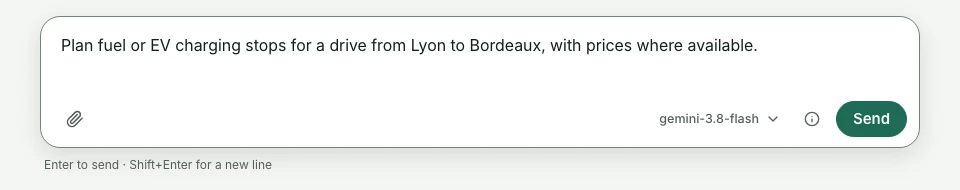
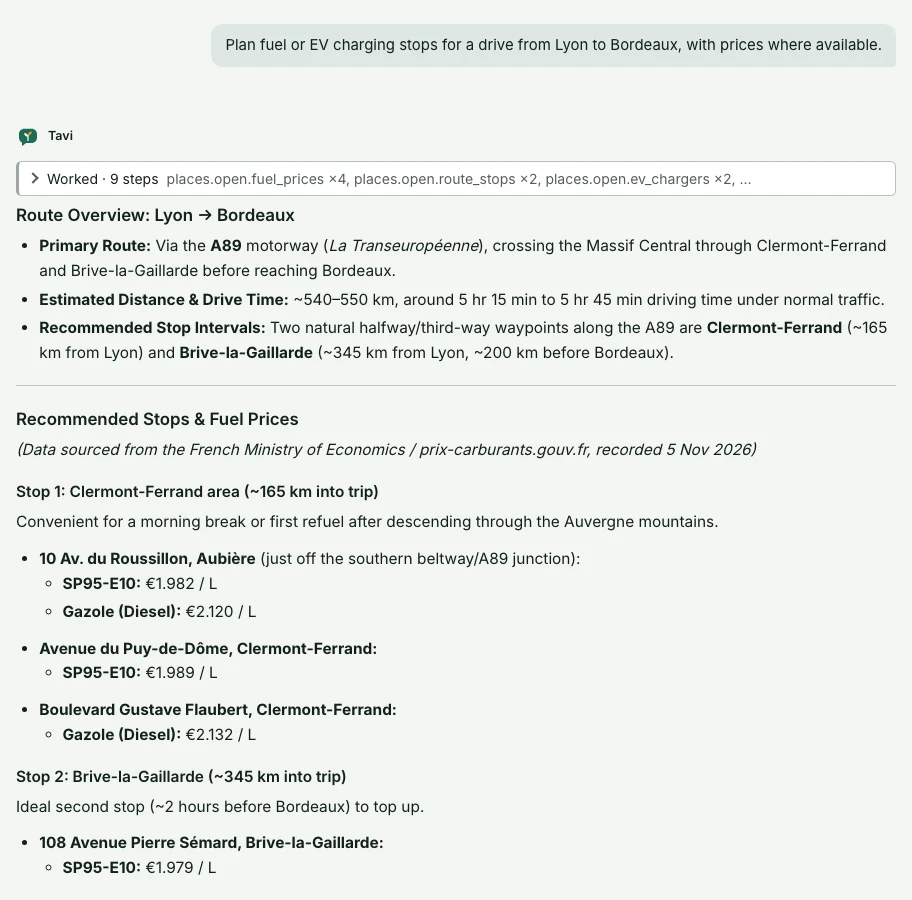

# Plan fuel stops

Give Tavi a road trip and it finds fuel or charging stops along it, with prices where a country publishes them.

> **Uses:** Places
> **Asks first:** Nothing — it only reads and suggests
> **Runs:** When you ask
> **Idea card:** "Plan fuel stops" (`travel.fuel-route`)
> **Before you start:** a model connected ([Connect your first model](../../get-started/first-model.md)) · the canvas open ([Open the web canvas and walk through Welcome](../../get-started/web-canvas-tour.md)) · Tavi running in the background with `tavi serve` ([Keep Tavi running in the background](../../get-started/keep-tavi-running.md)) · the Places app built from the repository with `pnpm --filter @tavi/plugin-places-open build` ([Install and enable a plugin](../../extend/install-a-plugin.md), [Places](../../../PLACES.md#install))

## 1. Add the Places app

Run `tavi plugins install packages/external/places-open/dist-plugin`, then `tavi plugins approve places.open 0.1.0` and `tavi plugins enable places.open`, and restart `tavi serve`: a plugin loads when Tavi starts. `tavi plugins show places.open` shows what you added. It runs as a confined worker and never books for you.

<picture>
  <source media="(prefers-color-scheme: dark)" srcset="../../../assets/use-cases/everyday/travel/fuel-route/01-add-the-places-app-dark.svg">
  
</picture>

## 2. Ask for it

Choose **New chat** above the chats to open a chat of its own and send the prompt with your trip in it: `Plan fuel or EV charging stops for a drive from Lyon to Bordeaux, with prices where available.` Once Tavi knows this is something you do, **Ideas** may offer it as a card in its own words; **Try it** there starts the same chat.

## 3. Read the result

Tavi finds stops along the way with `places.open.route_stops`, then looks up prices near them with `places.open.fuel_prices`. In France these are each station's own prices, from the government's feed, so the answer can name them stop by stop.

<!-- cover -->

What you get depends on where you drive:

- **Prices:** France, Spain, Austria and Italy have station prices with no key (Italy's are yesterday's), and Germany's need a Tankerkönig key. Most of the EU and the US only have a national or state average, and the UK has no prices at all.
- **The route:** without a router of your own, or a free OpenRouteService key (`tavi plugins config places.open --set orsKey=YOUR_KEY`), Tavi measures along a straight line between the towns, so a stop may be off the road you take. The distances are estimates either way.
- **Charging:** chargers need a free Open Charge Map key (`tavi plugins config places.open --set ocmKey=YOUR_KEY`) everywhere but Germany. No source says whether a charger is free right now.

Prices change through the day, so check the one on the pump before you turn off for it ([Places](../../../PLACES.md#tools)).

## Variations

- `Plan fuel or EV charging stops for a drive from Madrid to Valencia, with prices where available.`
- Ask a follow-up: `I drive a diesel with a 600 km range. Which stops would you pick?`

## Related

- [Places](../../../PLACES.md)
- [Install and enable a plugin](../../extend/install-a-plugin.md)
- [Weigh a rental car against the train](car-or-rail.md)
- [Plan a city day](itinerary.md)
