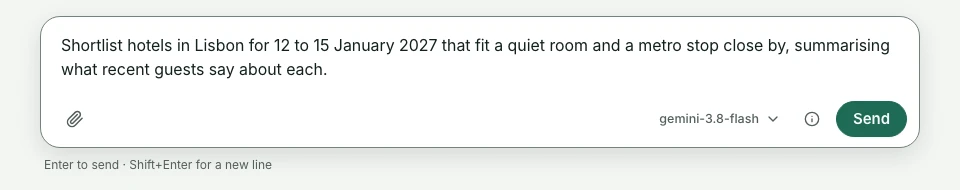
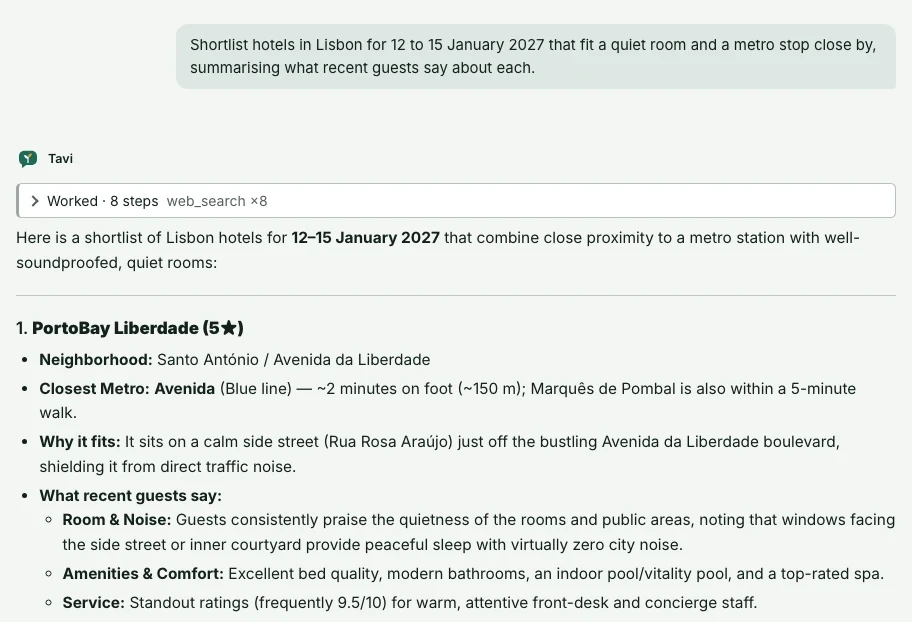

# Shortlist hotels

Give Tavi the city, the dates and what matters to you, and it sums up what guests say into a shortlist, with each hotel's fit spelled out.

> **Uses:** Web
> **Asks first:** Nothing — it only reads and suggests
> **Runs:** When you ask
> **Idea card:** "Shortlist hotels" (`travel.hotels`)
> **Before you start:** a model connected ([Connect your first model](../../get-started/first-model.md)) · the canvas open ([Open the web canvas and walk through Welcome](../../get-started/web-canvas-tour.md)) · web search set up ([Set up web search](../../web-and-browser/set-up-web-search.md))

## 1. Ask for it

Choose **New chat** above the chats to open a chat of its own and send the prompt with your trip in it: `Shortlist hotels in Lisbon for 12 to 15 January 2027 that fit a quiet room and a metro stop close by, summarising what recent guests say about each.` Once Tavi knows this is something you do, **Ideas** may offer it as a card in its own words; **Try it** there starts the same chat.

## 2. Read the result

Tavi searches the web and answers hotel by hotel: where it is, its nearest metro stop, why it fits, and what guests say about it. It may ask to open a site in the browser: allow it for a fuller answer, or deny it and Tavi answers from its search. Once it has opened a page, a further search asks first too ([Research a question with cited sources](../../web-and-browser/research-with-sources.md)).

<!-- cover -->

Tavi reads what search results show, not every review, and it doesn't check rooms or prices for your dates. Read the latest reviews and look up the price on the hotel's or the booking site's own page. Tavi doesn't book.

## Variations

- `Shortlist hotels in Vienna for 2 to 4 March 2027 that fit two children and a late check-out, summarising what recent guests say about each.`
- Ask a follow-up: `Which of these has the fewest complaints about noise?`

## Related

- [Research a question with cited sources](../../web-and-browser/research-with-sources.md)
- [Watch flight prices](fare-watch.md)
- [Plan a city day](itinerary.md)
