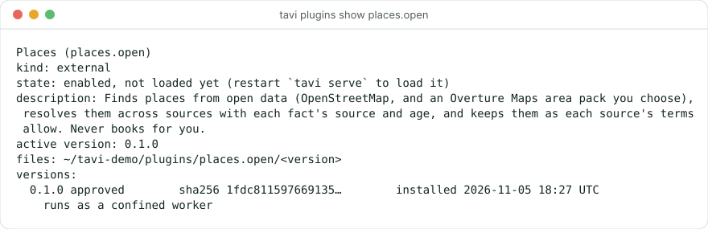
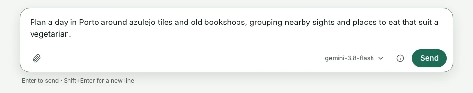
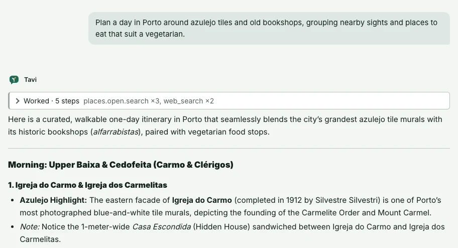

# Plan a city day

Name the city and what you enjoy, and Tavi builds a day that groups nearby sights and places to eat, with your diet in mind.

> **Uses:** Places · Web
> **Asks first:** Nothing — it only reads and suggests
> **Runs:** When you ask
> **Idea card:** "Plan a city day" (`travel.itinerary`)
> **Before you start:** a model connected ([Connect your first model](../../get-started/first-model.md)) · the canvas open ([Open the web canvas and walk through Welcome](../../get-started/web-canvas-tour.md)) · Tavi running in the background with `tavi serve` ([Keep Tavi running in the background](../../get-started/keep-tavi-running.md)) · web search set up ([Set up web search](../../web-and-browser/set-up-web-search.md)) · the Places app built from the repository with `pnpm --filter @tavi/plugin-places-open build` ([Install and enable a plugin](../../extend/install-a-plugin.md), [Places](../../../PLACES.md#install))

## 1. Add the Places app

Run `tavi plugins install packages/external/places-open/dist-plugin`, then `tavi plugins approve places.open 0.1.1` and `tavi plugins enable places.open`, and restart `tavi serve`: a plugin loads when Tavi starts. `tavi plugins show places.open` shows what you added. It runs as a confined worker and never books for you.

<picture>
  <source media="(prefers-color-scheme: dark)" srcset="../../../assets/use-cases/everyday/travel/itinerary/01-add-the-places-app-dark.svg">
  
</picture>

## 2. Ask for it

Choose **New chat** above the chats to open a chat of its own and send the prompt with your day in it: `Plan a day in Porto around azulejo tiles and old bookshops, grouping nearby sights and places to eat that suit a vegetarian.` Once Tavi knows this is something you do, **Ideas** may offer it as a card in its own words; **Try it** there starts the same chat.

## 3. Read the result

Tavi finds places near each other with `places.open.search`, reads about them on the web, and sets out the day part by part, with somewhere to eat among the sights. A search after it has read the web may ask first: allow it. If it asks to open a site in the browser, you can deny that and it plans from what it has.

<!-- cover -->

The plan is built from open data and web pages that can be out of date, and the model can get an address wrong. A shop may have moved or closed, and Tavi doesn't check opening hours for your day unless you ask. Look each place up before you set off, and ask a restaurant yourself if your diet is a matter of health.

## Variations

- `Plan a day in Vienna around coffee houses and modern art, grouping nearby sights and places to eat that suit a vegan.`
- Tell it the day, so that it can check the hours: `We're there on a Monday, and many museums close. What still works?`

## Related

- [Places](../../../PLACES.md)
- [Shortlist hotels](hotels.md)
- [Plan fuel stops](fuel-route.md)
- [Research a question with cited sources](../../web-and-browser/research-with-sources.md)
