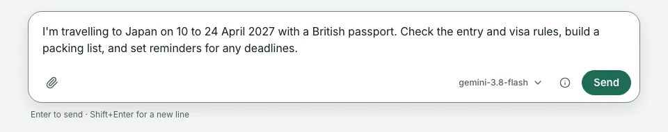
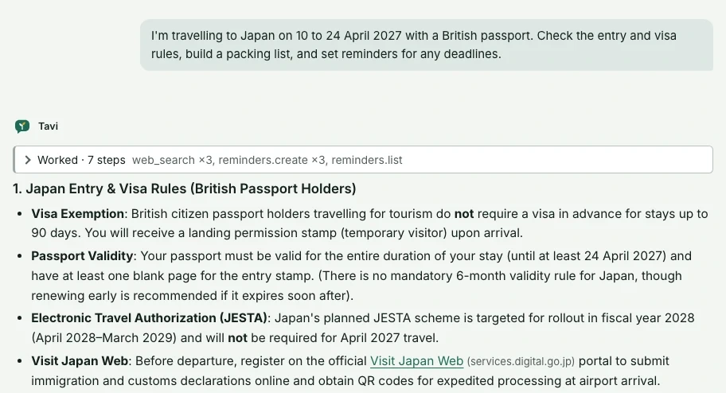
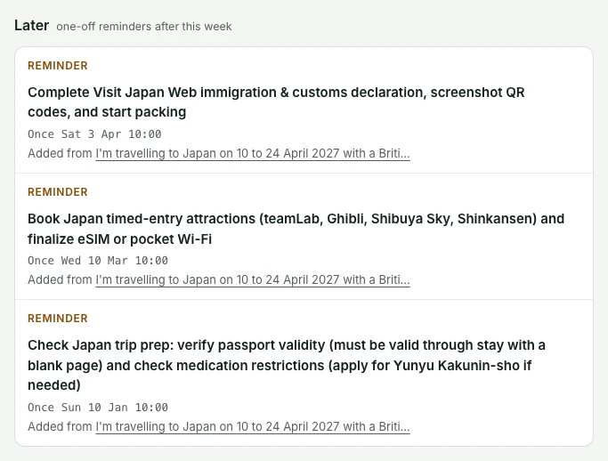

# Check visa and packing

Tell Tavi where and when you're going and which passport you hold. It looks up the entry rules, builds a packing list and sets reminders for the deadlines. Official sources decide what applies to you, and Tavi isn't legal or immigration advice.

> **Uses:** Web · Reminders
> **Asks first:** Nothing — it only reads and suggests
> **Runs:** When you ask
> **Idea card:** "Check visa and packing" (`travel.visa-packing`)
> **Before you start:** a model connected ([Connect your first model](../../get-started/first-model.md)) · the canvas open ([Open the web canvas and walk through Welcome](../../get-started/web-canvas-tour.md)) · web search set up ([Set up web search](../../web-and-browser/set-up-web-search.md)) · Tavi running in the background with `tavi serve` ([Keep Tavi running in the background](../../get-started/keep-tavi-running.md)), so reminders fire ([Set a reminder (once, on an event, or repeating)](../../automation/set-a-reminder.md))

## 1. Ask for it

Choose **New chat** above the chats to open a chat of its own and send the prompt with your trip in it: `I'm travelling to Japan on 10 to 24 April 2027 with a British passport. Check the entry and visa rules, build a packing list, and set reminders for any deadlines.` Once Tavi knows this is something you do, **Ideas** may offer it as a card in its own words; **Try it** there starts the same chat.

## 2. Read the rules

Tavi searches the web, then sets out what it found for your passport, followed by a packing list. Once it has read the web, a reminder can ask first: read what it will set, and choose **Allow once**, or for several reminders together **Allow selected; deny unchecked**. Unticking a reminder refuses it. If it asks to open a site in the browser, you can deny that and it answers from its search.

<!-- cover -->

This is a summary of what the search found, not a ruling on your case. Entry rules and fees change, and a search can turn up an old page: asked about the United States, Tavi quoted an ESTA fee that had since gone up. Whether you may enter is decided by the destination's government and its border officers, so check the rules on its official site and your own government's travel advice. Take more care still with medicines, whatever Tavi's answer says about them. Check with the embassy first, before you pack anything prescribed or bought over the counter: some medicines can't be brought in at all. If your case is unusual, ask the embassy or an immigration lawyer. Tavi can't apply for you.

## 3. Check your reminders

Open **Center → Schedule** to see each reminder and when it fires, or run `tavi reminders list`. Tavi works out the dates from what it read, so check each one against the official deadline. To change one, tell Tavi in a chat; the reminder's own page can pause or delete it.

## Variations

- `I'm travelling to Canada on 3 to 17 May 2027 with a French passport. Check the entry and visa rules, build a packing list, and set reminders for any deadlines.`
- Ask a follow-up: `I'm taking my child with me, who has a separate passport. What changes?`

## Related

- [Set a reminder (once, on an event, or repeating)](../../automation/set-a-reminder.md)
- [See every upcoming reminder, routine and schedule](../../automation/see-whats-coming-up.md)
- [Research a question with cited sources](../../web-and-browser/research-with-sources.md)
- [Watch flight prices](fare-watch.md)
