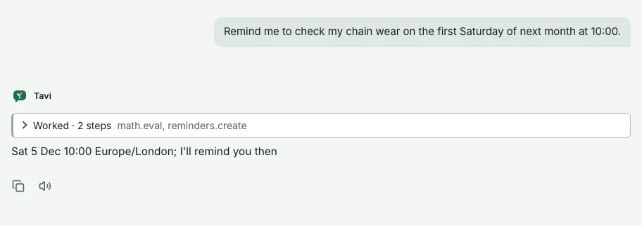
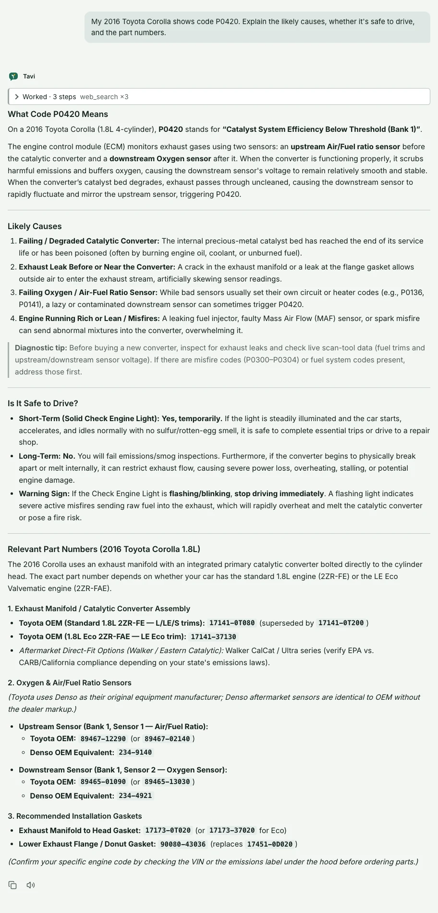
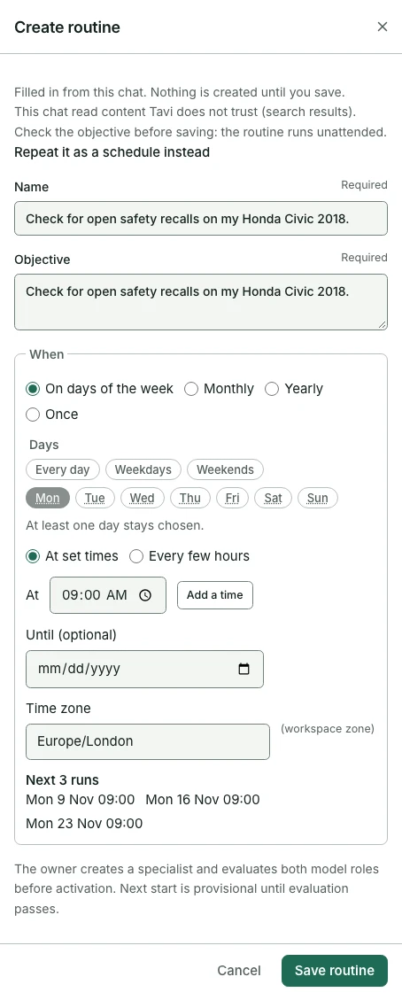

<!-- Generated by scripts/docs/guide-indexes.mjs from the guides: edit the guides, not this file. -->

# Vehicles

Warning codes, bike wear and recalls.

| | Guide |
| :--- | :--- |
|  | [Track wear on your bike](bike-wear.md) Tell Tavi how much you ride, and it works out when your chain, cassette and brake pads are likely to be due, keeps your bike in mind, and reminds you to check them. |
|  | [Decode a warning code from your car](car-code.md) Your code reader shows a code and you'd like to know what it means before you call the garage. |
|  | [Watch for safety recalls on your car](recalls.md) Tavi looks for open safety recalls on your car, and a weekly routine keeps looking for you. |

[All everyday recipes](../README.md)
