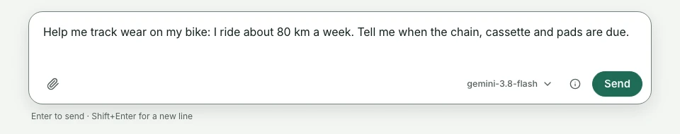
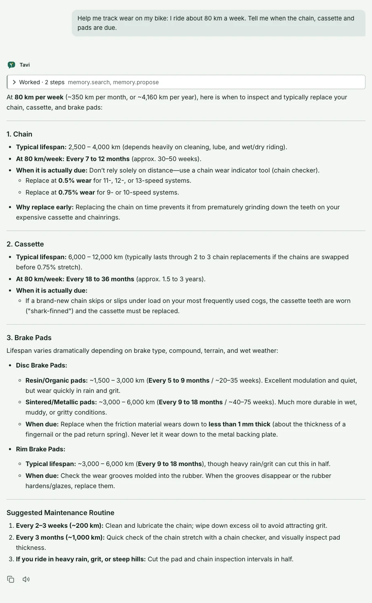
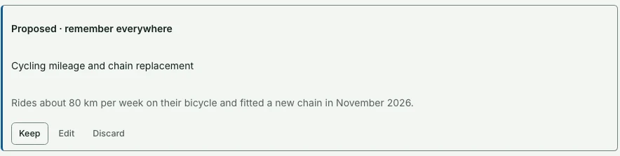
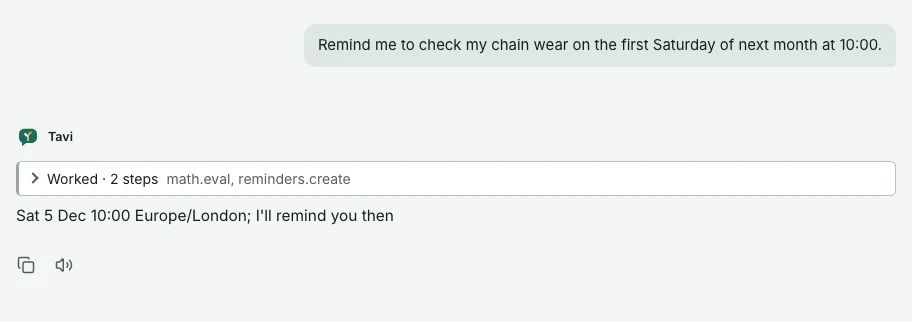

# Track wear on your bike

Tell Tavi how much you ride, and it works out when your chain, cassette and brake pads are likely to be due, keeps your bike in mind, and reminds you to check them.

> **Uses:** Memory · Reminders
> **Asks first:** Nothing — it only reads and suggests
> **Runs:** When you ask
> **Idea card:** "Track bike wear" (`travel.bike-wear`)
> **Before you start:** a model connected ([Connect your first model](../../get-started/first-model.md)) · the canvas open ([Open the web canvas and walk through Welcome](../../get-started/web-canvas-tour.md)) · Tavi running in the background with `tavi serve` ([Keep Tavi running in the background](../../get-started/keep-tavi-running.md)) · reminders need nothing else ([Set a reminder (once, on an event, or repeating)](../../automation/set-a-reminder.md)) · memory is on unless you paused it ([Teach Tavi a fact, and make it forget one](../../memory-and-skills/remember-and-forget.md))

## 1. Ask for it

Choose **New chat** above the chats to open a chat of its own and send the prompt with your distance in it: `Help me track wear on my bike: I ride about 80 km a week. Tell me when the chain, cassette and pads are due.` Once Tavi knows this is something you do, **Ideas** may offer it as a card in its own words; **Try it** there starts the same chat.

## 2. Read the result

Tavi turns your distance into rough times for each part. These are rules of thumb: wear depends on the weather, the terrain and how you look after the bike.

## 3. Have it remember your bike

Say `Remember that I ride about 80 km a week and that I fitted a new chain this month.` Tavi offers a memory card. Check what it wrote, since it may leave something out (**Edit** adds it), then choose **Keep**, and later chats start from what it holds.

## 4. Get a reminder to check it

Say `Remind me to check my chain wear on the first Saturday of next month at 10:00.` Tavi sets it up and says when it will fire. It is listed in **Center → Schedule** and in `tavi reminders list`.

<!-- cover -->

Tavi can't see your bike and doesn't count your rides: its times come from the distance you told it, so a chain checker in your hands beats the calendar. Brakes are a safety matter: if they feel soft or sound wrong, have them looked at now, whatever date Tavi gave you.

## Variations

- `I ride about 50 km a week on gravel, mostly in the wet.` Harder riding wears parts sooner, and Tavi adjusts its times.
- `Remind me on the first of every month to check my brake pads.` Reminders repeat on days of the week, monthly or yearly: Tavi tells you if you ask for something else.

## Related

- [Set a reminder (once, on an event, or repeating)](../../automation/set-a-reminder.md)
- [Teach Tavi a fact, and make it forget one](../../memory-and-skills/remember-and-forget.md)
- [See every upcoming reminder, routine and schedule](../../automation/see-whats-coming-up.md)
