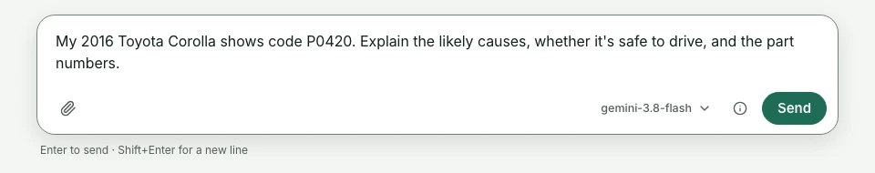
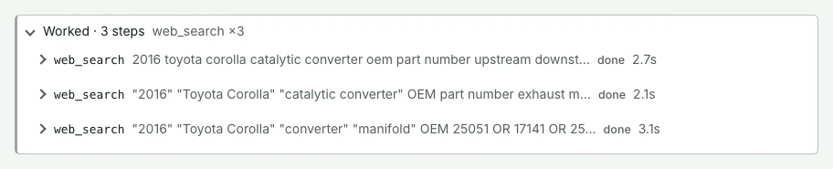
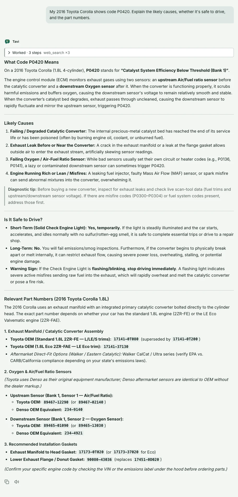

# Decode a warning code from your car

Your code reader shows a code and you'd like to know what it means before you call the garage. Tavi looks the code up for your car and explains the likely causes, whether it seems safe to drive on, and the parts involved.

> **Uses:** Web
> **Asks first:** Nothing — it only reads and suggests
> **Runs:** When you ask
> **Idea card:** "Decode a car code" (`travel.car-code`)
> **Before you start:** a model connected ([Connect your first model](../../get-started/first-model.md)) · the canvas open ([Open the web canvas and walk through Welcome](../../get-started/web-canvas-tour.md)) · web search set up ([Set up web search](../../web-and-browser/set-up-web-search.md)) · the code itself, from a code reader or your garage

## 1. Ask for it

Choose **New chat** above the chats to open a chat of its own and send the prompt with your car and code in it: `My 2016 Toyota Corolla shows code P0420. Explain the likely causes, whether it's safe to drive, and the part numbers.` Once Tavi knows this is something you do, **Ideas** may offer it as a card in its own words; **Try it** there starts the same chat.

## 2. See what it looked up

Tavi searches the web for your code on your car. The **Worked** row above its answer names **web_search**: open it to see what it searched for.

## 3. Read the result

The answer gives the code's meaning, its common causes, whether it seems safe to drive on and when it isn't, and further down the part numbers it found.

<!-- cover -->

Tavi is not a mechanic, and it hasn't seen your car. A code points at a fault, not at a cause, so treat the answer as what to ask your garage. If the car drives oddly, smells of burning, overheats, or a warning light flashes, stop and get it looked at, whatever the answer says. Part numbers depend on the exact engine and year: check any you are given against your car's VIN with a parts supplier before you buy.

## Variations

- `My 2019 Ford Fiesta shows codes P0301 and P0171 together. Could they have one cause?`
- Send a photo of the dashboard, if your model can read images, and ask which warning light it is.

## Related

- [Research a question with cited sources](../../web-and-browser/research-with-sources.md)
- [Watch for safety recalls on your car](recalls.md)
- [Pin an idea, make it recurring, or try it](../../automation/ideas-tab.md)
